![Infographic: building an ARM64 AI cluster by hand on SUSE Virtualization, with Harvey the mascot in his miner's hard hat and safety gear. Top: a 3-node RKE2 cluster with GPU Operator, Network Operator, vLLM and Open WebUI on Multus + Canal, plus macvlan rail networks with DSCP 26 QoS. Middle: three ARM64 hosts, each with one VM on the same NUMA socket as its NVIDIA A2 GPU and BlueField-2 DPU via vfio-pci passthrough and jumbo MTU 9000. Bottom: pod-to-pod RDMA write at 1.25 Gb/s on the wrong NUMA socket versus 24.51 Gb/s NUMA-aligned with DPU jumbo MTU, and three gotchas: SLES 15 SP7 needs the full kernel, leave PFC off on BlueField-2, RKE2 provides Multus](numa-rdma-ai-hero.jpg)

**TL;DR**

- I built a 3-node RKE2 AI cluster **by hand** on SUSE Virtualization: one VM per ARM64 host, each with an
  **NVIDIA A2 GPU and a BlueField-2 DPU passed through**, then deployed a **SUSE AI Factory blueprint**
  (GPU Operator, Network Operator, vLLM, Open WebUI) on top.
- **Placement decides RDMA performance.** With unpinned VMs (vCPUs and memory free to land on either
  socket) and MTU 1500 left on the DPU, pod-to-pod RDMA write ran at **1.25 Gb/s**. With dedicated vCPUs on
  the DPU's NUMA node, memory sized to fit that node and jumbo MTU on the DPU, it runs at **24.51 Gb/s**, the
  25GbE line rate.
- **SLES 15 SP7 Minimal needs the full kernel.** `kernel-default-base` has no `mlx5` driver, and a
  missing NIC makes cloud-init drop the whole network config. One cloud-config template now does the
  registration, kernel swap, packages, rail naming and RoCE QoS, and lives in the cluster as a SUSE
  Virtualization cloud-config template.
- **CNI: Multus + Canal.** RDMA rides on secondary macvlan networks, so the primary CNI only needs to be
  boring. Multus comes from RKE2, so the NicClusterPolicy doesn't deploy a second copy.
- **No PFC on the BlueField-2.** Trust DSCP on the hosts, mark RoCE with DSCP 26, and leave priority flow
  control off: in earlier testing, enabling it on the DPU uplink blackholed the whole fabric.

This post is the manual path: every step I took to turn three bare VMs into a working AI cluster with
RDMA, and the commands that prove each layer is right. Automation (Rancher node drivers, AI Factory
templates) hides most of this, which is great until performance is 20 times lower than it should be and
you need to know where to look.


## Setup

| Layer | Version / hardware |
|---|---|
| Hosts | 3 × Ampere Altra (Neoverse-N1), 2 sockets × 80 cores, 96–128 GB RAM |
| Accelerators per host | NVIDIA A2 (16 GB), NVIDIA BlueField-2 DPU (2 × 25GbE, DPU mode) |
| Hypervisor | SUSE Virtualization v1.9.1-rc3 (KubeVirt 1.8.4) |
| Fabric | MikroTik CRS510, flat L2, MTU 9000, DSCP trust |
| Guest OS | SLES 15 SP7 Minimal VM (Cloud) QU5, `kernel-default` 6.4.0-150700.53.90 |
| Kubernetes | RKE2 v1.36.6, CNI `multus,canal`, managed by Rancher v2.15.3 |
| AI stack | SUSE AI Factory 2.4.0, GPU Operator v26.7.2, Network Operator v26.7.1, vLLM, Open WebUI 0.13.0 |

## Part 1: VMs, PCI passthrough, CPU manager and NUMA

### Step 1: Hand the devices to vfio-pci

In the SUSE Virtualization UI, **Advanced → PCI Devices** lists every PCI function on every host. I
enabled passthrough for five functions per host: the A2, both BlueField-2 host physical functions (PFs),
and the two BlueField-2 management functions (the comm channel and the SoC management interface). Those
last two are what let `rshim` inside the VM reach the DPU's ARM cores over `tmfifo`, which I needed later
to fix the DPU's MTU without touching the host.

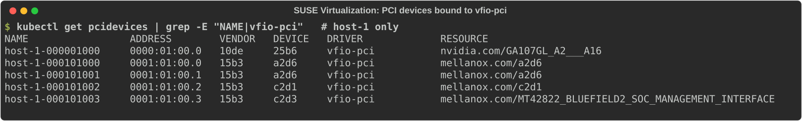

Each enabled device becomes a Kubernetes extended resource (`nvidia.com/GA107GL_A2___A16`,
`mellanox.com/a2d6`, …) that a VM requests in `hostDevices`.

### Step 2: Turn on the CPU manager

Dedicated vCPUs need the kubelet's static CPU manager. SUSE Virtualization exposes it per host:
**Hosts → ⋮ → Enable CPU Manager**. It runs a job that restarts the kubelet with `--cpu-manager-policy=static`.

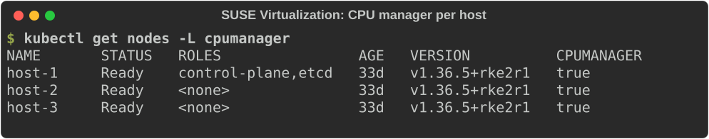

> [!WARNING] Restart pcidevices-controller after enabling the CPU manager
> Restarting the kubelet dropped the PCI device plugins' registration: the hosts advertised **0** of every
> passthrough resource, and the VMs sat in `ErrorUnschedulable`. Deleting the `harvester-pcidevices-controller`
> pod on each affected host (`kubectl -n harvester-system delete pod <pod>`) brought the counts back.

### Step 3: Define the VM

Three parts of the VM spec matter for NUMA and passthrough:

```yaml
spec:
  template:
    spec:
      nodeSelector: {kubernetes.io/hostname: host-1}
      domain:
        cpu: {cores: 16, sockets: 1, threads: 1, dedicatedCpuPlacement: true}
        memory: {guest: 32Gi}             # sized to fit the device's NUMA node
        resources: {limits: {cpu: "16", memory: 32Gi}}
        devices:
          hostDevices:
          - {name: gpu,   deviceName: nvidia.com/GA107GL_A2___A16}
          - {name: bf2-0, deviceName: mellanox.com/a2d6}
          - {name: bf2-1, deviceName: mellanox.com/a2d6}
          - {name: bf2-comm, deviceName: mellanox.com/c2d1}
          - {name: bf2-mgmt, deviceName: mellanox.com/MT42822_BLUEFIELD2_SOC_MANAGEMENT_INTERFACE}
```

`dedicatedCpuPlacement` plus equal requests and limits makes the virt-launcher pod Guaranteed QoS, so the
CPU manager gives it 16 exclusive cores. Full manifest: [vm-ai-vm-1.yaml](vm-ai-vm-1.yaml).

### Step 4: Verify NUMA alignment

RDMA performance depends on three things sharing one NUMA node: the NIC, the vCPUs, and the guest memory
the NIC writes into. Four checks on the host confirm it.

**1. Where the devices live.** Each host has two NUMA nodes (cores 0–79 and 80–159). The A2 and both
BlueField-2 PFs are on node 0:

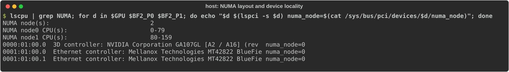

**2. Which cores the kubelet assigned.** The CPU manager state shows the VM's container got cores 2–17
exclusively (0–1 are reserved), all inside node 0:

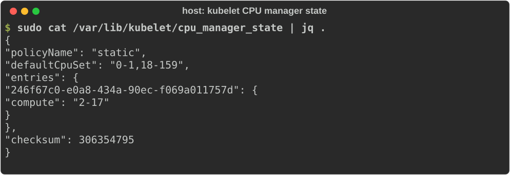

**3. Where QEMU's vCPU threads run.** Each vCPU thread is pinned to exactly one core (vCPU 0 → core 2 …
vCPU 15 → core 17); the emulator and I/O threads share the VM's set:

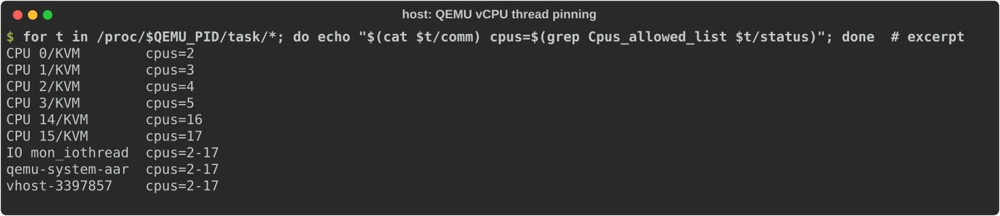

**4. Where the guest memory sits.** This is the check that caught a silent spill. `numastat` on the
QEMU process, all three hosts:

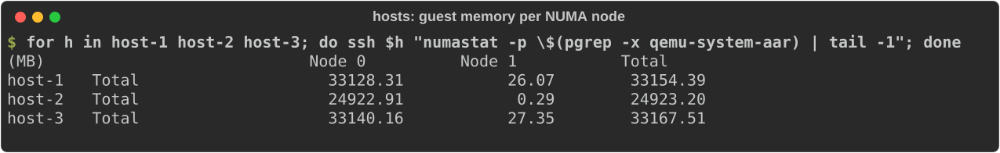

With a 32 GiB VM, one host showed **26.6 GB on node 0 and 6.5 GB on node 1**. That host has only about
31.7 GB of RAM on node 0 (0.5 GB free with the VM running), so the VM could never fit there, and the kernel
quietly placed the rest on the far socket. Shrinking that VM to 24 GiB put all of its memory on node 0.

For context, the 1.25 Gb/s run was on my first set of VMs, before any of this: no CPU manager on two of
the hosts (vCPUs free to run on any of the 160 cores), memory unconstrained, and the DPU MTU problem from
Step 5. I fixed placement and MTU together, so I can't split the gain between them; both are needed for
the 24.51 Gb/s result.

Use the exact QEMU process for these checks (`pgrep -x qemu-system-aar` on ARM64, `qemu-system-x86` on
x86). A loose `pgrep -f <vm-name>` can match a small wrapper process and report a few megabytes.

> [!NOTE] Aligned, but not enforced
> A static CPU manager picks the lowest free cores, which happen to be on node 0 here. Without the
> kubelet's **topology manager** (`single-numa-node`) and **memory manager** (`Static`), nothing stops a
> second pinned VM or a Guaranteed pod from landing on node 1. The PCI device plugin already reports each
> device's NUMA node to the kubelet, so enabling those two policies would turn this into a hard guarantee.
> I didn't find a SUSE Virtualization setting for those two policies in v1.9.1; configuring them would mean
> custom kubelet arguments on each host.

What I would like to see in the UI instead of these four commands: a NUMA node column on the PCI Devices
page, a NUMA topology card per host, and a placement badge on each VM ("aligned on node 0" or "memory
split: 6.5 GB on node 1"). Every number above is already on the host; it just isn't surfaced.

### Step 5: Raise the MTU on the DPU, not only on the host

In DPU mode, the BlueField-2's ARM cores run Open vSwitch with hardware offload between the uplink (`p0`)
and the host representor (`pf0hpf`). Offloaded flows ignored the representors' MTU, so host-to-host jumbo
pings worked, but new flows (a pod's macvlan MAC, the first packets of any flow) took the software path,
where `p0` and `pf0hpf` were still at 1500. From inside each VM, over `rshim`:

```console
$ ssh -J <vm> ubuntu@192.168.100.2        # DPU ARM over tmfifo
$ sudo ovs-vsctl set interface p0 mtu_request=9000 -- set interface pf0hpf mtu_request=9000 \
      -- set interface p1 mtu_request=9000 -- set interface pf1hpf mtu_request=9000
```

`mtu_request` is stored in the OVS database, so it survives DPU reboots.

## Part 2: Provisioning the guest OS

I picked **SLES 15 SP7** for the VMs because NVIDIA publishes the DOCA driver container that the Network
Operator can deploy for `sles15.7`, and SUSE publishes a precompiled NVIDIA GPU driver container for this
exact kernel (`registry.suse.com/third-party/nvidia/driver:595-6.4.0-150700.53.90-default-sles15.7`).

Four things went wrong on the first boot, and each one is now a line in the cloud-config:

1. **Minimal kernel, no RDMA.** The Minimal VM image ships `kernel-default-base`, which leaves out
   `mlx5_core` and the RDMA stack. Fix: install `kernel-default` and `kernel-default-devel` (headers for driver
   containers) and reboot.
2. **A missing NIC kills all networking.** I first named the rails in cloud-init's network data by MAC.
   Because the BlueField-2 netdevs don't exist under the minimal kernel, cloud-init failed the rename and
   dropped the **entire** network config, eth0 included. Fix: network data configures eth0 only; the rails
   are configured with udev rules and `ifcfg` files that take effect after the reboot.
3. **Default route dropped.** cloud-init's SLES (wicked) renderer ignored the `0.0.0.0/0` route. Fix:
   write `/etc/sysconfig/network/routes` directly.
4. **Registration before the network.** `runcmd` started before wicked had eth0 up, so `SUSEConnect`
   failed and nothing after it installed. Fix: wait for `scc.suse.com` before registering.

DNS also changed: the VMs use **8.8.8.8 and 1.1.1.1** only. My public DNS zone carries the lab's
internal records, while the home router's resolver had stale entries and answered NXDOMAIN for the Rancher
hostname.

Rails are named by the BlueField-2's physical port (`phys_port_name` `p0`/`p1`), not by PCI address or
MAC: inside one VM, port 0 showed up at PCI `0c:00.0`, in another at `0b:00.0`. One udev rule works on
every node. QoS on each rail is **trust DSCP, PFC off**, applied by a udev hook so it survives a driver
reload.

I stored the cloud-config **in the cluster** as SUSE Virtualization cloud-config templates (ConfigMaps
labeled `harvesterhci.io/cloud-init-template`), so it shows up under **Advanced Options → Cloud
Configuration** when creating a VM. User data stays node-generic: hostname from the VM name, rail IPs
derived from eth0's last octet. Registration code redacted:

```yaml
#cloud-config
users:
  - name: labadmin
    groups: [wheel]
    sudo: "ALL=(ALL) NOPASSWD:ALL"
    shell: /bin/bash
    ssh_authorized_keys: ["<your SSH public key>"]
write_files:
  - path: /etc/sysconfig/network/routes
    content: |
      default 192.0.2.1 - -
  - path: /etc/udev/rules.d/70-bf2-rails.rules
    content: |
      # BF2 host PFs by physical port: rail0 = p0, rail1 = p1 (stable across PCI order / VMs)
      SUBSYSTEM=="net", ACTION=="add", DRIVERS=="mlx5_core", ATTR{phys_port_name}=="p0", NAME="rail0"
      SUBSYSTEM=="net", ACTION=="add", DRIVERS=="mlx5_core", ATTR{phys_port_name}=="p1", NAME="rail1"
  - path: /etc/udev/rules.d/90-roce-host-qos.rules
    content: |
      SUBSYSTEM=="net", ACTION=="add", DRIVERS=="mlx5_core", ATTR{phys_port_name}=="p0", RUN+="/usr/local/sbin/roce-host-qos rail0"
      SUBSYSTEM=="net", ACTION=="add", DRIVERS=="mlx5_core", ATTR{phys_port_name}=="p1", RUN+="/usr/local/sbin/roce-host-qos rail1"
  - path: /usr/local/sbin/roce-host-qos
    permissions: "0755"
    content: |
      #!/bin/bash
      # MTU 9000 + trust DSCP (DSCP>>3 -> prio) on a BF2 rail. No PFC, on purpose.
      dev="$1"
      for i in $(seq 1 20); do [ -e "/sys/class/net/$dev" ] && break; sleep 0.5; done
      [ -e "/sys/class/net/$dev" ] || exit 0
      ip link set "$dev" mtu 9000
      map=""; for d in $(seq 0 63); do map="$map $d:$((d>>3))"; done
      /usr/sbin/dcb app add dev "$dev" dscp-prio $map 2>/dev/null || true
      logger -t roce-host-qos "$dev: mtu 9000, trust dscp, pfc off"
  - path: /etc/sysctl.d/90-roce.conf
    content: |
      net.ipv4.conf.all.arp_ignore=1
  - path: /root/.regcode
    permissions: "0600"
    content: "xxxxxxxxxxxxxxxxxxxxxxxxxxx"
  - path: /root/.rancher-register
    permissions: "0600"
    content: ""          # optional: paste the Rancher registration command to auto-join
  - path: /etc/systemd/system/rancher-register.service
    content: |
      [Unit]
      Description=Join the Rancher custom cluster once (after bootstrap reboot)
      Wants=network-online.target
      After=network-online.target
      ConditionFileNotEmpty=/root/.rancher-register
      ConditionPathExists=!/etc/systemd/system/rancher-system-agent.service
      [Service]
      Type=oneshot
      ExecStartPre=/bin/sh -c 'until curl -s -o /dev/null --max-time 5 https://scc.suse.com; do sleep 5; done; sleep 30'
      ExecStart=/bin/sh /root/.rancher-register
      ExecStartPost=/bin/rm -f /root/.rancher-register
      [Install]
      WantedBy=multi-user.target
  - path: /usr/local/sbin/vm-bootstrap
    permissions: "0700"
    content: |
      #!/bin/bash
      set -euo pipefail
      exec >>/var/log/vm-bootstrap.log 2>&1
      h=$(hostname -s); hostnamectl set-hostname "$h.example.com"
      # Rail IPs from eth0's last octet
      oct=$(ip -4 -o addr show eth0 | awk '{print $4}' | cut -d/ -f1 | cut -d. -f4)
      nets=(198.51.100 203.0.113)   # rail0, rail1 subnets
      for r in 0 1; do
        printf 'STARTMODE=auto\nBOOTPROTO=static\nIPADDR=%s.%s/24\nMTU=9000\n' "${nets[$r]}" "$oct" > /etc/sysconfig/network/ifcfg-rail$r
      done
      for i in $(seq 1 60); do curl -s -o /dev/null --max-time 5 https://scc.suse.com && break; sleep 5; done
      SUSEConnect -r "$(cat /root/.regcode)"
      SUSEConnect -p PackageHub/15.7/aarch64
      rm -f /root/.regcode
      zypper -n --gpg-auto-import-keys ref
      zypper -n in kernel-default kernel-default-devel -kernel-default-base
      zypper -n in iptables rdma-core libibverbs-utils ethtool iproute2 iputils tcpdump numactl \
                   pciutils curl jq rshim
      systemctl enable rshim
      systemctl enable rancher-register.service
      touch /var/lib/vm-bootstrap.done
      systemctl reboot
runcmd:
  - [/usr/local/sbin/vm-bootstrap]
```

Network data, one per VM (edit the address):

```yaml
version: 2
ethernets:
  eth0:
    match: {name: eth0}
    addresses: [192.0.2.XX/24]
    routes: [{to: 0.0.0.0/0, via: 192.0.2.1}]   # dropped by the SLES renderer; user data writes it too
    nameservers: {addresses: [8.8.8.8, 1.1.1.1], search: [example.com]}
```

Downloads with the full comments: [cloud-config-user.yaml](cloud-config-user.yaml),
[cloud-config-network.yaml](cloud-config-network.yaml). `iptables` is in the package list on purpose: RKE2
and Canal need it, and the Minimal image doesn't ship it.

After the bootstrap reboot, each guest has the full kernel, both rails at MTU 9000 with DSCP trust, PFC
off, and both RDMA devices active:

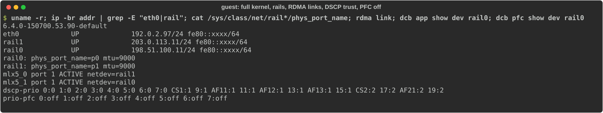

## Part 3: Creating the cluster in Rancher

In Rancher: **Cluster Management → Create → Custom**, Kubernetes **v1.36.6+rke2r1**, and in **Cluster
Configuration → Basics → Container Network**, pick **multus,canal**. Everything else stays at defaults; no
cloud provider and no storage class (I add local-path later).

Why this pair:

- **Canal** is RKE2's default and the most tested option with Rancher. RDMA traffic never touches it: pods
  get a second interface on a macvlan network bound to a BlueField-2 rail. Canal carries API and
  service traffic, so it only needs to be reliable.
- **Multus** lets a pod attach to those secondary networks. Because RKE2 deploys it, the NicClusterPolicy
  below leaves Multus out to avoid running two copies.

On the registration screen, tick **etcd, Control Plane and Worker** and run the command on each VM. The
three nodes were Ready about seven minutes later:

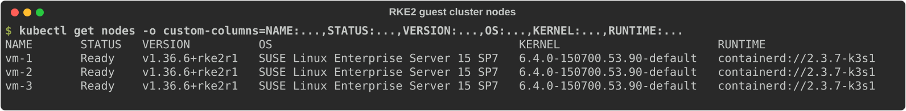

Then the default storage class, since the vLLM chart wants a persistent volume claim for the model:

```console
$ kubectl apply -f https://raw.githubusercontent.com/rancher/local-path-provisioner/v0.0.37/deploy/local-path-storage.yaml
$ kubectl patch storageclass local-path -p '{"metadata":{"annotations":{"storageclass.kubernetes.io/is-default-class":"true"}}}'
```

## Part 4: SUSE AI Factory blueprint and the RDMA operators

A **Blueprint** in SUSE AI Factory is a versioned list of Helm charts with their values. Applying it to a
cluster creates an **AIWorkload**, which injects registry pull secrets into each chart's values and
delivers each component as a Fleet bundle. Blueprint versions are immutable once used: every change got a
new version (0.0.5, 0.0.6), never an edit in place.

| Component | Chart (repo, version) | What it does here |
|---|---|---|
| GPU Operator | `gpu-operator` (nvidia, v26.7.2) | SUSE precompiled driver 595 for the SLES 15 SP7 kernel, container toolkit for RKE2's containerd, device plugin, DCGM exporter |
| Network Operator | `network-operator` (nvidia, 26.7.1) | Operator only; NicClusterPolicy applied separately. NFD off (GPU Operator already runs one) |
| vLLM | `vllm` (SUSE Application Collection, 0.1.10) | Router + engine serving Qwen2.5-3B-Instruct on the A2 |
| Open WebUI | `open-webui` (SUSE Application Collection, 18.0.0) | Chat UI against the vLLM router's OpenAI API |

Key values per component (full blueprint: [blueprint-arm64-ai-stack-0.0.6.yaml](blueprint-arm64-ai-stack-0.0.6.yaml)):

```yaml
# gpu-operator
driver:
  enabled: true
  repository: registry.suse.com/third-party/nvidia
  version: "595"
  usePrecompiled: true
toolkit:
  env:
  - {name: CONTAINERD_SOCKET, value: /run/k3s/containerd/containerd.sock}
cdi: {enabled: true}

# network-operator
nfd:
  enabled: false                 # GPU Operator's NFD already labels the nodes
  deployNodeFeatureRules: true   # keep the pci-15b3.present labeling rule
operator:
  imagePullSecrets: [ngc-secret] # plain strings: see the note below
sriovNetworkOperator: {enabled: false}
maintenanceOperator: {enabled: false}

# vllm
servingEngineSpec:
  modelSpec:
  - name: qwen2-5-3b-instruct
    modelURL: Qwen/Qwen2.5-3B-Instruct
    requestGPU: 1
    requestCPU: 4
    requestMemory: 16Gi
    limitMemory: 20Gi
    pvcStorage: 20Gi
    vllmConfig: {dtype: bfloat16, gpuMemoryUtilization: 0.85, maxModelLen: 8192}

# open-webui
enableOpenaiApi: true
openaiBaseApiUrl: http://vllm-router-service.arm64-ai-stack.svc.cluster.local/v1
extraEnvFrom:
- secretRef: {name: open-webui-admin-credentials}   # WEBUI_ADMIN_NAME / _EMAIL / _PASSWORD
service: {type: NodePort}
```

Open WebUI creates its first admin account from the `WEBUI_ADMIN_*` variables in a Secret (verified: that
account signs in with the admin role). Create it before applying the blueprint:

```console
$ kubectl create namespace arm64-ai-stack
$ kubectl -n arm64-ai-stack create secret generic open-webui-admin-credentials \
    --from-literal=WEBUI_ADMIN_NAME=admin --from-literal=WEBUI_ADMIN_EMAIL=<email> \
    --from-literal=WEBUI_ADMIN_PASSWORD=<password>
```

> [!IMPORTANT] Network Operator pull secrets need plain strings
> The Network Operator chart reads `imagePullSecrets` as a list of secret **names** and wraps each one as
> `{name: …}` (its documented contract, Mellanox/network-operator#1707). AI Factory writes the standard
> `[{name: …}]` shape, so the chart rendered `{name: {name: …}}` and its pre-install hook Job was
> rejected. Setting `operator.imagePullSecrets` to plain strings works around it. I sent a fix that writes the
> right shape for this chart: [SUSE/aif#373](https://github.com/SUSE/aif/pull/373), in review.

### NicClusterPolicy and rail networks

A blueprint only takes Helm charts, and the Network Operator 26.7.1 chart doesn't render a NicClusterPolicy
from its values, so the policy and networks are applied directly:

```yaml
apiVersion: mellanox.com/v1alpha1
kind: NicClusterPolicy
metadata:
  name: nic-cluster-policy
spec:
  rdmaSharedDevicePlugin:
    image: k8s-rdma-shared-dev-plugin
    repository: nvcr.io/nvidia/mellanox
    version: network-operator-v26.7.1
    config: |
      {"configList": [
        {"resourceName": "rdma_rail0", "rdmaHcaMax": 63,
         "selectors": {"vendors": ["15b3"], "deviceIDs": ["a2d6"], "ifNames": ["rail0"]}},
        {"resourceName": "rdma_rail1", "rdmaHcaMax": 63,
         "selectors": {"vendors": ["15b3"], "deviceIDs": ["a2d6"], "ifNames": ["rail1"]}}]}
  secondaryNetwork:
    cniPlugins:                  # macvlan & friends; Multus comes from RKE2
      image: plugins
      repository: nvcr.io/nvidia/mellanox
      version: network-operator-v26.7.1
  nvIpam:
    image: nvidia-k8s-ipam
    repository: nvcr.io/nvidia/mellanox
    version: network-operator-v26.7.1
    enableWebhook: false
```

Each rail gets an nv-ipam pool (hosts keep .1–.99) and a macvlan network
([rail-networks.yaml](rail-networks.yaml), [nicclusterpolicy.yaml](nicclusterpolicy.yaml)):

```yaml
apiVersion: nv-ipam.nvidia.com/v1alpha1
kind: IPPool
metadata: {name: rail0, namespace: arm64-ai-stack}
spec:
  subnet: 198.51.100.0/24
  perNodeBlockSize: 32
  exclusions: [{startIP: 198.51.100.1, endIP: 198.51.100.99}]
---
apiVersion: mellanox.com/v1alpha1
kind: MacvlanNetwork
metadata: {name: rail0}
spec:
  networkNamespace: arm64-ai-stack
  master: rail0
  mode: bridge
  mtu: 9000
  ipam: '{"type": "nv-ipam", "poolName": "rail0"}'
```

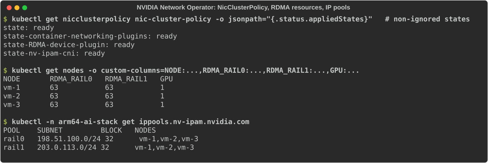

A pod joins rail0 with the annotation `k8s.v1.cni.cncf.io/networks: rail0`, requests
`rdma/rdma_rail0: 1`, and needs the `IPC_LOCK` capability to register memory. Two such pods on different
nodes, RDMA write over RoCEv2 marked with DSCP 26 (`--tclass=106`):

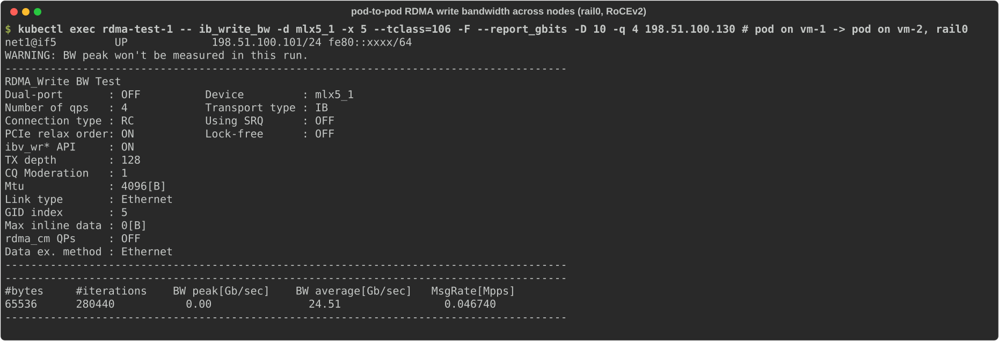

**24.51 Gb/s** on a 25GbE port, the same number this hardware reached on bare metal.

### Result

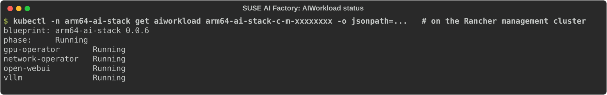

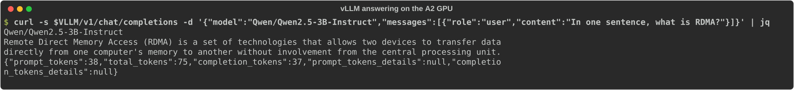

## Gotchas, in one place

- **PCI device plugins vanish after enabling the CPU manager.** Restart `harvester-pcidevices-controller` on that host.
- **Size VM memory to the device's NUMA node,** not to the host. Check `numastat -p <qemu-pid>`.
- **Raise MTU on the DPU representors and uplinks,** not only in the guest. Offloaded flows hide the problem until a new MAC appears.
- **Use `kernel-default` on SLES Minimal** before expecting any Mellanox or RDMA device.
- **Never put a NIC that appears late into cloud-init network data.** Configure it with udev and `ifcfg` files.
- **No PFC on the BlueField-2.** Trust DSCP and mark RoCE traffic instead.
- **Blueprints are Helm-only.** NicClusterPolicy and rail networks go in separately.

## What's next

The GPU driver already comes from a container. Next I want the Network Operator's DOCA driver container to
deliver the `mlx5` stack too, with the inbox driver blacklisted, and then to propose the NUMA visibility
pieces from Part 1 for the SUSE Virtualization UI.
