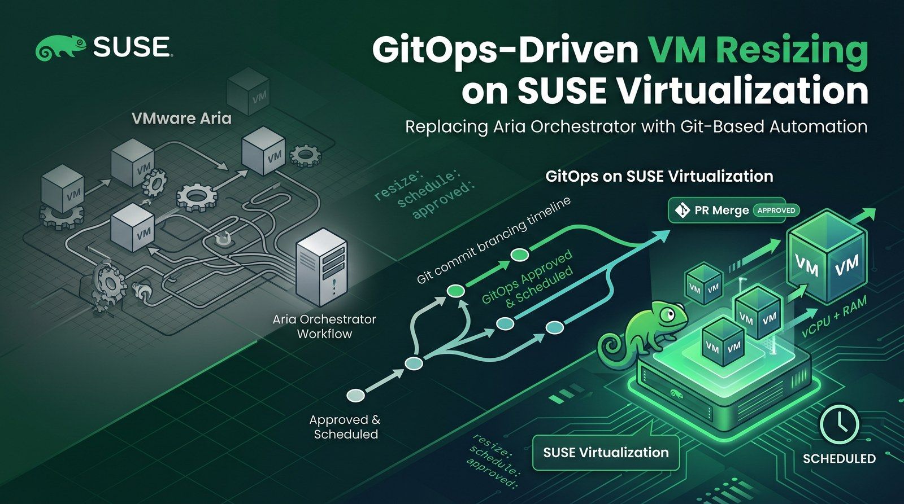
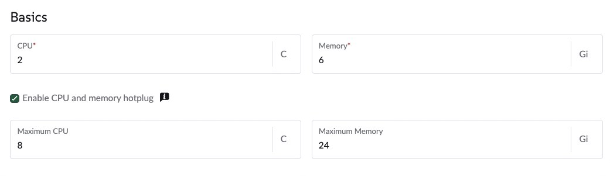
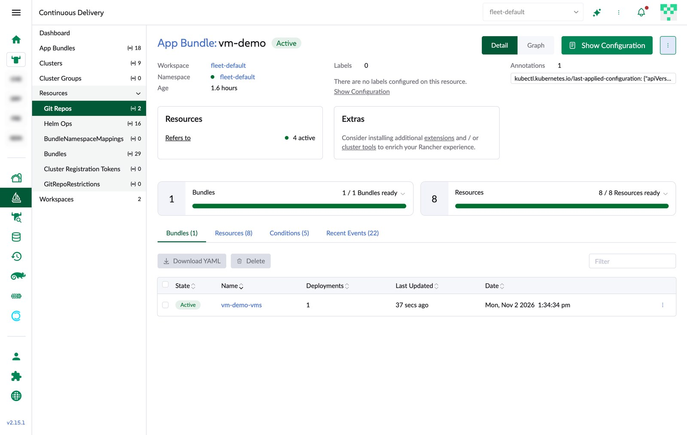
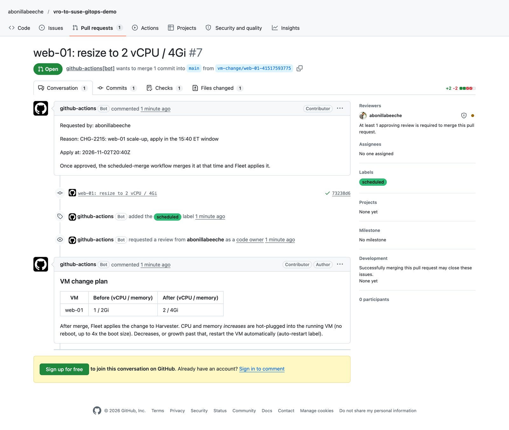
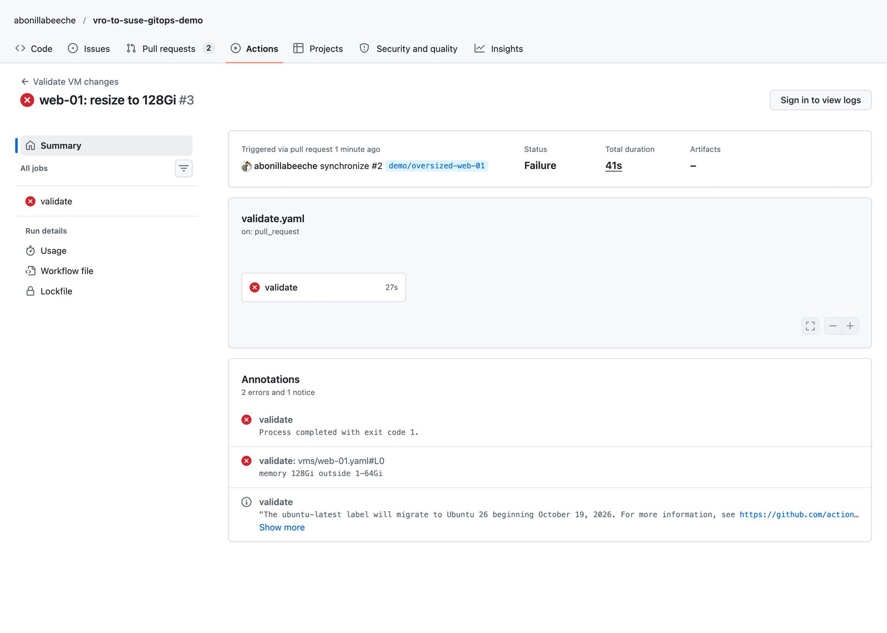
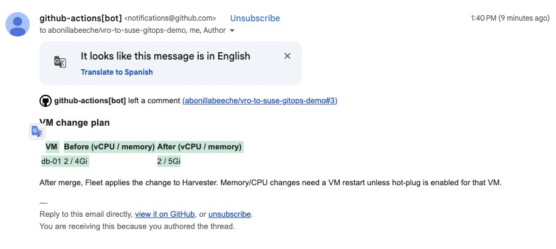
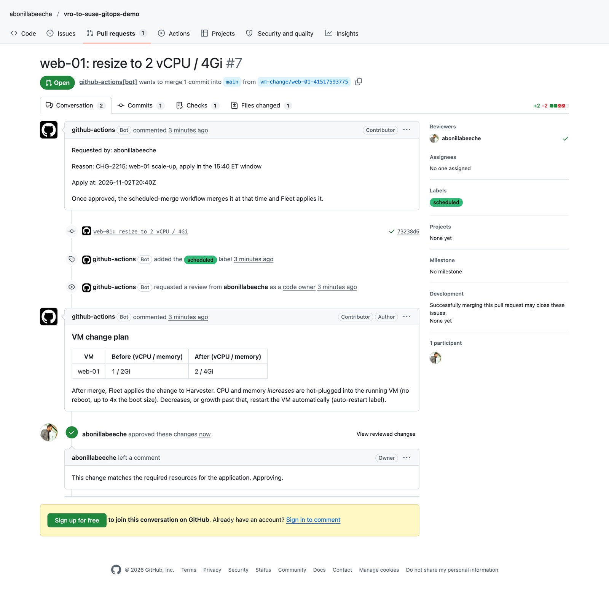
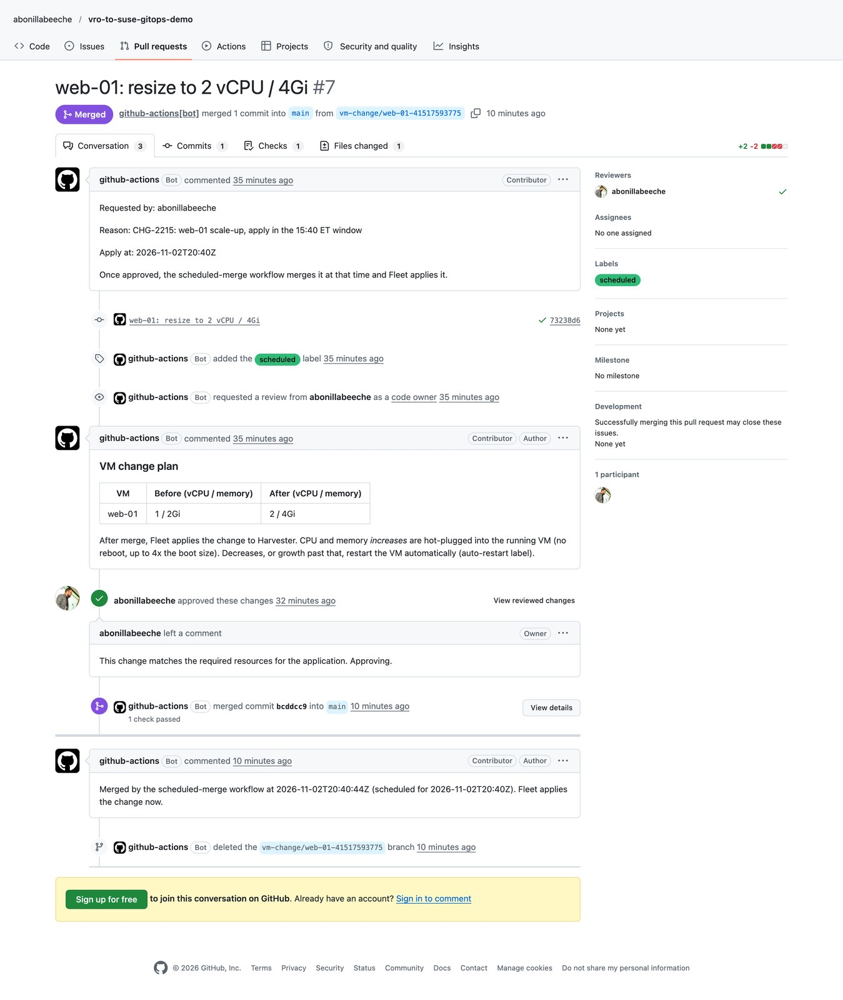
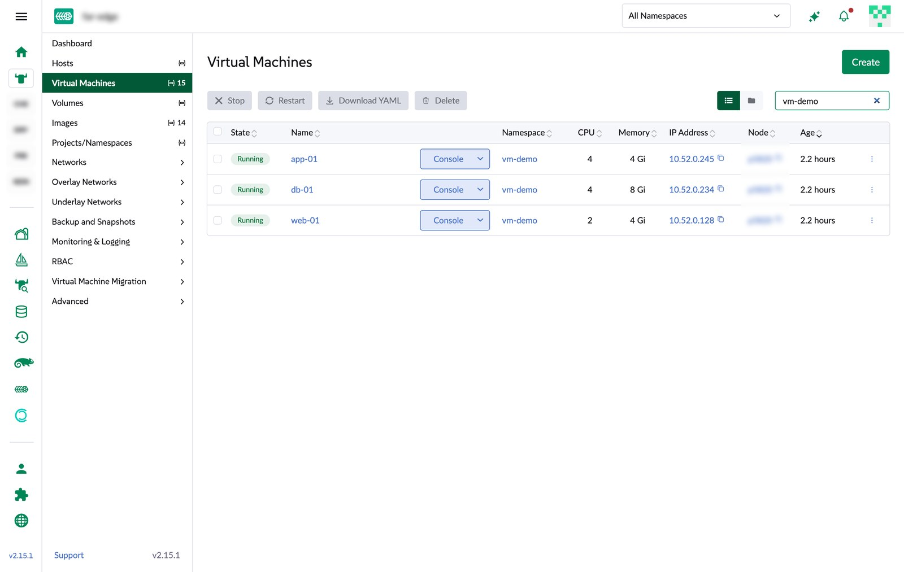

**TL;DR**

- A customer moving off VMware asked how their Aria Orchestrator (vRO) automation maps to SUSE. I built the answer as a public repo: [abonillabeeche/vro-to-suse-gitops-demo](https://github.com/abonillabeeche/vro-to-suse-gitops-demo).
- Every VM is a YAML file. A form in the repo's **Actions** tab turns "resize db-01 to 4 vCPU / 8Gi" into a pull request (PR) with a before/after plan, policy checks and a required code-owner approval.
- An optional **Apply at** time makes a bot merge the approved PR inside the maintenance window. Rancher Fleet applies `main` to SUSE Virtualization within seconds of the merge.
- VMs enable CPU/memory **hot-plug**, so increases go into the running guest without a reboot on a multi-node cluster. On a single node the live step cannot finish, and a small CronJob restarts the VM inside the window instead.
- Several things broke on the way (auto-assigned MACs, a stale `maxSockets`, a Fleet clone that never retried, a single-node hot-plug that cannot finish). All are fixed in the repo and listed under Troubleshooting.

A customer that runs a lot of proprietary automation in VMware Aria Orchestrator asked for a side-by-side with SUSE before a deeper session with their automation team. A comparison table is useful, but a resize request that goes from a form to a running VM, with an approval in the middle, answers more questions. This post walks through that build on SUSE Virtualization (Harvester) with Rancher Fleet and GitHub. This is part 1 of a series; part 2 covers the Salt side with SUSE Multi-Linux Manager.

## Why GitOps instead of workflows

Aria Automation (formerly vRA) gives users a catalog, and Aria Orchestrator runs the workflow behind each item: a sequence of JavaScript steps that call vCenter, wait for approvals, and log what happened. That model has served VMware shops for years. It also means the real state of a VM lives in vCenter, the logic lives in vRO, and the history lives in workflow run logs.

GitOps flips this around: Git holds the desired state of each VM, and a controller keeps the platform equal to Git. For day-2 changes such as a resize, that brings:

- **Review built in.** A change is a pull request: who asked, why, the exact diff, automated checks, and who approved it, all on one page.
- **Approvals without workflow code.** CODEOWNERS routes the review to the owning team, and branch rules enforce it for everyone.
- **Audit and rollback for free.** Git history is the change log; reverting a commit reverts the VM shape.
- **Drift detection.** Fleet reports resources that no longer match Git, instead of trusting that a workflow ran once.
- **No orchestrator server to run.** Git hosting, a CI runner and Fleet (already part of Rancher) replace the workflow engine for this class of task.
- **General skills.** Git, YAML and Kubernetes, instead of the vRO JavaScript object model.

| Capability | Aria Orchestrator / Automation | Git + Fleet + SUSE Virtualization |
|---|---|---|
| Model | Imperative workflow steps against vCenter | Declarative: Git is the desired state, Fleet converges |
| Self-service | Catalog item calling a vRO workflow | GitHub form (`workflow_dispatch`) or any portal that opens a PR |
| Approval | Approval policy or user-interaction step | PR review, CODEOWNERS, branch rules |
| Guardrails | Logic inside the workflow | PR checks (schema + policy) |
| Day-2 resize | Workflow calls vCenter reconfigure | Edit YAML, merge, Fleet applies; hot-plug avoids the reboot |
| Maintenance window | Scheduled workflow | Bot merges the approved PR at its "Apply at" time |
| Audit / rollback | Workflow run logs; compensating workflow | Git history; `git revert` |

Workflows are not gone: some tasks really are ordered sequences across many systems (IPAM, ITSM, DNS), and those still need scripting. Most "clone, reconfigure, notify" workflows, though, collapse into a file and a review. The [full comparison](https://github.com/abonillabeeche/vro-to-suse-gitops-demo/blob/main/COMPARISON.md) in the repo also maps vRO concepts (workflows, actions, plugins, configuration elements) to their equivalents and lists the honest gaps.

## How it fits together

1. **Request:** someone fills in the *Request VM change* form in GitHub Actions. It edits `vms/<vm>.yaml` and opens a PR.
2. **Validate:** a check runs a schema test and the policy in `policy/limits.yaml`, then posts a before/after plan on the PR.
3. **Approve:** CODEOWNERS requests a review; the branch ruleset blocks merging until it is approved and the check is green.
4. **Schedule:** if the request has an *Apply at* time, the *Scheduled merge* workflow merges the approved PR at that time.
5. **Apply:** Fleet sees the new commit on `main` and applies `vms/` to the SUSE Virtualization cluster.
6. **No reboot:** hot-plug adds CPU and memory to the running VM. Anything that cannot be applied live is restarted by a CronJob, still inside the window.

Lab versions: SUSE Virtualization v1.9.0 (KubeVirt 1.8.4) on a single-node x86_64 cluster, Rancher v2.15.1 with Fleet v0.16.1, GitHub Actions on GitHub-hosted runners. Guests run openSUSE Leap 16.0.

## SUSE Virtualization side

### Step 1: Describe each VM in Git

Each VM is a KubeVirt `VirtualMachine` in `vms/`. SUSE Virtualization creates the root disk from a VM image through the `harvesterhci.io/volumeClaimTemplates` annotation, so a new file in Git becomes a new VM with a disk, and changing the file changes the VM. This is `vms/web-01.yaml`:

```yaml
apiVersion: kubevirt.io/v1
kind: VirtualMachine
metadata:
  name: web-01
  namespace: vm-demo
  labels:
    demo.example.com/tier: web
    demo.example.com/owner: team-web
    demo.example.com/cost-center: "cc-1001"
    # opt in: vms/auto-restart.yaml restarts this VM when a change cannot be applied live
    demo.example.com/auto-restart: "true"
  annotations:
    # CPU (sockets) and memory increases are hot-plugged into the running VM, no reboot (up to 4x the boot size)
    harvesterhci.io/enableCPUAndMemoryHotplug: "true"
    # Harvester creates the root disk from a VM image (here: openSUSE Leap 16.0; adjust image + storage class to your cluster)
    harvesterhci.io/volumeClaimTemplates: '[{"metadata":{"name":"web-01-rootdisk","annotations":{"harvesterhci.io/imageId":"default/image-s4khv"}},"spec":{"accessModes":["ReadWriteMany"],"resources":{"requests":{"storage":"10Gi"}},"volumeMode":"Block","storageClassName":"longhorn-v2"}}]'
spec:
  runStrategy: RerunOnFailure
  template:
    metadata:
      labels:
        harvesterhci.io/vmName: web-01
    spec:
      domain:
        cpu:
          cores: 1
          sockets: 1
          threads: 1
          maxSockets: 8
        memory:
          guest: 2Gi
        devices:
          disks:
            - name: rootdisk
              bootOrder: 1
              disk:
                bus: virtio
            - name: cloudinit
              disk:
                bus: virtio
          interfaces:
            - name: default
              masquerade: {}
              model: virtio
              macAddress: ba:55:fb:7a:f4:41
      networks:
        # pod network keeps the demo self-contained; use multus + a VM network (e.g. default/vlan1) in production
        - name: default
          pod: {}
      volumes:
        - name: rootdisk
          persistentVolumeClaim:
            claimName: web-01-rootdisk
        - name: cloudinit
          cloudInitNoCloud:
            # registers the guest with SUSE Multi-Linux Manager on first boot (see suma/)
            secretRef:
              name: suma-bootstrap
```

Three details in that file matter for day-2 changes:

- **Hot-plug shape:** vCPUs are `sockets` with one core each, memory is `memory.guest`, and there is **no** `resources.limits` block. Explicit limits block live memory changes.
- **`maxSockets` is set in Git.** It is the CPU hot-plug ceiling. Without it, SUSE Virtualization pins it to the boot size, and KubeVirt later rejects any CPU increase.
- **`macAddress` is pinned.** SUSE Virtualization assigns a random MAC at creation. If Git does not carry it, every Fleet re-apply removes it, flags the VM for a restart, and the restart changes the MAC (bad news for DHCP reservations and licensing).

### Step 2: Turn on hot-plug

Hot-plug needs three things, and SUSE Virtualization v1.9.0 ships the first two by default:

1. KubeVirt's VM rollout strategy set to `LiveUpdate`:

   ```console
   $ kubectl -n harvester-system get kubevirt kubevirt -o jsonpath='{.spec.configuration.vmRolloutStrategy}'
   LiveUpdate
   ```

2. A hot-plug ceiling. The `max-hotplug-ratio` setting (default 4) sets `maxGuest` to four times the memory the VM booted with. A VM that boots with 2Gi can grow to 8Gi without a restart.
3. The VM opting in with `harvesterhci.io/enableCPUAndMemoryHotplug: "true"` and the shape described in Step 1. In the SUSE Virtualization UI this is the **Enable CPU and memory hotplug** checkbox on the VM form, where *Maximum CPU* and *Maximum Memory* are the `maxSockets` and `maxGuest` ceilings:

   

   For VMs managed by Fleet, set the same fields in Git instead (Step 1); the UI shows a warning on those VMs because Fleet would revert a UI edit (see Troubleshooting).

With that in place, a memory change is a one-line edit: `memory.guest: 2Gi` becomes `memory.guest: 4Gi`. KubeVirt applies it by live-migrating the VM to a new pod with the larger size, and the guest sees the added memory without a reboot. A CPU change works the same way through `cpu.sockets`. Progress shows up in the VMI (VirtualMachineInstance) status, where `guestAtBoot` stays put and `guestCurrent` follows the new request once the change is live:

```console
$ kubectl -n vm-demo get vmi web-01 -o jsonpath='{.status.memory}'
```

Decreasing memory, or growing past the ceiling, still needs a restart.

> [!WARNING] Single-node clusters cannot finish the live step
> KubeVirt will not schedule the migration target pod on the same node as the source. On my single-node lab cluster the VM kept running on the same boot, KubeVirt raised the hot-plug conditions, and the migration waited for a second node that does not exist:
>
> ```console
> $ kubectl -n vm-demo get vm db-01 -o jsonpath='{range .status.conditions[*]}{.type}={.status} {end}'
> Ready=True DataVolumesReady=True LiveMigratable=True StorageLiveMigratable=True AgentConnected=True HotVCPUChange=True HotMemoryChange=True
> $ kubectl -n vm-demo get events | grep -i anti-affinity
> 2m31s   Warning   FailedScheduling   pod/virt-launcher-db-01-pdw29   0/1 nodes are available: 1 node(s) didn't match pod anti-affinity rules. ...
> ```
>
> On a cluster with two or more nodes the same change completes live. For single-node clusters, and for changes that need a restart anyway, Step 4 adds a controlled restart.

### Step 3: Let Fleet apply the repo

Fleet ships with Rancher. One `GitRepo` points it at the repo and at the clusters that carry a label (`fleet/gitrepo.yaml`):

```yaml
apiVersion: fleet.cattle.io/v1alpha1
kind: GitRepo
metadata:
  name: vm-demo
  namespace: fleet-default
spec:
  repo: https://github.com/abonillabeeche/vro-to-suse-gitops-demo
  branch: main
  paths:
    - vms
  # clientSecretName: github-deploy-key   # needed if the repo is private
  targets:
    - clusterSelector:
        matchLabels:
          demo.example.com/vm-gitops: "true"
```

`vms/fleet.yaml` sets the namespace and tells Fleet to ignore fields that SUSE Virtualization fills in after apply, so the bundle stays green while still reporting real drift:

```yaml
defaultNamespace: vm-demo
diff:
  comparePatches:
    - apiVersion: kubevirt.io/v1
      kind: VirtualMachine
      jsonPointers:
        - /metadata/annotations
        - /spec/template/metadata/annotations
        - /spec/template/spec/domain/resources/requests
        - /spec/runStrategy
```

To connect a SUSE Virtualization cluster that is imported into Rancher:

```console
$ kubectl label clusters.management.cattle.io <cluster-id> demo.example.com/vm-gitops=true
$ kubectl apply -f fleet/gitrepo.yaml
```

Put the label on the **management** cluster object (or edit the cluster's labels in the Rancher UI). For imported clusters Rancher copies labels from there to the Fleet cluster; a label on the provisioning cluster object matched nothing.

From then on, adding a file to `vms/` creates a VM, and merging a change to a file updates it.



### Step 4: Restart inside the window when live is not possible

`vms/auto-restart.yaml` is deployed by the same Fleet bundle. Every two minutes it restarts VMs labelled `demo.example.com/auto-restart=true` when KubeVirt reports `RestartRequired`, or when a hot-plug has had no migration target for five minutes. Because merges happen at the scheduled time, these restarts land in the window too. Its Role only allows reading VMs, deleting stuck migrations and calling the restart subresource in one namespace:

```yaml
apiVersion: v1
kind: ServiceAccount
metadata:
  name: vm-auto-restart
  namespace: vm-demo
---
apiVersion: rbac.authorization.k8s.io/v1
kind: Role
metadata:
  name: vm-auto-restart
  namespace: vm-demo
rules:
  - apiGroups: ["kubevirt.io"]
    resources: ["virtualmachines"]
    verbs: ["get", "list"]
  - apiGroups: ["subresources.kubevirt.io"]
    resources: ["virtualmachines/restart"]
    verbs: ["update"]
  - apiGroups: ["kubevirt.io"]
    resources: ["virtualmachineinstancemigrations"]
    verbs: ["get", "list", "delete"]
---
apiVersion: rbac.authorization.k8s.io/v1
kind: RoleBinding
metadata:
  name: vm-auto-restart
  namespace: vm-demo
roleRef:
  apiGroup: rbac.authorization.k8s.io
  kind: Role
  name: vm-auto-restart
subjects:
  - kind: ServiceAccount
    name: vm-auto-restart
    namespace: vm-demo
---
apiVersion: batch/v1
kind: CronJob
metadata:
  name: vm-auto-restart
  namespace: vm-demo
spec:
  schedule: "*/2 * * * *"
  concurrencyPolicy: Forbid
  jobTemplate:
    spec:
      backoffLimit: 0
      ttlSecondsAfterFinished: 3600
      template:
        spec:
          serviceAccountName: vm-auto-restart
          restartPolicy: Never
          containers:
            - name: restart
              image: docker.io/rancher/kuberlr-kubectl:v8.1.1
              command: ["/bin/sh", "-c"]
              args:
                - |
                  now=$(date -u +%s)
                  for vm in $(kubectl -n vm-demo get vm -l demo.example.com/auto-restart=true -o name); do
                    name=${vm#*/}
                    conds=$(kubectl -n vm-demo get vm "$name" -o jsonpath='{range .status.conditions[*]}{.type}={.status}{" "}{end}')
                    reason=""
                    case "$conds" in *RestartRequired=True*) reason="change needs a restart" ;; esac
                    # hot-plug pending: KubeVirt retries the migration (failed attempts stay listed); if the first
                    # attempt is 5+ minutes old and none is in flight, the change cannot be applied live
                    case "$conds" in *HotVCPUChange=True*|*HotMemoryChange=True*)
                      migs=$(kubectl -n vm-demo get vmim -o jsonpath="{range .items[?(@.spec.vmiName==\"$name\")]}{.metadata.creationTimestamp} {.status.phase} {.metadata.name}{\"\n\"}{end}" | sort)
                      first=$(echo "$migs" | head -1 | cut -d' ' -f1 | sed 's/T/ /; s/Z//')
                      if [ -n "$first" ] && ! echo "$migs" | grep -q -E ' (Running|PreparingTarget|TargetReady|Scheduled) '; then
                        age=$(( now - $(date -u -d "$first" +%s) ))
                        if [ "$age" -ge 300 ]; then
                          reason="hot-plug could not be applied live for ${age}s (no migration target node)"
                          echo "$migs" | cut -d' ' -f3 | xargs -r kubectl -n vm-demo delete vmim --wait=false
                        fi
                      fi ;;
                    esac
                    if [ -n "$reason" ]; then
                      echo "restarting $name: $reason"
                      echo '{}' | kubectl replace --raw "/apis/subresources.kubevirt.io/v1/namespaces/vm-demo/virtualmachines/$name/restart" -f -
                    fi
                  done
```

On the single-node cluster it logged exactly what it did:

```console
$ kubectl -n vm-demo logs job/vm-auto-restart-29894208
virtualmachineinstancemigration.kubevirt.io "kubevirt-workload-update-dqmwv" deleted from vm-demo namespace
restarting web-01: hot-plug could not be applied live for 418s (no migration target node)
```

## GitHub side

### Step 5: Add the request form

`.github/workflows/request-vm-change.yaml` is the catalog item. GitHub renders its `workflow_dispatch` inputs as a form: open the repo's **Actions** tab, pick **Request VM change** in the list of workflows, and click **Run workflow**. Only signed-in users with write access to the repo see that button. From the GitHub CLI, which is also how a portal or ServiceNow integration would call it:

```console
$ gh workflow run "Request VM change" -R <owner>/<repo> \
    -f vm=web-01 -f cpu=2 -f memory=4Gi \
    -f reason="CHG-2215: web-01 scale-up" -f apply_at=2026-11-02T20:40Z
```

It edits the VM file with `yq`, runs the same policy check the PR will run, and opens the PR. With *Apply at* filled in, it adds the `scheduled` label and an `Apply at:` line that the merge bot reads:

```yaml
name: Request VM change

on:
  workflow_dispatch:
    inputs:
      vm:
        description: VM to change
        type: choice
        options: [web-01, app-01, db-01]
      cpu:
        description: vCPUs
        type: choice
        options: ["1", "2", "4", "8"]
        default: "2"
      memory:
        description: Memory
        type: choice
        options: [2Gi, 4Gi, 8Gi, 16Gi, 32Gi, 64Gi]
        default: 4Gi
      reason:
        description: Business justification / ticket number
        type: string
        required: true
      apply_at:
        description: "Apply at (UTC, e.g. 2026-11-03T02:00Z). Empty = merge manually after approval"
        type: string
        required: false

permissions:
  contents: write
  pull-requests: write

jobs:
  open-pr:
    runs-on: ubuntu-latest
    env:
      VM: ${{ inputs.vm }}
      CPU: ${{ inputs.cpu }}
      MEMORY: ${{ inputs.memory }}
      REASON: ${{ inputs.reason }}
      APPLY_AT: ${{ inputs.apply_at }}
      REQUESTER: ${{ github.actor }}
      GH_TOKEN: ${{ github.token }}
    steps:
      - uses: actions/checkout@v5

      - name: Update VM spec
        run: |
          yq -i '
            .spec.template.spec.domain.cpu.sockets = (strenv(CPU) | tonumber) |
            .spec.template.spec.domain.memory.guest = strenv(MEMORY)
          ' "vms/${VM}.yaml"
          if [ -n "$APPLY_AT" ]; then
            due=$(date -u -d "$APPLY_AT" +%s) || { echo "::error::Apply at '$APPLY_AT' is not a valid time"; exit 1; }
            [ "$due" -gt "$(date -u +%s)" ] || { echo "::error::Apply at '$APPLY_AT' is in the past"; exit 1; }
          fi
          git diff --exit-code --quiet && { echo "::error::No change: ${VM} is already ${CPU} vCPU / ${MEMORY}"; exit 1; }
          scripts/validate.sh

      - name: Open pull request
        run: |
          branch="vm-change/${VM}-${GITHUB_RUN_ID}"
          git config user.name "github-actions[bot]"
          git config user.email "41898282+github-actions[bot]@users.noreply.github.com"
          git switch -c "$branch"
          git commit -am "${VM}: resize to ${CPU} vCPU / ${MEMORY}"
          git push origin "$branch"
          if [ -n "$APPLY_AT" ]; then
            when="Apply at: $(date -u -d "$APPLY_AT" +%FT%H:%MZ)"
            next="Once approved, the scheduled-merge workflow merges it at that time and Fleet applies it."
            label=(--label scheduled)
          else
            when="Apply at: on merge"
            next="Merging this PR applies the change via Fleet."
            label=()
          fi
          gh pr create --base main --head "$branch" "${label[@]}" \
            --title "${VM}: resize to ${CPU} vCPU / ${MEMORY}" \
            --body "$(printf 'Requested by: %s\n\nReason: %s\n\n%s\n\n%s' "$REQUESTER" "$REASON" "$when" "$next")"
```

Form inputs reach the shell only through environment variables, never through `${{ }}` inside `run:`, so a creative "reason" cannot inject commands.

### Step 6: Check every change

`.github/workflows/validate.yaml` runs on any PR that touches `vms/` or `policy/`. It validates the manifests against the KubeVirt schema with kubeconform, runs [`scripts/validate.sh`](https://github.com/abonillabeeche/vro-to-suse-gitops-demo/blob/main/scripts/validate.sh) against the policy below, and posts (or updates) a before/after plan comment:

```yaml
# policy/limits.yaml
allowedNamespaces:
  - vm-demo
requiredLabels:
  - demo.example.com/owner
  - demo.example.com/cost-center
cpu:
  min: 1
  max: 8
memoryGi:
  min: 1
  max: 64
```

`validate.sh` also enforces the hot-plug shape from Step 1 (annotation present, one core per socket, `maxSockets` set, no limits), so a hand-edited file cannot quietly break live resizes.



A request for 128Gi fails the check with a clear message, and the PR cannot be merged:



### Step 7: Require approval

Approval is enforced by GitHub, not by workflow code. CODEOWNERS says who must review (`.github/CODEOWNERS`):

```text
# Last matching line wins. In a real org each line points at a different team.
*                   @your-org/vm-approvers
/vms/db-*.yaml      @your-org/dba-approvers
/policy/            @your-org/platform-admins
```

A branch ruleset on `main` requires a PR, one approval from a code owner and a green `validate` check. Create it once with the GitHub CLI:

```console
$ cat > ruleset.json <<'EOF'
{
  "name": "main: approval required",
  "target": "branch",
  "enforcement": "active",
  "conditions": {"ref_name": {"include": ["~DEFAULT_BRANCH"], "exclude": []}},
  "rules": [
    {"type": "deletion"},
    {"type": "non_fast_forward"},
    {"type": "pull_request", "parameters": {
      "required_approving_review_count": 1,
      "require_code_owner_review": true,
      "dismiss_stale_reviews_on_push": true,
      "require_last_push_approval": false,
      "required_review_thread_resolution": false}},
    {"type": "required_status_checks", "parameters": {
      "strict_required_status_checks_policy": false,
      "required_status_checks": [{"context": "validate"}]}}
  ]
}
EOF
$ gh api -X POST repos/<owner>/<repo>/rulesets --input ruleset.json
```

My lab repo also lists repository admins as a bypass actor so I could fix things quickly. Leave that out for real use: during the demo, a click on **Merge** instead of **Approve** merged a scheduled PR 22 minutes early, with no approval recorded.

Approvers get the plan in their notification e-mail and approve from GitHub:



### Step 8: Configure the bot

All automation runs as the built-in `github-actions[bot]` with the repository's `GITHUB_TOKEN`; there is no personal token to store. Three settings make it work:

1. **Let workflows write and open PRs** (Settings > Actions > General > Workflow permissions, or):

   ```console
   $ gh api -X PUT repos/<owner>/<repo>/actions/permissions/workflow \
       -f default_workflow_permissions=write -F can_approve_pull_request_reviews=true
   ```

2. **Create the `scheduled` label** that the form adds and the merge bot looks for:

   ```console
   $ gh label create scheduled --color 30ba78 --description "Merged automatically at its 'Apply at' time once approved"
   ```

3. **Approve the bot's first run once.** On a public repo GitHub treats `github-actions[bot]` as a first-time contributor and holds the checks on its first PR until a maintainer clicks *Approve and run*. To avoid that entirely, open PRs with a GitHub App token instead of `GITHUB_TOKEN`.

Merges made with `GITHUB_TOKEN` go through the same ruleset as people, so the bot can only merge what was approved and passed the check.

### Step 9: Merge at the maintenance window

`.github/workflows/scheduled-merge.yaml` runs every 10 minutes (and on demand). It merges a `scheduled` PR only when its *Apply at* time has passed, it is approved, and all checks are green, then leaves a comment for the audit trail:

```yaml
name: Scheduled merge

on:
  schedule:
    - cron: "*/10 * * * *"
  workflow_dispatch:

permissions:
  contents: write
  pull-requests: write

jobs:
  merge-due:
    runs-on: ubuntu-latest
    env:
      GH_TOKEN: ${{ github.token }}
      GH_REPO: ${{ github.repository }}
    steps:
      - name: Merge approved PRs whose apply time has passed
        run: |
          now=$(date -u +%s)
          gh pr list --label scheduled --state open --json number,body,reviewDecision,statusCheckRollup --jq '
            .[] | [.number, .reviewDecision,
                   ([.statusCheckRollup[].conclusion] | length > 0 and all(. == "SUCCESS")),
                   ((.body | capture("Apply at: (?<t>[0-9TZ:+-]+)") | .t) // "")] | @tsv' |
          while IFS=$'\t' read -r pr decision checks_ok at; do
            if [ -z "$at" ]; then echo "#$pr: no 'Apply at:' line, skipping"; continue; fi
            due=$(date -u -d "$at" +%s) || { echo "#$pr: bad time '$at'"; continue; }
            if [ "$now" -lt "$due" ]; then echo "#$pr: scheduled for $at, not yet"; continue; fi
            if [ "$decision" != "APPROVED" ]; then echo "#$pr: due but not approved ($decision), waiting"; continue; fi
            if [ "$checks_ok" != "true" ]; then echo "#$pr: due but checks are not green, waiting"; continue; fi
            echo "#$pr: due ($at) and approved, merging"
            gh pr merge "$pr" --merge --delete-branch
            gh pr comment "$pr" --body "Merged by the scheduled-merge workflow at $(date -u +%FT%TZ) (scheduled for $at). Fleet applies the change now."
          done
```

GitHub can start scheduled runs late. In my repo the new schedule had not fired once 75 minutes after it landed on `main`, so at the 20:40 UTC window I started the same workflow with `gh workflow run "Scheduled merge"`. Its log:

```text
#7: due (2026-11-02T20:40Z) and approved, merging
```

For a precise window, trigger the workflow from an external scheduler, or run the same logic as a CronJob next to Fleet.





## End to end

Once the merge lands, Fleet applies the commit and the VM grows. For PR #7 (web-01 from 1 vCPU / 2Gi to 2 vCPU / 4Gi, approved at 20:19, merged by the bot at 20:40) the single-node cluster could not hot-plug, so the auto-restart job restarted web-01 at 20:48, inside the window:



```console
$ kubectl -n vm-demo get vmi -o custom-columns=NAME:.metadata.name,STARTED:.metadata.creationTimestamp,SOCKETS:.status.currentCPUTopology.sockets,MAXSOCKETS:.spec.domain.cpu.maxSockets,MEM:.status.memory.guestCurrent,MAXMEM:.spec.domain.memory.maxGuest
NAME     STARTED                SOCKETS   MAXSOCKETS   MEM   MAXMEM
app-01   2026-11-02T20:14:05Z   4         8            4Gi   16Gi
db-01    2026-11-02T20:04:07Z   4         8            8Gi   32Gi
web-01   2026-11-02T20:48:07Z   2         8            4Gi   16Gi
```

Who asked, who approved, what changed and when are all in the PR, its checks and the Git history, with no separate workflow log to dig through.

## Troubleshooting

- **Every VM flagged "restart required" after an unrelated commit.** Fleet's re-apply removed the MAC address SUSE Virtualization had auto-assigned. Pin `macAddress` in Git (Step 1).
- **`Number of sockets in CPU topology is greater than the maximum sockets allowed`.** A VM created before hot-plug was enabled kept `maxSockets: 1`, and Fleet never removes fields Git does not mention. Set `maxSockets` explicitly. Fleet still showed the bundle as ready while this apply failed, so check the bundle deployment's `Deployed` condition when a change does not show up.
- **Fleet stuck on an old commit.** A single DNS failure during `git clone` left the GitRepo `Stalled`, and Fleet did not retry by itself. *Force Update* on the GitRepo (Continuous Delivery > Git Repos) fixed it.
- **Hot-plug never completes.** Single-node cluster; see Step 2. My first fallback keyed on the age of one migration and never fired, because KubeVirt fails each unschedulable attempt and creates a new one. Key on the oldest attempt instead.
- **Fleet target matches 0 clusters.** For imported clusters, label the management cluster object, not the provisioning one.
- **Checks never start on the first bot PR.** First-time contributor rule; see Step 8.
- **"This VirtualMachine is managed by a Helm app; changes made here will likely be overwritten the next time Helm runs."** Fleet deploys each bundle as a Helm release, so the VMs carry `app.kubernetes.io/managed-by: Helm`, and the Rancher dashboard shows this warning when you open them for editing. It has been in the dashboard since at least early 2022. It is a warning, not a lock: a UI edit would be reverted at Fleet's next sync, so change the YAML in Git instead. Newer dashboard code (PR #19562, merged to `master` on 2026-10-19 and not in Rancher v2.15.1) replaces it for Fleet-managed resources with a banner that links to the source repo and a *Managed* badge.
- **A VM looks stuck "migrating" after a resize, with `NoSuitableNodesForHostModelMigration` in the events.** Same single-node cause as Step 2: the VMs use the `host-model` CPU, and there is no second node to migrate to. After five minutes the auto-restart job clears it.

## Takeaways

- A resize request, its approval and its maintenance window fit in a repo, three small workflows and Fleet. No workflow engine required.
- Hot-plug is what makes GitOps resizes acceptable for production VMs: on a multi-node SUSE Virtualization cluster a CPU or memory increase is a merge, not an outage.
- Put every field you care about in Git (`maxSockets`, `macAddress`). Anything left to defaults can be set once by the platform and then fight your next change.
- Everything here is in [the repo](https://github.com/abonillabeeche/vro-to-suse-gitops-demo): VM manifests, Fleet config, policy, workflows and the CronJob.

## What's next: part 2

VM shape is only half of what Aria-based automation usually does. [Part 2: reusing Salt states with SUSE Multi-Linux Manager](/posts/replacing-aria-orchestrator-part-2-salt-suse-multi-linux-manager/) moves inside the guest: the Salt state from an Aria WordPress blueprint runs unchanged from SUSE Multi-Linux Manager, a VM bootstraps itself with cloud-init on SUSE Virtualization, and day-2 changes and drift correction are handled with highstates. [Part 3: forms, schedules, approved content and workflows](/posts/replacing-aria-orchestrator-part-3-day-2-suse-multi-linux-manager/) then rebuilds Aria's day-2 patterns in SUSE Multi-Linux Manager: formulas with forms, recurring actions, Content Lifecycle Management and action chains.
