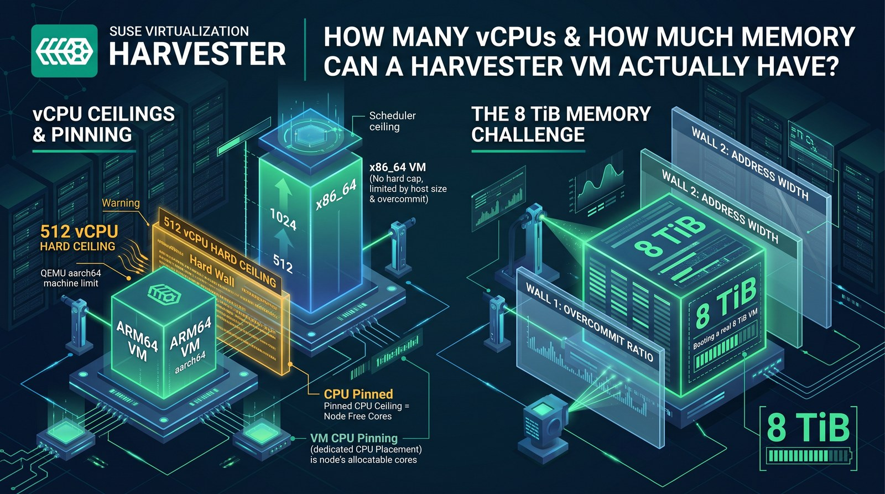
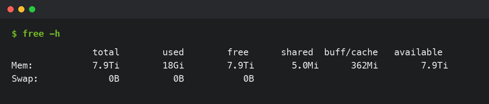

**TL;DR:**

- ARM64 VMs on Harvester hit a hard, fixed wall at **512 vCPUs** — baked into QEMU's `virt` machine type (GICv3), unrelated to CPU pinning. x86_64 has no equivalent wall; 1024+ vCPUs booted fine.
- CPU pinning (`dedicatedCpuPlacement`) isn't a fixed number either — it's whatever CPU capacity is actually free on the node at the time.
- Guest memory above roughly 1 TiB on x86_64 requires `cpu.model: host-passthrough`. Default CPU model's address width is too narrow for KubeVirt's memory-hotplug headroom, and QEMU refuses to start.
- Large-memory VMs (above ~1 TiB) also need UEFI (`firmware.bootloader.efi`) set explicitly — legacy BIOS can hang indefinitely building the memory map.
- Booted a real Ubuntu guest with **8 TiB of RAM**, confirmed from inside the VM. Next ceiling is computable from the CPU's address width: **16 TiB theoretical** on this hardware.

Sizing a VM on Harvester, two questions come up fast: how many vCPUs can one VM actually get, and how much memory can it actually use? Harvester's docs cover resource *overcommit ratios* — the knobs that let the scheduler pack more virtual resources onto a host than physically exists — but they don't say where the real ceilings are. I spent a session finding out, on two very different clusters: a 3-node ARM64 cluster built on Ampere Altra CPUs, and a single-node x86_64 box built on a Dell PowerEdge R640. Both questions turned up more than a number — the vCPU ceiling depends entirely on architecture, and the memory ceiling turned out to be two separate walls stacked on top of each other, one of which I only found by actually booting a VM with 8 TiB of RAM.



## Lab setup

ARM64 cluster: three nodes, each a dual-socket Ampere Altra with 2×80 cores (160 cores/node, no hyperthreading), running Harvester v1.9.1-rc3 (KubeVirt 1.8.4).

x86_64 cluster: a single Dell PowerEdge R640, dual Intel Xeon Platinum 8160 (24 cores/socket, hyperthreaded, 96 threads total), 754 GB RAM, running Harvester v1.9.0.

Both clusters use the default Harvester resource-overcommit settings unless noted: 1000% CPU / 150% memory on the ARM64 cluster, 400% CPU / 150% memory on the x86_64 box.

## First surprise: admission accepts almost anything

Before touching real VMs, I ran `kubectl apply --dry-run=server` against `VirtualMachine` manifests with absurd resource requests — 512, 2048, even 65536 vCPU cores, and a 900 GiB memory guest on a cluster with nowhere near that much RAM:

```console
$ kubectl apply --dry-run=server -f vcpu-test-65536.yaml
virtualmachine.kubevirt.io/vcpu-test-65536 created (server dry run)
```

Every one of them passed. Harvester's `KubeVirt` custom resource had no `liveUpdateConfiguration.maxGuestCpuTopology` configured on either cluster, so there's no admission-time soft cap on vCPU count or memory size at all. Whatever ceiling exists has to come from somewhere further down the stack — the Kubernetes scheduler matching real resource requests against node capacity, or the hypervisor itself refusing to start. Dry-run tests can't see either of those, so the only way to find the real numbers was to actually create and start VMs.

## Finding the vCPU ceiling

### ARM64: a hard wall at 512

I started a VM on an idle ARM64 node at 256 cores, then 512, then 513 — no CPU pinning, default (shared) CPU placement:

```console
$ kubectl get vmi arm-boundary-test -o jsonpath='{.status.phase}'
Running          # at 512 cores
```

At 513 cores, the `VirtualMachineInstance` got scheduled and its launcher pod started, but the VM itself never reached `Running`, sitting in `Scheduled` indefinitely. Actual cause: a libvirt error in the `virt-launcher` pod's logs:

```
level=error msg="unsupported configuration: Maximum CPUs greater than specified machine type limit 512" pos="qemuValidateDomainVCpuTopology:822" subcomponent="libvirt"
level=error msg="Defining the VirtualMachineInstance failed." reason="virError(Code=67, Domain=10, Message='unsupported configuration: Maximum CPUs greater than specified machine type limit 512')"
```

512 vCPUs is the hard ceiling for QEMU/libvirt's `virt` machine type on aarch64 — the machine type Harvester uses for every ARM64 VM. It's tied to the GICv3 interrupt controller's redistributor region sizing, not to anything Harvester or KubeVirt configures; it's baked into how the `virt` machine type is defined. I confirmed it twice more to rule out other explanations:

- Reproduced the identical error on a second node with CPU Manager (exclusive CPU pinning) **never enabled**. Same failure, same message, same 512 boundary. This rules out pinning or CPU Manager state as the cause.
- Tried `cpu.model: host-model` explicitly on ARM64. KubeVirt's own admission webhook rejected it before a VM object was even created:

```console
$ kubectl get events --field-selector involvedObject.name=arm-hostmodel-test
Warning  FailedCreate  virtualmachine/arm-hostmodel-test  Error creating virtual machine instance: admission webhook "virtualmachineinstances-create-validator.kubevirt.io" denied the request: currently, host-passthrough is the only model supported on Arm64
```

So on ARM64, `host-passthrough` (exposing the exact physical CPU to the guest) isn't a choice — it's the only legal CPU model, which is also why Harvester's VM creation defaults to it automatically without you asking. There's no "try a different CPU model and get more vCPUs" option on this architecture. 512 is the number, full stop, for any unpinned VM on any ARM64 Harvester node.

### x86_64: no equivalent wall, at least not below 1024

Same test on the x86_64 box (`q35` machine type, default `host-model` CPU, which on this hardware resolves to the named QEMU CPU model `Skylake-Server-IBRS`): 64, 96, 128, 192, 256, 384, 512, 513, and 1024 vCPUs all booted cleanly. No libvirt topology error, no stuck `Scheduled` phase, nothing.

I also tried `cpu.model: host-passthrough` explicitly (this one *is* legal to set on x86_64) at 512 and 1024 cores — identical result, no difference between the two CPU models for this question. Both booted fine at counts that would have failed immediately on ARM64.

Past 1024, Kubernetes scheduler started refusing the pod with `Insufficient cpu` — but that's the 400% CPU overcommit ratio doing simple arithmetic against the node's 96 real threads, not a QEMU or libvirt limit. Practical ceiling for an unpinned x86_64 VM is physical host capacity and the configured overcommit ratio, not a hard number QEMU enforces.

## Pinned CPUs: a different question entirely

Everything above is for VMs sharing the host's CPU pool. Harvester also supports CPU pinning (`dedicatedCpuPlacement: true`), which hands a VM exclusive, dedicated physical cores instead of a time-sliced share. That requires Kubernetes' static CPU Manager policy, which Harvester enables per node through its own mechanism.

### How CPU Manager actually gets enabled

Clicking "Enable CPU Manager" in the UI (or setting the equivalent annotation directly) doesn't just flip a label. I traced it through Harvester's source (`pkg/controller/master/node/cpu_manager_controller.go`) to understand the real flow:

1. A node annotation, `harvesterhci.io/cpu-manager-update-status`, gets set to `{"policy":"static","status":"requested"}`.
2. A controller watching that annotation submits a privileged, host-mounted `Job` on that specific node.
3. The Job runs a script that writes `/etc/rancher/rke2/config.yaml.d/99-z01-harvester-cpu-manager.yaml` with `kubelet-arg: cpu-manager-policy=static`, clears the stale `cpu_manager_state` file, and restarts `rke2-agent` (or `rke2-server` on a control-plane node).
4. That's a kubelet bounce, not a reboot — running containers, including other VMs on the same node, keep running throughout.

End to end, the whole thing took about 40 seconds and never touched other workloads on the node, confirmed by watching Longhorn's instance-manager pods and a pair of actively-running benchmark VMs on the same cluster the entire time.

### Real pinned ceiling: whatever's actually free

With CPU Manager live on that node, I stepped a pinned VM's core count up and watched where the Kubernetes scheduler stopped accepting it:

```console
$ kubectl describe pod virt-launcher-pin-test-xxxxx | tail -3
Warning  FailedScheduling  default-scheduler  0/3 nodes are available: 1 Insufficient cpu.
```

118 cores scheduled and ran. 119 scheduled and ran. 120 failed, every time, reproducibly. Node's allocatable capacity was 158.26 cores; two Longhorn instance-manager pods and a handful of system DaemonSets already held 38.88 cores of that in standing requests. 158.26 − 38.88 = 119.38 — exactly where the boundary landed. A pinned VM's real ceiling isn't a fixed number at all: it's whatever's left on the node after everything else already running has taken its share, and that number moves every time something else gets scheduled.

## Memory: two walls, not one

This is the part worth paying the most attention to, because the answer isn't what I expected going in — and it took booting an actual 8 TiB VM to find the second wall.

### Real consumption, verified both ends

Before chasing a number, I wanted to confirm a VM's memory usage shows up as real host RAM, not some virtualized accounting trick. I booted an actual Ubuntu 24.04 guest (using `virtctl ssh`, which proxies SSH through the Kubernetes API itself — no guest network routing or DHCP needed, useful when a VM's only interface is the pod network) and filled a `tmpfs` mount inside the guest:

```console
$ virtctl ssh --namespace=default --username=ubuntu -c \
  "sudo mount -t tmpfs -o size=64G tmpfs /mnt/fill && \
   sudo dd if=/dev/zero of=/mnt/fill/block bs=1M count=55705 && free -h" vmi/mem-test
62Gi        55Gi       7.8Gi       54Gi        54Gi       7.6Gi
```

Checked from the host side, the `qemu-system-x86_64` process's resident memory had grown by almost exactly the same amount. I repeated this at 8, 64, and 200 GiB guest sizes (170 GiB filled at the largest step) — every time, host free memory dropped by exactly the filled amount, cleanly and predictably, no ballooning, no surprises. Real memory consumption tracks real host RAM one-to-one, as you'd expect, and there's no page deduplication in play (KSM was disabled on this host; worth checking on yours if you're trying to reproduce these numbers, since `tmpfs` filled with identical content would otherwise be deduplicated and give a false sense of headroom).

### Wall one: the overcommit ratio

For the admission ceiling, I didn't need to actually fill the memory — just create VMs at increasing sizes and see where the Kubernetes scheduler stops accepting them:

- 900 GiB: scheduled and ran (computed pod memory *request* ≈ 602 GiB)
- 907 GiB: scheduled and ran
- 915 GiB: stuck in `Scheduling`, scheduler event `Insufficient memory`
- 938, 939, 940, 950, 960, 1200 GiB: all failed the same way

Boundary sits between 907 GiB (works) and 915 GiB (fails) — on a node with 626.56 GiB of real allocatable memory. That number is `node allocatable memory × memory overcommit ratio` (626.56 GiB × 150%, plus a small per-VM overhead). It's not a hardware fact: raise `overcommit-config` to 300% and the same boundary roughly doubles, on the exact same physical RAM. Kubernetes isn't checking whether the VM's memory *limit* could physically fit — it's checking the computed memory *request* (roughly limit ÷ ratio) against what's free. Harvester's [resource overcommit](https://docs.harvesterhci.io/v1.9/vm/resource-overcommit) docs already note that memory ballooning isn't supported — memory given to a VM isn't returned once allocated — which makes the distinction more than academic: a VM can be *scheduled* with far more memory than a node could ever back if every byte were actually touched.

I raised the ratio myself to confirm this scales exactly as predicted. At 500% overcommit, a VM requesting 1200 GiB got *scheduled* cleanly (computed request ≈ 241 GiB, comfortably under the 626.56 GiB allocatable) — past the first wall entirely. And then it hit a second one.

### Wall two: the CPU model's address width

The 1200 GiB VM scheduled, its pod started, and then QEMU itself refused to launch:

```
level=error msg="internal error: QEMU unexpectedly closed the monitor (vm='default_mem-sched-test'): qemu-system-x86_64: Address space limit 0x3ffffffffff < 0x4b87fffffff phys-bits too low (42)"
```

`0x3ffffffffff` is 4 TiB (2⁴², matching the default named CPU model's 42-bit physical address width). `0x4b87fffffff` is the memory-hotplug ceiling (`maxmem`) KubeVirt computed for this VM — about 4.8 TiB, because KubeVirt sets `maxmem` to roughly 4× the guest memory size by default, to leave headroom for live memory hotplug. At 1200 GiB guest, that 4× multiplier produces a `maxmem` bigger than the CPU model's entire addressable space, and QEMU refuses outright, independent of how much RAM the host physically has or what the overcommit ratio allows.

Switching `cpu.model` to `host-passthrough` fixed it immediately — same 1200 GiB VM, same overcommit setting, now `Running`. `host-passthrough` exposes the real CPU's actual address width instead of the named model's generic one, and this Xeon Platinum 8160 reports 46-bit physical addressing (captured straight from `lscpu` on the host: `Address sizes: 46 bits physical, 48 bits virtual`) — 64 TiB addressable, comfortably past the 4.8 TiB `maxmem` that tripped the default model.

### Booting a real 8 TiB VM

At this point I wasn't satisfied with a scheduling test — I wanted to watch an actual operating system boot with that much memory assigned. I raised the memory overcommit ratio to 1500% (math: 8192 GiB ÷ 626.56 GiB allocatable ≈ 13.07, so the ratio needs to clear ~1307% — 1500% leaves margin), set `cpu.model: host-passthrough`, cloned a real Ubuntu 24.04 image onto the VM's disk, and booted it with 8192 GiB (8 TiB) of guest memory.

First attempt hung. Serial console produced zero output for minutes while the `qemu-system-x86_64` process sat there actively burning CPU and slowly climbing toward 130+ GiB of resident memory — real work was happening, just never reaching a point where anything printed to the screen. The VM was using legacy BIOS (SeaBIOS), Harvester's default when `firmware.bootloader.efi` isn't set explicitly, and legacy BIOS has known trouble constructing memory maps at multi-terabyte scale.

Switching to UEFI fixed it immediately:

```yaml
spec:
  template:
    spec:
      domain:
        firmware:
          bootloader:
            efi:
              secureBoot: false
```

Console output appeared within seconds of restart:

```
BdsDxe: loading Boot0001 "UEFI Misc Device" from PciRoot(0x0)/Pci(0x2,0x6)/Pci(0x0,0x0)
BdsDxe: starting Boot0001 "UEFI Misc Device" from PciRoot(0x0)/Pci(0x2,0x6)/Pci(0x0,0x0)
EFI stub: Loaded initrd from LINUX_EFI_INITRD_MEDIA_GUID device path
```

It still took about three minutes total to reach a login prompt, with the kernel's own memory-map initialization — `struct page` bookkeeping for roughly two billion 4 KiB pages — accounting for most of that time and most of the climbing RSS. That's expected at this scale, not a Harvester problem: any kernel, bare metal or virtual, needs real time and real memory to build page-tracking structures proportional to RAM size. Once it settled, `cloud-init` finished and the VM was fully up:

```console
$ virtctl ssh --namespace=default --username=ubuntu -c "free -h" vmi/mem-8tb-boot
```



Real login, real memory report, zero swap, 8 TiB actually there. Pushing further, 2 TiB and 8 TiB guest VMs both started cleanly under `host-passthrough` at 900% and 1500% overcommit respectively — the only real wall I ever hit was the address-width one, and `host-passthrough` clears it.

### How far could this actually go?

With the mechanism fully understood, the next ceiling is computable rather than mysterious. `host-passthrough` exposes this CPU's real 46-bit physical address width — 64 TiB addressable — and KubeVirt's `maxmem` scaled at exactly 4× guest size in both the 1200 GiB and 8192 GiB tests (confirmed in the domain XML: `maxMemory` was precisely 4800 GiB and 32768 GiB respectively). 64 TiB ÷ 4 = **16 TiB** — the theoretical guest memory ceiling this exact CPU model and KubeVirt's hotplug-headroom math would allow, derived from numbers this hardware reported about itself, not a vendor-published figure. I didn't test all the way to 16 TiB (this host has 754 GB of physical RAM; nothing past the scheduling and firmware mechanics was ever going to be real memory), but the formula is simple enough to apply to any host: take the CPU's `phys-bits` from `lscpu`, convert to TiB, divide by four.

## What about cluster size itself?

Two more questions came up alongside these — maximum hosts and maximum worker nodes per cluster — and neither has a clean empirical answer the way vCPU and memory do, because there's no published number to test against and no safe way to build a cluster large enough to find a real one in a homelab. What does hold up from how Harvester is built: every cluster always has exactly three management/etcd nodes (the first three, auto-promoted), and every additional node is a worker. Practical ceiling in the field comes from etcd write performance on those three nodes, Longhorn's replica and rebuild traffic growing with node and VM count, and the fact that Harvester upgrades one node at a time — drain, live-migrate, reboot — so a cluster's maintenance window scales directly with its size. Production deployments I'm aware of tend to run in the tens of nodes per cluster; past that, the standard pattern is several Harvester clusters managed under one Rancher, rather than one enormous cluster.

## Takeaways

| Question | Answer | Governed by |
|---|---|---|
| Max vCPU, ARM64, unpinned | 512 | QEMU/libvirt `virt` machine-type validation (GICv3) — fixed |
| Max vCPU, x86_64, unpinned | None found up to 1024 | Physical thread count + CPU overcommit ratio — tunable |
| Max vCPU, pinned (either arch) | Node's free allocatable CPU | Whatever else is already scheduled on the node |
| CPU model on ARM64 | `host-passthrough` only | KubeVirt admission webhook rejects `host-model` |
| Max memory, default CPU model | ~900 GiB–1 TiB region | Overcommit ratio, then CPU model address width |
| Max memory, `host-passthrough` | 8 TiB confirmed booting, 16 TiB theoretical | CPU `phys-bits` ÷ KubeVirt's 4× `maxmem` multiplier |
| Large-memory VM firmware | UEFI required above ~1 TiB | Legacy BIOS hangs building the memory map |

ARM64's 512-vCPU number deserves the most planning attention if you're sizing large VMs on Ampere hardware — it's fixed and will bite a database or Kubernetes-in-Kubernetes node that wants more than 512 vCPUs, regardless of how big the physical hosts are. Memory story is more forgiving than it first looks: the ~900 GiB wall most people will hit by default isn't a hardware fact, it's two tunable settings (`overcommit-config` and `cpu.model`) away from a VM that can use most of what a real server has installed.

What's next: I'm filing a short docs PR against Harvester's [Virtual Machines](https://docs.harvesterhci.io/v1.9/vm/virtual-machines/) page with these tested numbers, since none of this is currently documented.
