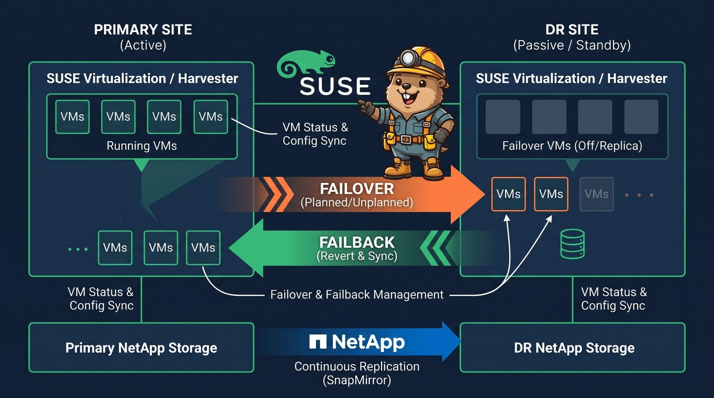
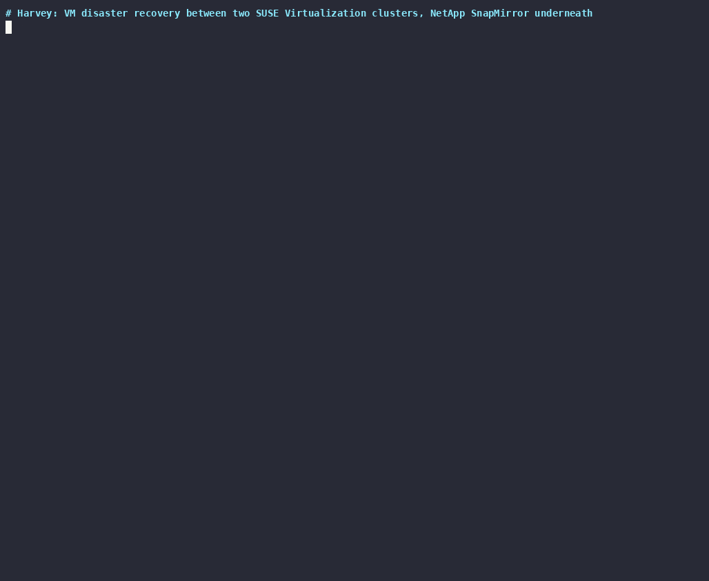

**TL;DR**

- [Harvey](https://github.com/abonillabeeche/harvey) is a CLI for VM disaster recovery between two SUSE Virtualization (Harvester) clusters. Version 0.2 is storage-aware: NetApp SnapMirror, driven through Trident, replicates the disks, and Harvey copies the VM spec, cloud-init Secrets, ConfigMaps and network definitions and orchestrates the failover.
- A planned failover of a VM with three disks (an image-cloned root disk on iSCSI, an iSCSI data disk, an NFS data disk) took **72 to 101 seconds** end to end with **no data loss**, checked inside the guest. Failback took 75 to 95 seconds, also lossless.
- An unplanned failover (source treated as down, no final sync) reported a worst-case data loss of 65 seconds; the guest showed 7 seconds lost on the data disks and 62 seconds on the root disk.
- `harvey replication status` shows each disk's SnapMirror state, health, lag and recovery point; `harvey sync` keeps VM changes in step; `harvey health-check` fails when replication is unhealthy or lags too far.
- Everything below is recorded from real runs against two clusters and two ONTAP simulators. **Update (November 3):** after NetApp's review, the lab's one-minute SnapMirror schedule is flagged as unsupported (five minutes is the minimum), and the limitations reflect their feedback.

Storage replication only gets you half of a VM failover. The DR site also needs the VM: its CPU and memory, its disks wired to the right PVCs, its cloud-init data, its networks, and something that stops it in one place and starts it in the other in the right order. [The storage half](/posts/netapp-snapmirror-two-ontap-simulators-suse-virtualization/) covers two peered ONTAP simulators and Trident volume replication. This post is the other half: Harvey, which I first wrote as a stop-on-one-cluster, start-on-the-other tool and have now rebuilt around SnapMirror.

## How Harvey splits the work

| Layer | Who moves it | How |
|---|---|---|
| Disk data | NetApp ONTAP | SnapMirror, one relationship per PVC, created through Trident `TridentMirrorRelationship` (TMR) objects |
| VM definition | Harvey | `VirtualMachine` copied to the DR cluster, stopped, without runtime fields and PVC templates |
| Cloud-init, SSH keys, sysprep | Harvey | Secrets and ConfigMaps the VM references |
| Networks | Harvey | `NetworkAttachmentDefinition`s the VM uses (left alone if the DR site already has its own) |
| Order and timing | Harvey | priority labels, startup delays, hooks, RTO/RPO measurement, audit log |

Harvey keeps no state of its own. Which site is primary is recorded in labels on the two copies of the VM and in the TMR states on both clusters, so any machine with the config can run it. ONTAP credentials are not in the config either: for every disk, Harvey follows PV → TridentVolume → TridentBackendConfig and uses the management LIF and credentials Secret that Trident already has.

## Configuration

```yaml
# ~/.config/harvey/config.yaml
clusters:
  primary:
    kubeconfig: ~/.kube/primary.yaml      # or rancher_cluster_id: c-m-xxxx with rancher_url + api_token
  dr:
    kubeconfig: ~/.kube/dr.yaml
defaults: {source: primary, destination: dr}
replication:
  policy: MirrorAllSnapshots              # asynchronous SnapMirror policy
  schedule: 5min                          # ONTAP schedule; 5 minutes is NetApp's supported minimum
  max_lag_seconds: 600                    # health-check threshold
```

## Protect a VM

```console
$ harvey protect -n harvey-dr-demo dr-demo-1
────── protect harvey-dr-demo/dr-demo-1: primary → dr ──────
  dr: secret/dr-demo-1-cloudinit created
  dr: nad/harvey-dr-demo/demo-vlan999 created
  dr: vm/dr-demo-1 created (Halted)
  ✓ harvey-dr-demo/dr-demo-1 protected
```

For each disk, `protect` creates a TMR on the primary to get the ONTAP volume handle, then a TMR and an annotated PVC on the DR cluster; SnapMirror starts the baseline transfer. Harvey creates the replica VM with `runStrategy: Halted`; it keeps the name, namespace, MAC addresses and disk names of the original. In this run the TMRs and PVCs already existed from my manual tests, so Harvey adopted them and only created the missing pieces.

My test VM runs openSUSE Leap 16.0 from an image on a NetApp iSCSI StorageClass, so its root disk is a FlexClone of the image volume. It also has an iSCSI data disk, an NFS data disk, a cloud-init Secret and a second NIC on an isolated VLAN. A small service inside the guest appends a UTC timestamp to a file on each of the three disks every 5 seconds; a gap in those files is either the outage or lost data.

## Status, metadata sync and health check



`harvey replication status` reads lag and the recovery point straight from ONTAP. Lag is the age of the newest replicated snapshot, which is the most data you would lose if the primary site failed at that moment. With the one-minute schedule I used in the lab it stayed between 7 and 41 seconds. NetApp supports five minutes as the minimum schedule, so expect up to about five minutes in a supported setup (see [the storage post](/posts/netapp-snapmirror-two-ontap-simulators-suse-virtualization/#what-netapp-said)). Five minutes is comfortable for a handful of volumes on a quiet array. At scale, remember that Harvey creates one SnapMirror relationship per VM disk: an array can hold a relationship for every volume (up to 5,000), but it runs only 100 or 250 transfers at the same time, depending on the platform, so with hundreds of disks on a busy system transfers queue and lag grows.

`harvey sync` copies the VM definition and everything it references from whichever side is currently primary. Run it from cron, or as `harvey sync --watch 300`, so that a CPU, memory or cloud-init change made on the primary is already on the DR side when you need it. Replicas always stay stopped.

## Planned failover


`harvey failover vm` runs these phases and times each one:

1. **Metadata sync** from primary to DR, to catch late changes.
2. **Stop** the VM on the primary (lowest priority first when there are several) and wait until it is gone.
3. **Final SnapMirror update** for every disk through the ONTAP REST API, waiting for each transfer to finish. A transfer that stops making progress for two minutes is aborted and retried.
4. **Promote** the DR volumes (TMR `state: promoted`, which breaks the relationship) and verify in ONTAP that each volume really is read-write.
5. **Start** the VM on DR (highest priority first, with optional startup delays) and wait for `Running`.

In the recorded run: stop 6 s, final sync 21 s, promote 28 s, start 15 s, **72 s total, RPO 0**. Inside the guest on DR, the timestamps run up to the moment the VM stopped on the primary and continue after it booted on DR; the only gap is the outage.

`--unplanned` is for a primary site that is down: it skips the stop and the final sync, promotes the last replicated data, and reports the expected data loss per VM from the age of each disk's newest snapshot. If the primary is reachable and the VM is still running there, Harvey refuses (split brain) unless you add `--force`.

## Reprotect and failback


After a failover nothing replicates until you run `harvey reprotect`: the old primary's TMRs go to `reestablished` with the DR volume handles, ONTAP reverse-resyncs, and the old primary's copy of each disk is overwritten with the current data from DR. `harvey failback` is a planned failover back to the original site followed by a reprotect in the original direction. In the recording it took 95 seconds with RPO 0, and replication ended up running primary → DR again with healthy lag.

All three recordings are also available as asciinema casts: [status and sync](harvey-status-sync.cast), [failover](harvey-failover.cast), [reprotect and failback](harvey-reprotect-failback.cast) (play with `asciinema play <file>`).

## Recovery plans

For more than one VM, a recovery plan lists protection groups with priorities, startup delays and shell hooks, and runs on the same engine:

```yaml
name: demo-dr
source: primary
destination: dr
protection_groups:
  - name: demo-tier
    priority: 100          # stopped last, started first
    startup_delay: 0
    vms:
      - {namespace: harvey-dr-demo, name: dr-demo-1}
hooks:
  pre_failover:  [{name: "notify", command: "./notify.sh start", on_failure: abort}]
  pre_start:     [{name: "volumes promoted", command: "./dns.sh prepare"}]
  post_failover: [{name: "done", command: "./notify.sh done"}]
```

```console
$ harvey plan run demo-dr                 # planned failover
$ harvey reprotect -n harvey-dr-demo dr-demo-1
$ harvey plan run demo-dr --reverse       # failback
```

A full plan cycle with hooks took 97 seconds for the failover and 75 seconds for the reverse run, both with RPO 0; the hooks ran before the stop, after the promote and at the end, in both directions.

## Results

| Operation | Runs | Time | Data loss |
|---|---|---|---|
| Planned failover, primary → DR | 3 | 72–101 s | none (checked in the guest) |
| Failback, DR → primary | 4 | 75–95 s | none (checked in the guest) |
| Unplanned failover | 1 | promote + start | reported ≤ 65 s; measured 7 s (data disks), 62 s (root disk) |
| Steady-state lag, one-minute lab schedule (not supported by NetApp; minimum is 5 min) | 51 samples | 7–41 s | — |

Final SnapMirror updates took 6 to 15 seconds per volume and promotes about 10 seconds per volume, run one volume at a time. Running them in parallel is the obvious next speed-up.

## Limitations

- **Asynchronous only.** Trident replicates with asynchronous SnapMirror policies, so an unplanned failover loses up to the schedule interval plus transfer time. NetApp's supported minimum schedule is five minutes; my lab ran one minute. Synchronous SnapMirror has no Trident integration by design; NetApp points customers who need zero data loss to MetroCluster.
- **Per-disk consistency.** After an unplanned failover, the disks of one VM can come from slightly different points in time (55 seconds apart in my test). Planned failovers are not affected. Trident's VolumeGroupSnapshot gives crash-consistent groups, but according to NetApp it does not work with replication yet.
- **Trident promote check.** Harvey verifies every promotion in ONTAP because Trident 26.06 can report a mirror as promoted while the volume is still read-only; details are in [the storage post](/posts/netapp-snapmirror-two-ontap-simulators-suse-virtualization/). NetApp has not seen it in support cases and is trying to reproduce it.
- **DR test mode** (`plan run --test`) boots copies of the VM definitions in shadow namespaces but does not clone the replica volumes yet. ONTAP FlexClones of the destination volumes would make it a real non-disruptive test.

## Harvey and Trident Protect

NetApp's own answer to the same problem is [Trident Protect](https://docs.netapp.com/us-en/trident/trident-protect/trident-protect-kubevirt-vms.html): its `AppMirrorRelationship` replicates both the volumes and the application metadata (through an S3 bucket) and fails the VM over by promoting the relationship. NetApp has described it for [OpenShift Virtualization](https://community.netapp.com/t5/Tech-ONTAP-Blogs/OpenShift-Virtualization-Disaster-Recovery-with-NetApp-Trident-Protect/ba-p/460716), and Yves at NetApp has a [KubeVirt scenario](https://github.com/YvosOnTheHub/LabNetApp/tree/master/Kubernetes_v6/Trident_Protect_Scenarios/Scenario11). Harvey takes a different split: NetApp moves only the disk data, and Harvey owns the VM metadata, the ordering and the checks. I will set up Trident Protect on the same two clusters, the way NetApp recommends, in a separate post.

## Try it

```console
$ uv tool install git+https://github.com/abonillabeeche/harvey.git
$ harvey config init
$ harvey protect -n <namespace> <vm> --wait
$ harvey replication status
```

Version 0.1, the stop/start-only tool, stays available on the `v0.1` branch of the repository. Harvey might get a more Rancher-like name in a future release.
