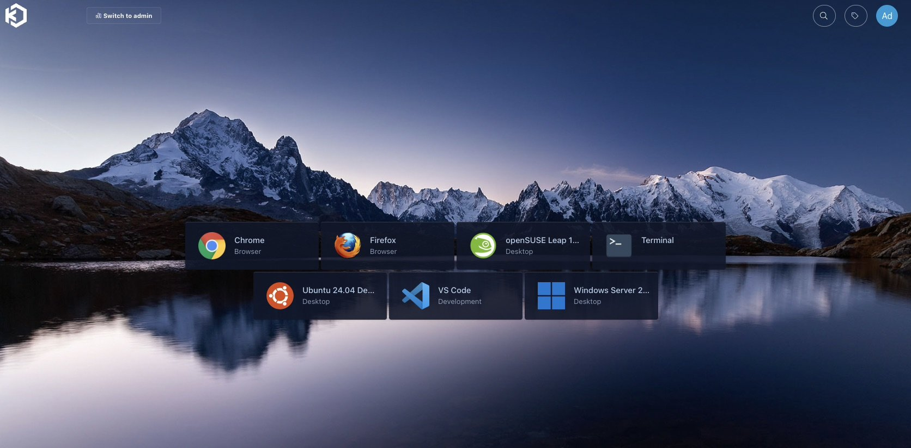
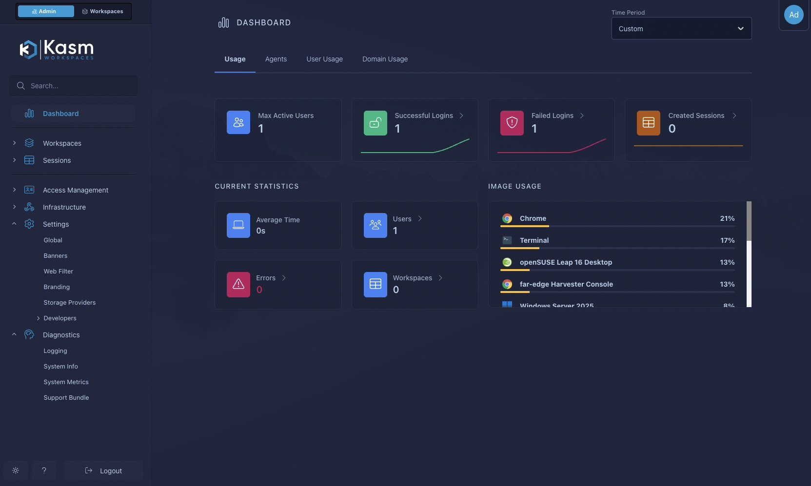

[Kasm Workspaces](https://kasmweb.com/) streams desktops and single applications to a
browser. Sessions run as containers on "agents", and Kasm can create those agents on
demand on a virtualization platform. Since version 1.19, one of those platforms is
SUSE Virtualization (Harvester): Kasm creates VMs through the Kubernetes API, installs
its agent on them, runs sessions, and deletes idle VMs again.

This post walks through a working deployment on a single-node SUSE Virtualization
v1.9.0 cluster. It covers Linux container desktops and full Windows desktops over RDP,
plus the workarounds I needed along the way.



*What a user sees after logging in: browsers, Linux desktops, VS Code and a Windows
Server desktop, each one click away.*

## Architecture

```
 browser ──HTTPS──▶ Kasm control plane VM (namespace kasm)
                     database, API, manager, proxy
                          │ Harvester VM provider (namespace-scoped service account)
                          ▼
                     agent VMs, created on demand (namespace kasm-autoscale)
                     4 vCPU / 8 GiB / 60 GiB, LAN address via DHCP
                          │ persistent profiles
                          ▼
                     S3 bucket (Ceph RGW)
```

Components and versions:

- SUSE Virtualization (Harvester) v1.9.0, single node.
- Kasm Workspaces 1.19.0, single-server install, on an Ubuntu 24.04 VM.
- Agent VMs from an Ubuntu 24.04 cloud image (later a pre-built "golden" image).
- A Rook Ceph object store (RGW) for persistent user profiles.

## Step 1: Create namespaces, an image and a network

Kasm needs two namespaces: one for the control plane VM and one where it creates agent
VMs. In the agent namespace you also need:

- **The base disk image.** Kasm looks it up by the label
  `harvesterhci.io/imageDisplayName=<Disk Image>` *inside the VM namespace*, so the image
  has to live in `kasm-autoscale`, not `default`.
- **A VM network.** Agent VMs need addresses that the Kasm proxy can reach. I attach them
  to the untagged LAN with a NetworkAttachmentDefinition named `kasm-lan`, and the LAN
  router hands out addresses over DHCP.

## Step 2: Give Kasm a least-privilege identity

Kasm's provider configuration asks for a Kubernetes API endpoint and a token. Avoid
handing it the Harvester admin kubeconfig. Instead, create a service account whose
permissions stop at the agent namespace:

```yaml
apiVersion: v1
kind: ServiceAccount
metadata:
  name: kasm-provider
  namespace: kasm-autoscale
---
apiVersion: v1
kind: Secret
metadata:
  name: kasm-provider-token
  namespace: kasm-autoscale
  annotations:
    kubernetes.io/service-account.name: kasm-provider
type: kubernetes.io/service-account-token
---
apiVersion: rbac.authorization.k8s.io/v1
kind: Role
metadata:
  name: kasm-provider
  namespace: kasm-autoscale
rules:
- apiGroups: ["kubevirt.io", "subresources.kubevirt.io", "cdi.kubevirt.io"]
  resources: ["*"]
  verbs: ["*"]
- apiGroups: [""]
  resources: ["persistentvolumeclaims", "secrets", "configmaps", "events", "pods"]
  verbs: ["*"]
- apiGroups: ["harvesterhci.io"]
  resources: ["virtualmachineimages", "virtualmachinetemplates",
              "virtualmachinetemplateversions", "keypairs"]
  verbs: ["get", "list", "watch"]
- apiGroups: ["k8s.cni.cncf.io"]
  resources: ["network-attachment-definitions"]
  verbs: ["get", "list", "watch"]
```

Bind the Role to the service account with a RoleBinding. Kasm also reads
StorageClasses, which are cluster-scoped, so add a small ClusterRole with `get`, `list`
and `watch` on `storageclasses`.

## Step 3: Install the Kasm control plane

Kasm's control plane runs in an ordinary Harvester VM: Ubuntu 24.04, cloud-init, a fixed
MAC address so DHCP keeps its IP stable. Inside it, Kasm's installer sets up every role
on one machine:

```bash
# -e: accept the EULA, -S all: every role on this VM, -L: HTTPS port, -J: swap size in MB
sudo bash kasm_release/install.sh -e -S all -L 443 -J 8192
```

I replaced Kasm's self-signed certificate with my lab's wildcard certificate by copying
it over `/opt/kasm/current/certs/kasm_nginx.crt` and `.key` and restarting the
`kasm_proxy` container. Remember to repeat that after each certificate renewal.

## Step 4: Add a StorageClass alias for each image

Kasm 1.19 hardcodes the PVC StorageClass as `longhorn-<image name>`. That was
Harvester's naming before v1.9; v1.9 names image StorageClasses `lh-<uuid>`. Without a
fix, every agent PVC stays Pending forever.

My workaround: publish an alias StorageClass with the name Kasm expects, pointing at the
same Longhorn backing image as the real one:

```yaml
apiVersion: storage.k8s.io/v1
kind: StorageClass
metadata:
  name: longhorn-ubuntu-noble           # longhorn-<image metadata.name>
provisioner: driver.longhorn.io
parameters:
  backingImage: vmi-d25b069b-...        # copy from the image's own lh-<uuid> class
  migratable: "true"
  numberOfReplicas: "1"                 # single-node cluster
  staleReplicaTimeout: "30"
allowVolumeExpansion: true
reclaimPolicy: Delete
volumeBindingMode: Immediate
```

Repeat this for every image Kasm uses, including the golden image in step 7. I
reported the naming issue as
[kasmtech/workspaces-issues#914](https://github.com/kasmtech/workspaces-issues/issues/914).

## Step 5: Configure the pool, provider and autoscaling

In the Kasm admin UI, under **Infrastructure → Pools**, create a Docker agent pool and
attach a Harvester VM provider and an autoscale configuration to it. My values:

- **Provider:** API host and service-account token from step 2, namespace
  `kasm-autoscale`, disk image `ubuntu-noble`, network `kasm-lan`, 4 vCPU, 8 GiB RAM,
  60 GiB disk.
- **Autoscaling:** keep 2 cores of standby capacity, at most 3 agent VMs, and a
  15-minute (900 s) back-off before scaling down.
- **Startup script:** Kasm's Docker agent cloud-config, which installs the agent and
  registers it with the control plane.

Three details in the startup script cost me time:

- **Kasm runs the script through Python's `str.format()`.** Any `{word}` in it, even in
  a comment, breaks provisioning with a bare `KeyError: 'word'`. Double literal braces
  (`{{` and `}}`).
- **Install qemu-guest-agent.** Kasm reads the agent's IP from the VM's status, and with
  bridged networking only the guest agent reports it.
- **Ubuntu cloud images lack the `videodev` module**, so the agent installer aborts while
  setting up webcam passthrough. Install `linux-modules-extra-$(uname -r)` at the top of
  the script.

## Step 6: Keep sessions off the control plane

A single-server install includes a built-in agent on the control plane VM, and Kasm
prefers it. Pinning workspaces to the Harvester pool doesn't help, because agents
outside any pool still qualify. Disable the built-in agent under **Infrastructure →
Docker Agents** so every session runs on a Harvester VM.

Also set the zone's **Upstream Auth Address** to the control plane's real IP or hostname.
Its default, `proxy`, is a Docker-internal name that remote agents can't resolve.

## Step 7: Bake a golden agent image

With the stock Ubuntu cloud image, a new agent VM took about 7 minutes to come up and then
spent about 30 more minutes pulling workspace images (around 38 GB) before it could start
the first session.

So I built a golden image: a one-off builder VM installs the agent, pre-pulls six
workspace images, cleans itself up and shuts down. I then export its disk as a Harvester
image and point the provider at it:

| Agent disk image | Agent ready | First Chrome session |
|---|--:|--:|
| Stock Ubuntu 24.04 cloud image | about 37 min (with image pulls) | waits for its pull |
| Golden image, workspaces pre-pulled | 4–5 min | 12 s |

Rebuild the golden image whenever you upgrade Kasm or change the catalog. Don't forget
its StorageClass alias from step 4.

## Step 8: Store user profiles in S3

Persistent profiles keep each user's browser data and desktop settings between sessions.
For S3-compatible storage outside AWS, use this path format in the workspace
settings, plus the global object-storage access key and secret:

```
s3://kasm-profiles@s3.example.com:443/{username}/{image_id}/
```

I use a bucket on a Rook Ceph object store. Clients must request persistent profiles at
launch; the toggle in the UI does exactly that.

## Windows desktops over RDP

Kasm also brokers full Windows desktops. A second pool uses RDP instead of Docker
agents: Kasm creates a Windows VM from a Harvester image, and a startup script enables
RDP, creates the account Kasm logs in with, and installs the Kasm Desktop Service. Kasm
keeps one warm VM ready and destroys each VM after use, so every user gets a clean
desktop. A new VM is ready in about 8 minutes.

Getting there took three fixes:

- **Cloudbase-Init must read Kasm's config drive first.** Kasm delivers the startup
  script on a config drive (`config-2`). With Cloudbase-Init's NoCloud service listed
  first, it claimed that drive, crashed during sysprep, and Windows Setup failed with
  "Windows could not start the installation process". Listing `ConfigDriveService` first
  in `metadata_services` fixed it. Its root cause, a config-drive label bug, is
  [cloudbase/cloudbase-init#113](https://github.com/cloudbase/cloudbase-init/issues/113).
- **Copy images off Longhorn v2 volumes first.** Longhorn can't export a backing image
  from a v2 (SPDK) volume, so I cloned the Windows disk to a v1 volume first. Without a
  backup target, force a full copy with the annotation `cdi.kubevirt.io/cloneType: copy`.
- **Bake the Desktop Service into the image.** For a Windows 11 image, I installed the
  Kasm Desktop Service and WinFSP at build time, so each new VM only registers itself
  instead of downloading and installing on every boot.

On licensing: Windows Server without Remote Desktop Services allows two admin sessions,
which is enough for one user per VM in a lab. Production one-to-one VDI usually means
Windows 11 Enterprise, while multi-user hosts need Windows Server plus RDS CALs.

## Day-2 notes

Kasm's admin dashboard shows logins, sessions and which workspaces people actually use,
which helps decide what to bake into the golden image:



- **Scaling** lives in the pool's AutoScale settings.
- **Kasm doesn't clean up after itself.** If you halt a Kasm-owned VM, Kasm treats it as
  dead and deletes it, but leaves its PVC behind. VMs, PVCs and Secrets that Kasm creates
  carry the autoscale configuration ID as a label, which makes orphans easy to find.
- **Rotating the provider token** means recreating the token Secret and updating the
  provider in Kasm.

## Upstream issues

I filed these with Kasm; all are open at the time of writing:

- [#914](https://github.com/kasmtech/workspaces-issues/issues/914): hardcoded
  `longhorn-<image>` StorageClass (step 4).
- [#915](https://github.com/kasmtech/workspaces-issues/issues/915): destroying a session
  that's still being requested fails.
- [#916](https://github.com/kasmtech/workspaces-issues/issues/916): pool-pinned
  workspaces still land on the built-in agent (step 6).
- [#917](https://github.com/kasmtech/workspaces-issues/issues/917): startup-script
  placeholder errors only log a bare `KeyError` (step 5).
- [#918](https://github.com/kasmtech/workspaces-issues/issues/918): installer aborts on
  cloud images without `videodev` (step 5).

## Wrapping up

Kasm's Harvester provider turns SUSE Virtualization into an elastic VDI back end: no
idle fleet of desktop VMs, just agents that appear when users arrive and disappear when
they leave. Once you work around the StorageClass naming and the startup-script quirks,
it runs well. A golden image is the single biggest improvement, cutting the wait for a
new agent from over half an hour to a few minutes.
