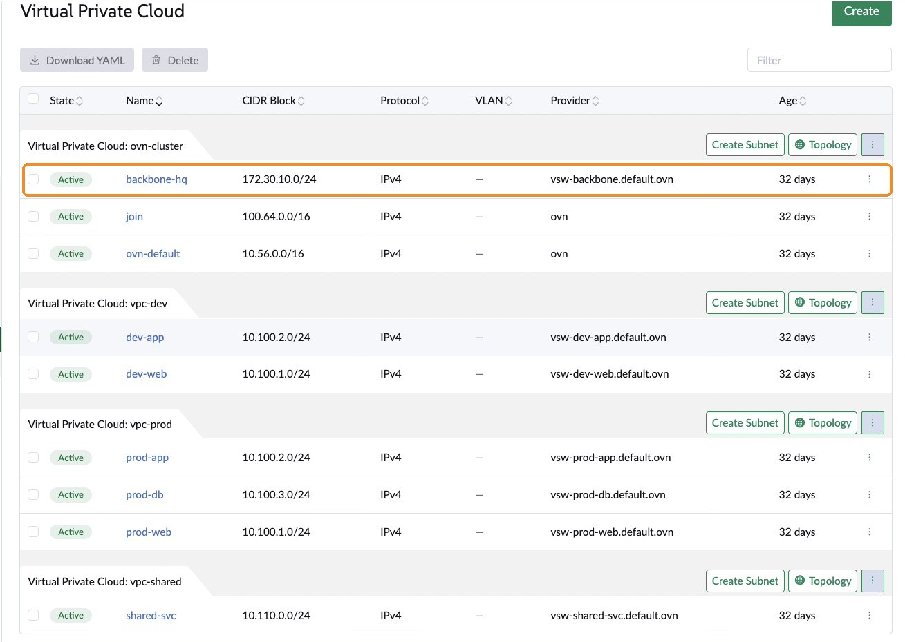
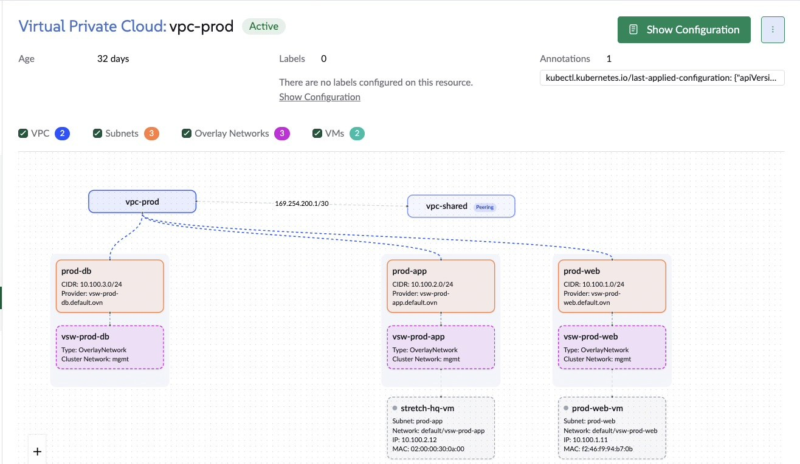

Kube-OVN brings NSX-style networking to SUSE Virtualization (Harvester): virtual private
clouds (VPCs), subnets with access control lists, peering, and NAT. I wanted to go one
step further and give VMs on *different* clusters a shared, routed network, the way a
multi-site NSX deployment would.

Kube-OVN can do that with **OVN interconnection (OVN-IC)**. I built it across four lab
clusters, and VMs on three of them now reach each other in 1–2 ms. Along the way I
learned where its limits are, worked around a routing quirk in Kube-OVN 1.16.2, and saw
its data plane keep VMs connected through a control-plane recovery.

**A caveat up front:** SUSE Virtualization 1.9 lists multi-cluster networking as **not
supported**, and nothing about OVN-IC appears in its UI. Everything here is a lab
experiment. VPCs, peering, subnet ACLs and NAT on a single cluster are supported; the
cross-cluster part is not.

## What I built

Four clusters, each an OVN availability zone (AZ), all on SUSE Virtualization 1.9.0
with Kube-OVN 1.16.2 (installed by the `kubeovn-operator` add-on) and VXLAN
encapsulation. Kube-OVN runs as a secondary network, so it carries VM NICs while pods
keep the default Canal network.

| AZ | Nodes | Role |
|---|--:|---|
| `hq` | 3 | hosts the OVN-IC database |
| `ai` | 1 | GPU cluster, powered on part-time |
| `edge` | 1 | always-on single node |
| `dr` | 3 | disaster-recovery cluster on a separate underlay subnet |

| Piece | Status |
|---|---|
| Shared backbone network, VM to VM across `hq`, `ai` and `edge` | working |
| `dr` joined to the interconnection control plane | working |
| `dr` data plane | next: needs a return route on its underlay network |
| Tenant VPCs per site, including overlapping CIDRs and VPC peering | working |
| Micro-segmentation with subnet ACLs | working |
| Stretched layer 2 between two sites (bridge network, dual-NIC VMs) | working |
| Outbound internet through subnet `natOutgoing` | working |
| VPC NAT gateway with elastic IPs | next: needs a dedicated NIC |

This is the `hq` site in the SUSE Virtualization UI. Its default VPC (`ovn-cluster`)
holds the cross-site `backbone-hq` subnet, outlined, while the tenant VPCs reuse the
same 10.100.x ranges without conflict:



## Limits to know before you start

1. **OVN-IC only interconnects the default VPC.** Kube-OVN patches every transit
   switch into the default cluster router (`ovn-cluster`), and the VPC resource has no
   interconnection setting, so custom VPCs stay local to their cluster (I confirmed
   this in testing).
2. **Custom VPCs can't peer with the default VPC.** SUSE Virtualization's docs say so
   explicitly, which closes the obvious bridge between tenant VPCs and the
   interconnected network.
3. **Overlay networks can only be created on the `mgmt` cluster network.**
4. **`natOutgoing` isn't in the UI.** It defaults to `false` and must be set in YAML.

So the design is: a `backbone-<az>` subnet in each cluster's default VPC carries
cross-site traffic, and tenant VPCs stay local to their site.

Within a site, the VPC topology view makes that local design easy to follow. Here
`vpc-prod` has database, application and web tiers, each with its own subnet and
overlay network, and peers with `vpc-shared` for common services:



## How OVN-IC fits together

Each cluster keeps its own OVN databases. OVN-IC adds one more pair of databases, the
**IC northbound and southbound DBs**, which all AZs share. Through them, every AZ
attaches its cluster router to a common **transit switch** (`ts`, 169.254.100.0/24)
via one or more gateway nodes, and traffic between AZs crosses that switch over
VXLAN tunnels.

## Step 1: Enable interconnection in each cluster

Patch Kube-OVN's `Configuration` resource, not just the add-on. Its field lives under
`components`:

```bash
kubectl patch configurations.kubeovn.io kubeovn -n kube-system --type=merge \
  -p '{"spec":{"components":{"enableIC":true}}}'
```

About three minutes later, the interconnection controller appears.

## Step 2: Run the IC database

I run the IC database on `hq` as a three-member raft cluster, using Kube-OVN's
`install-ic-server.sh` from the release-1.16 branch:

```bash
TS_NUM=1 bash install-ic-server.sh
```

It places members on nodes labelled `kube-ovn/role=master`, so label three nodes
first. Only the raft leader answers database commands; followers report `Ready` but
reject requests.

## Step 3: Turn on VXLAN mode before anything joins

OVN-IC assigns transit-switch tunnel keys from the Geneve range
unless you opt into VXLAN mode. With VXLAN encapsulation, each AZ then computes its
own key and packets disappear silently. Set it on the IC northbound leader:

```bash
ovn-ic-nbctl set ic_nb_global . options:vxlan_mode=true
```

Afterwards, every AZ's transit switch should show `tunnel_key : 1025` and
`requested-tnl-key="1025"`.

## Step 4: Point each cluster at the IC database

One ConfigMap per cluster. `az-name` must be unique, and `gw-nodes` lists the nodes
that carry traffic to the transit switch:

```yaml
apiVersion: v1
kind: ConfigMap
metadata:
  name: ovn-ic-config
  namespace: kube-system
data:
  enable-ic: "true"
  az-name: "hq"
  ic-db-host: "<ic-db-node-1>,<ic-db-node-2>,<ic-db-node-3>"
  ic-nb-port: "6645"
  ic-sb-port: "6646"
  gw-nodes: "<gateway-node-1>,<gateway-node-2>"
  auto-route: "false"
```

Treat it as immutable: to change it, delete it and apply it again.

## Step 5: Create a backbone subnet in each site

Each site gets a non-overlapping `/24` in the default VPC, attached to VMs through an
overlay network definition:

```yaml
apiVersion: k8s.cni.cncf.io/v1
kind: NetworkAttachmentDefinition
metadata:
  name: vsw-backbone
  namespace: default
  labels:
    network.harvesterhci.io/type: OverlayNetwork
spec:
  config: '{"cniVersion":"0.3.1","name":"vsw-backbone","type":"kube-ovn","provider":"vsw-backbone.default.ovn","server_socket":"/run/openvswitch/kube-ovn-daemon.sock"}'
---
apiVersion: kubeovn.io/v1
kind: Subnet
metadata:
  name: backbone-hq            # 172.30.10/20/30/40.0/24 for hq/ai/edge/dr
spec:
  vpc: ovn-cluster
  protocol: IPv4
  provider: vsw-backbone.default.ovn
  cidrBlock: 172.30.10.0/24
  gateway: 172.30.10.1
  enableDHCP: true
  natOutgoing: false           # SNAT would break the return path across sites
```

## Step 6: Route between sites by hand

With `auto-route: "true"`, OVN-IC exchanges routes for you. In my lab, three clusters
share the same default pod subnet, and in Kube-OVN 1.16.2 the overlap filter didn't
exclude those routes (it matches an empty route marker, while the real value is a
UUID), so they showed up as equal-cost routes in two AZs. Explicit routing sidesteps
that and gives full control over the paths.

Instead, each site gets explicit routes in its default VPC: a static route per remote
backbone through that AZ's transit-switch address, plus a priority-31000 `allow`
policy. Without the policy, Kube-OVN's own priority-29000 node-egress rule pulls the
traffic onto the join network. For `hq`:

```json
{"spec":{"staticRoutes":[
 {"cidr":"172.30.20.0/24","nextHopIP":"169.254.100.23","policy":"policyDst"},
 {"cidr":"172.30.30.0/24","nextHopIP":"169.254.100.52","policy":"policyDst"},
 {"cidr":"172.30.40.0/24","nextHopIP":"169.254.100.34","policy":"policyDst"}
],"policyRoutes":[
 {"action":"allow","match":"ip4.dst == 172.30.20.0/24","priority":31000},
 {"action":"allow","match":"ip4.dst == 172.30.30.0/24","priority":31000},
 {"action":"allow","match":"ip4.dst == 172.30.40.0/24","priority":31000}
]}}
```

```bash
kubectl patch vpc ovn-cluster --type=merge --patch-file=ic-routes-hq.json
kubectl ko nbctl lr-route-list ovn-cluster     # verify
```

A merge patch replaces the whole route list, so always apply the complete file. Take
the next-hop addresses from `ovn-ic-sbctl show`; they belong to each AZ's gateway
port on the transit switch.

## Results

Pings between sites, all with 0% loss:

| Path | Round trip |
|---|--:|
| `hq` ↔ `edge` | ~1.0 ms (0.55 ms after the October rebuild) |
| `hq` ↔ `ai` | ~1.9 ms |
| `ai` ↔ `edge` | ~2.2 ms |

VMs attached to the backbone on `hq`, `ai` and `edge` reach each other directly.
`dr` already participates in the interconnection control plane; its data plane comes
up once its underlay network gets a return route.

## Gotchas

- **Keep routes in step with transit addresses.** Each AZ's address on the transit
  switch can change when the IC database is rebuilt, and static routes must follow.
  After any IC change, regenerate the routes from `ovn-ic-sbctl show`; a small script
  that applies all four files keeps the sites consistent.
- **Test the data plane, not just the join.** An AZ can register correctly in the IC
  database before its tunnels pass traffic (VXLAN mode is the usual culprit), so
  confirm with real pings.
- **Warm up before measuring.** After a rebuild, the first packet in each direction is
  dropped while OVN learns MAC bindings.
- **Don't copy your pod network range.** On one cluster, Kube-OVN's default subnet used
  the same CIDR as Canal with outbound NAT on, which masqueraded cross-node traffic and
  interfered with Kubernetes network policies for other workloads. Renumbering fixed
  it, in this order: add-on, then the `Configuration` resource, then the subnet itself.

## Resilience: the data plane kept running

My lab is hard on its systems. Nodes get power-cycled abruptly, reflashed and rebuilt
far more often than any production cluster would allow. On September 24, one `hq` node
came back from a rebuild without its local OVN state (`/etc/origin/ovn`), rejoined
under new raft server IDs, and left two control-plane databases without a quorum:

- **Its own OVN databases**, which I had running as a two-member raft.
- **Shared IC database**, whose member list now held two stale entries.

What impressed me is what happened next: nothing visible. Every running VM kept
talking across sites on the flows OVN had already programmed into each host. Only new
changes waited: a freshly started VM sat in `Starting`, and the rebuilt node's CNI pod
retried until the control plane came back. I spotted it on October 4.

Recovery was quick because Kube-OVN rebuilds its northbound database from Kubernetes
resources. For each raft cluster, I moved the database files aside and restarted the
members together, re-enabled VXLAN mode on the new IC leader, and regenerated the
routes for the new transit addresses. Everything came back with 0% loss at 0.55 ms
between `hq` and `edge`.

What I'd carry into any deployment:

- **Run three raft members (or one), never two.** Two members need each other to elect
  a leader, so they can't ride out the loss of either.
- **Check raft health after node maintenance,** not just pod readiness:
  `ovn-appctl -t /var/run/ovn/ovnnb_db.ctl cluster/status OVN_Northbound` inside each
  `ovn-central` pod (and `ovn_ic_nb_db.ctl` / `OVN_IC_Northbound` for the IC database).
- **Monitor the control plane separately from traffic.** OVN's data plane is resilient
  enough that VMs alone won't tell you when the control plane needs attention.

## Takeaways

- OVN-IC gives SUSE Virtualization a real routed network across clusters at 1–2 ms,
  using only open-source pieces. It's unsupported today, so treat it as a lab
  technique.
- Design around its limits: only the default VPC interconnects, so keep tenant VPCs
  local and use a dedicated backbone subnet for cross-site traffic.
- Set VXLAN mode before the first AZ joins, use explicit routes on Kube-OVN 1.16.2, and
  regenerate them after every IC change.
- Run three raft members. OVN's data plane rides out control-plane trouble; give the
  control plane the same resilience.

## What's next

- Add a third member to the two-member OVN database cluster.
- Fix the `dr` underlay route so its data plane comes up.
- Give a site a dedicated NIC for a VPC NAT gateway with elastic IPs.
