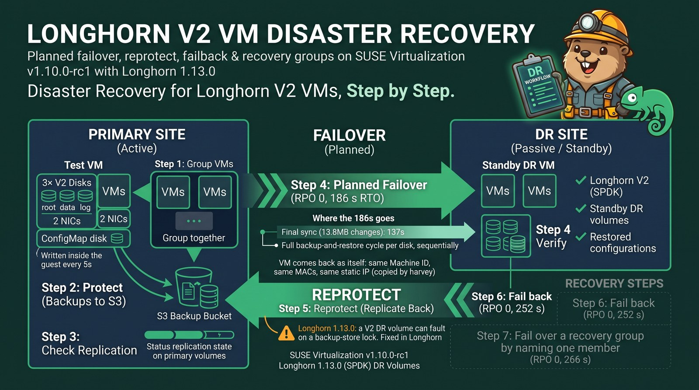
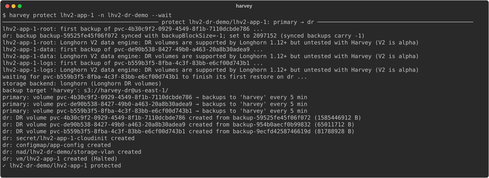
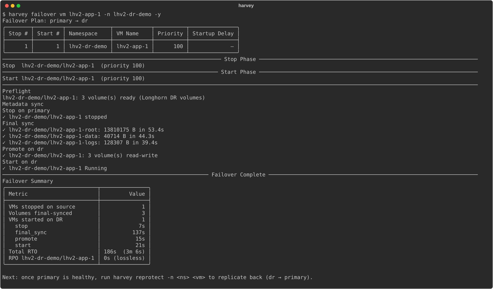
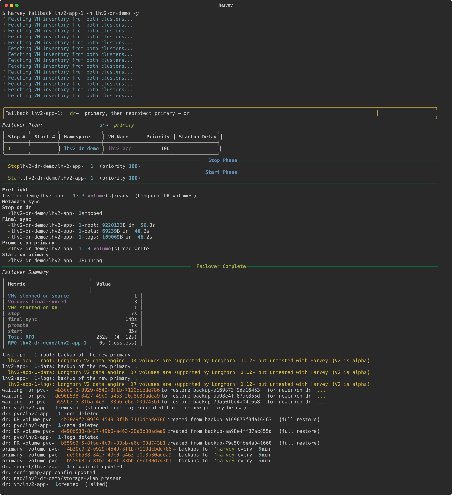
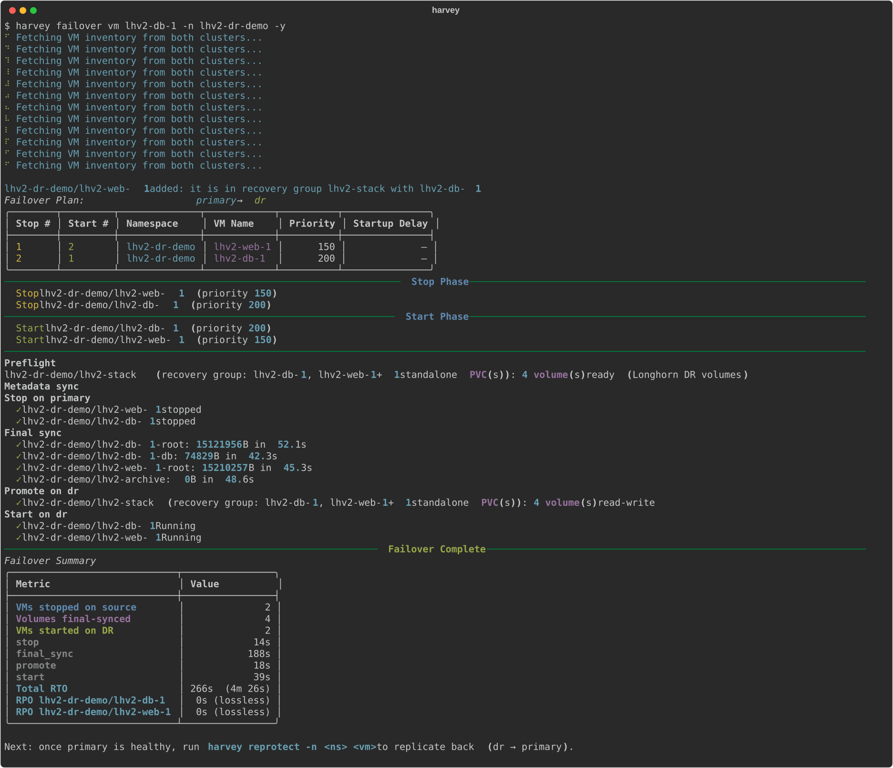
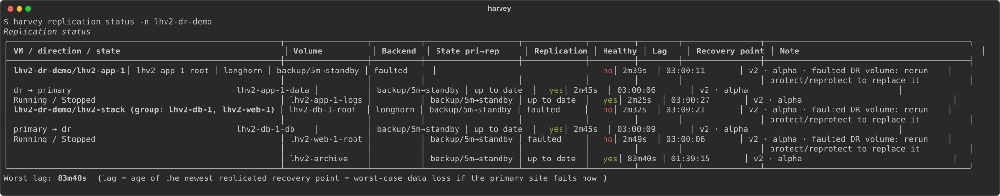

**TL;DR**

- Disaster recovery (DR) for VMs on the Longhorn V2 (SPDK) data engine works end to end on SUSE Virtualization v1.10.0-rc1 with Longhorn 1.13.0: backups to S3, standby DR volumes on the second cluster, engine-confirmed restores.
- A VM with three V2 disks, two NICs and a ConfigMap disk failed over in **186 s with RPO 0**, and failed back in **252 s with RPO 0**. A two-VM recovery group failed over in **266 s with RPO 0**. Timestamps written inside the guests every 5 seconds prove it.
- Each VM came back as itself: same machine ID, same MAC addresses, same static IP on a VLAN network that `harvey` copied along with the cloud-init Secret and the ConfigMap.
- Final sync, not data, dominates the RTO: 13.8 MB of changes still took 137 s, because each disk runs a full backup-and-restore cycle and the disks go one after another.
- On Longhorn 1.13.0, a V2 DR volume can turn **Faulted** when its restore hits a backup-store lock ([longhorn#14085](https://github.com/longhorn/longhorn/issues/14085)). **Longhorn 1.13.1** (and 1.12.2) ships the fix. Until then, keep more backups so the recurring job doesn't prune during restores.

I wanted to know whether disaster recovery for VMs on the Longhorn V2 data engine works out of the box, end to end. Longhorn has supported V2 DR volumes since 1.12, but the last time I tried, on SUSE Virtualization v1.9.0, the restore side never finished. This time both clusters run SUSE Virtualization v1.10.0-rc1, and I used [`harvey`](https://github.com/abonillabeeche/harvey), my DR orchestrator, to drive every step.

## How Longhorn DR works for a VM

Longhorn doesn't replicate between clusters. Disaster recovery is built on backups:

1. Each primary volume is backed up to a backup target (S3 here) on a schedule.
2. On the DR cluster, a **DR volume** (a standby volume created from a backup) polls the same target and restores each new backup incrementally.
3. At failover you **activate** the DR volume, and it becomes a normal volume with a PV and PVC.

A VM has several disks plus metadata (the VM spec, cloud-init Secrets, ConfigMaps, networks). `harvey` drives the Longhorn side for every disk and copies the metadata, so the VM can start on the other cluster.

## Lab setup

| | Primary | DR |
|---|---|---|
| Platform | SUSE Virtualization v1.10.0-rc1, single node | SUSE Virtualization v1.10.0-rc1, single node |
| Longhorn | 1.13.0, V2 data engine on an NVMe disk | 1.13.0, V2 data engine on a 100 GiB LVM logical volume |
| Network | **1 GbE** | 2 × 10 GbE |

Both clusters use one Longhorn `BackupTarget` named `harvey`, pointing at the same bucket on a local Ceph RGW (S3) reachable at 10 GbE. On the primary, a 1 GbE link caps everything it sends or receives at about 110 MB/s, so keep that in mind for every time below.

## Prerequisites

- **V2 enabled on both clusters**, with a V2 disk and a `longhorn-v2` StorageClass.
- **One backup target with the same name and URL on both clusters.** `harvey` refuses to protect a VM if the URLs differ.
- **CDI images for V2 root disks.** V2 volumes have no backing images, so the root disk comes from a CDI-backed image and nothing has to match by name on the DR side.
- Install `harvey`:

```console
$ uv tool install git+https://github.com/abonillabeeche/harvey.git
```

## Test VMs

All three VMs run openSUSE Leap 16.1 with every disk on `longhorn-v2`. A small service writes a UTC timestamp to every disk every 5 seconds; those timestamps are how I measure the real RPO inside the guest.

- **`lhv2-app-1`**: 5 GiB RWX block root, 1 GiB RWX block data disk, 1 GiB RWO **filesystem-mode** log disk, a ConfigMap attached as a disk, and two NICs: the pod network plus `storage-vlan`, a namespaced VLAN network with a static IP and a fixed MAC.
- **`lhv2-db-1`** (root plus a 2 GiB database disk) and **`lhv2-web-1`** (root) in a recovery group, plus a standalone 1 GiB PVC that no VM mounts.

## Step 1: Group VMs that fail over together

```console
$ harvey group add lhv2-stack lhv2-db-1 lhv2-web-1 --pvc lhv2-archive -n lhv2-dr-demo
$ harvey group add lhv2-stack lhv2-db-1 lhv2-web-1 --pvc lhv2-archive -n lhv2-dr-demo
  ✓ vm/lhv2-db-1 → group lhv2-stack
  ✓ vm/lhv2-web-1 → group lhv2-stack
  ✓ pvc/lhv2-archive → group lhv2-stack
Next: harvey protect -n lhv2-dr-demo --group lhv2-stack (already protected members: harvey sync -n lhv2-dr-demo)
$ harvey group show lhv2-stack -n lhv2-dr-demo
$ harvey group show lhv2-stack -n lhv2-dr-demo
lhv2-dr-demo/lhv2-stack on primary
  VMs:        lhv2-db-1, lhv2-web-1
  volumes:    lhv2-db-1-root, lhv2-db-1-db, lhv2-web-1-root, lhv2-archive
  standalone: lhv2-archive
  backend:    longhorn
```

## Step 2: Protect

`protect` points every source volume at the `harvey` target, schedules backups every 5 minutes, takes a first backup, creates a V2 DR volume on the DR cluster, waits for the first restore and copies the metadata. `harvey` creates the replica VM stopped.



97 seconds, and the ConfigMap and the namespaced VLAN network came along. Protecting the recovery group uses the same command with `--group`:

```console
$ harvey protect -n lhv2-dr-demo --group lhv2-stack --wait
```

> [!TIP] Synced backups carry backupBlockSize -1
> A backup that a cluster learns about through the target sync has `spec.backupBlockSize: -1`, which the DR volume would inherit and the CRD rejects. `harvey` sets the real block size on the synced Backup first; the yellow line in the output is that fix.

## Step 3: Check replication

`harvey` reports a DR volume as "up to date" only when the **engine** reports the backup as restored, not just when the volume says it should be.

```console
$ harvey replication status -n lhv2-dr-demo
VM / direction / state          Volume           State                Replication  Healthy  Lag    Recovery point
lhv2-dr-demo/lhv2-app-1         lhv2-app-1-root  backup/5m→standby    up to date   yes      4m46s  01:35:01
primary → dr                    lhv2-app-1-data  backup/5m→standby    up to date   yes      4m02s  01:35:47
Running / Stopped               lhv2-app-1-logs  backup/5m→standby    up to date   yes      3m46s  01:36:05
lhv2-dr-demo/lhv2-stack         lhv2-db-1-root   backup/5m→standby    up to date   yes      2m49s  01:37:05
(group: lhv2-db-1, lhv2-web-1)  lhv2-db-1-db     backup/5m→standby    up to date   yes      2m07s  01:37:50
primary → dr                    lhv2-web-1-root  backup/5m→standby    up to date   yes      113s   01:38:05
Running / Stopped               lhv2-archive     backup/5m→standby    up to date   yes      43s    01:39:15
Worst lag: 4m46s
```

All seven V2 DR volumes restored: the step that never finished on v1.9.0.

## Step 4: Planned failover

A planned failover stops the VM, takes one last backup of every disk, waits until each DR volume has restored it, activates the volumes, creates the PVs and PVCs, and starts the VM. Nothing written before the stop is lost.



### Verify inside the guest

```console
lhv2-app-1
machine-id d4d4ade27c3849d18cc17de401856fd8
enp1s0           UP             10.0.2.2/24 fe80::5054:ff:fe27:11/64 
enp2s0           UP             192.168.227.11/24 fe80::5054:ff:fe27:111/64 
enp1s0           UP             52:54:00:27:00:11 <BROADCAST,MULTICAST,UP,LOWER_UP> 
enp2s0           UP             52:54:00:27:01:11 <BROADCAST,MULTICAST,UP,LOWER_UP> 
vda        5G        
├─vda1     2M        
├─vda2   512M        /boot/efi
└─vda3   4.5G        /
vdb        1G data01 /mnt/data
vdc    957.3M logs01 /mnt/logs
vdd        1M cfg01  
vde        1M        
== /var/lib/harvey-marker (118 lines, first 2026-11-10T01:31:17Z)
   gap: 2026-11-10T01:40:24Z -> 2026-11-10T01:43:36Z (192s)
   last: 2026-11-10T01:44:12Z
== /mnt/data/marker (118 lines, first 2026-11-10T01:31:17Z)
   gap: 2026-11-10T01:40:24Z -> 2026-11-10T01:43:36Z (192s)
   last: 2026-11-10T01:44:12Z
== /mnt/logs/marker (118 lines, first 2026-11-10T01:31:17Z)
   gap: 2026-11-10T01:40:24Z -> 2026-11-10T01:43:36Z (192s)
   last: 2026-11-10T01:44:12Z
marker service: active
role=app
site=primary-at-protect-time
db=192.168.227.12
```

- **RPO 0:** every disk shows exactly one gap, 01:40:24 → 01:43:36 (192 s), which is the outage.
- **Same machine:** hostname and machine ID unchanged; both NICs kept their MAC addresses; the VLAN NIC came up with its static 192.168.227.11 on the copied network.
- **ConfigMap disk:** attached with the same serial; mounted, it still reads `role=app`.

### Where the 186 seconds go

| Phase | Time |
|---|---|
| Stop | 7 s |
| Final sync (3 disks) | 137 s |
| Promote | 15 s |
| Start | 21 s |

Final sync moved only 13.8 MB, 41 KB and 128 KB, yet took 39–53 s per disk. Each disk runs a fixed cycle (snapshot, backup, DR poll, engine restore), and the disks go **one after another**.

## Step 5: Reprotect

After a failover, `reprotect` reverses replication: it backs up the new primary, replaces the old primary's copies with DR volumes of the new primary, waits for the restore, and only then schedules the new primary's recurring backups.

```console
$ harvey reprotect lhv2-app-1 -n lhv2-dr-demo -y --wait
```

> [!NOTE] Reprotect is a full restore
> Longhorn can create a DR volume only from a backup; it can't turn the old, diverged volume into a DR volume or apply just the changes in reverse. So reprotect replaces the old copy and restores the new primary's data in full. Nothing is lost by that: every backup of the old primary stays on the target. Only the new primary's upload is incremental (same backup volume, changed blocks); the download onto the old site is a full restore, here over its 1 GbE link. VMware's vSphere Replication avoids this by using the original disks as seeds; Longhorn has no equivalent today.

## Step 6: Fail back

`failback` is a planned failover in the other direction followed by a reprotect, so replication runs the original way again:



```console
lhv2-app-1
machine-id d4d4ade27c3849d18cc17de401856fd8
enp1s0           UP             10.0.2.2/24 fe80::5054:ff:fe27:11/64 
enp2s0           UP             192.168.227.11/24 fe80::5054:ff:fe27:111/64 
enp1s0           UP             52:54:00:27:00:11 <BROADCAST,MULTICAST,UP,LOWER_UP> 
enp2s0           UP             52:54:00:27:01:11 <BROADCAST,MULTICAST,UP,LOWER_UP> 
vda        5G        
├─vda1     2M        
├─vda2   512M        /boot/efi
└─vda3   4.5G        /
vdb        1G data01 /mnt/data
vdc    957.3M logs01 /mnt/logs
vdd        1M cfg01  
vde        1M        
== /var/lib/harvey-marker (1374 lines, first 2026-11-10T01:31:17Z)
   gap: 2026-11-10T01:40:24Z -> 2026-11-10T01:43:36Z (192s)
   gap: 2026-11-10T03:23:24Z -> 2026-11-10T03:27:48Z (264s)
   last: 2026-11-10T03:33:35Z
== /mnt/data/marker (1374 lines, first 2026-11-10T01:31:17Z)
   gap: 2026-11-10T01:40:24Z -> 2026-11-10T01:43:36Z (192s)
   gap: 2026-11-10T03:23:24Z -> 2026-11-10T03:27:48Z (264s)
   last: 2026-11-10T03:33:40Z
== /mnt/logs/marker (1375 lines, first 2026-11-10T01:31:17Z)
   gap: 2026-11-10T01:40:24Z -> 2026-11-10T01:43:36Z (192s)
   gap: 2026-11-10T03:23:24Z -> 2026-11-10T03:27:48Z (264s)
   last: 2026-11-10T03:33:40Z
marker service: active
```

Across both moves the guest history has exactly two gaps, both outages; nothing written in between was lost.

## Step 7: Fail over a recovery group by naming one member

Naming one VM of a recovery group fails over the whole group. `harvey` stops and starts the members by priority (the database starts first) and syncs every disk, including the standalone PVC:



```console
## lhv2-db-1
machine-id 27eb794b02df41ffb1f1cac986c85476
enp2s0           UP             192.168.227.12/24 fe80::5054:ff:fe27:112/64 
   gap: 2026-11-10T03:34:49Z -> 2026-11-10T03:38:54Z (245s)
   last: 2026-11-10T03:45:21Z
   gap: 2026-11-10T03:34:49Z -> 2026-11-10T03:38:54Z (245s)
   last: 2026-11-10T03:45:26Z
marker service: active
## lhv2-web-1
machine-id 97c5ad1c9e83498baa435735fdd2dd97
enp2s0           UP             192.168.227.13/24 fe80::5054:ff:fe27:113/64 
   gap: 2026-11-10T03:34:38Z -> 2026-11-10T03:39:12Z (274s)
   last: 2026-11-10T03:45:30Z
marker service: active
## web -> db over storage-vlan
3 packets transmitted, 3 received, 0% packet loss, time 2062ms
rtt min/avg/max/mdev = 0.531/0.852/1.323/0.339 ms
```

Both VMs kept their static IPs on the copied VLAN network, and the web VM reaches the database on the DR site.

## Watch for faulted V2 DR volumes on Longhorn 1.13.0

During the test, the root DR volumes turned **Faulted** a few times, on both sites, always on a 5-minute recurring-job boundary. Longhorn's event says it all:

```console
replica pvc-…-r-91efc31d failed the restore: failed to acquire lock backupstore/volumes/…/locks/lock-….lck
when performing backup create/restore, please try again later
```

A V1 DR volume retries a restore that hits a backup-store lock. A V2 DR volume doesn't: one failed attempt faults it, and it never restores again. This is [longhorn#14085](https://github.com/longhorn/longhorn/issues/14085), fixed in Longhorn v1.14.0 and backported to **v1.13.1** and **v1.12.2**. SUSE Virtualization v1.10.0-rc1 ships Longhorn 1.13.0, which still has it.

`harvey` makes it visible and repairable:



> [!WARNING] Until Longhorn 1.13.1
> - Rerun `harvey protect` (or `reprotect` for the reverse direction) to replace a faulted DR volume; it takes about a minute for these sizes.
> - Keep more backups per volume. Faults lined up with the recurring job pruning old backups, which holds the backup-store lock. With `retain: 100` instead of 6, no DR volume faulted for the rest of the test.
> - Watch `harvey replication status` or `harvey health-check`: a faulted volume shows `faulted` and `Healthy: no`.

## Other gotchas

- **Detached standalone PVCs get no scheduled backups.** Longhorn's recurring jobs skip detached volumes unless `allow-recurring-job-while-volume-detached` is on, so the group's archive PVC only got backups when `harvey` took them.
- **SPDK busy-polls its CPUs.** On v1.9.0, the SPDK reactor starved the kernel's per-CPU work on its CPU and hung LVM and pod teardown ([harvester#12222](https://github.com/harvester/harvester/issues/12222)). It did not show up on v1.10.0-rc1, but watch `dmesg | grep "workqueue lockup"` if you run V2 next to the LVM CSI driver.
- **Keep the same StorageClass names on both sites** so later volume operations behave the same.

## What this test didn't cover

- **Unplanned failover** (primary site gone) was not part of this run.
- **DHCP addresses.** The VLAN NIC here uses a static IP set by cloud-init, matched by MAC. A VM that gets its address from DHCP keeps its MAC through `harvey`, but it only gets the same lease if the DR site's DHCP server knows that MAC: plan reservations on both sites, or sync the lease database (for Kube-OVN, the subnet's IP allocations), or you risk a different address or a conflict.

## Takeaways

- Longhorn V2 DR volumes are ready for VM disaster recovery on SUSE Virtualization v1.10.0-rc1: planned failover, reprotect, failback and recovery groups all ran with RPO 0.
- Plan for the per-disk final sync (tens of seconds each) and for full restores on reprotect.
- Run Longhorn 1.13.1 or later for V2 DR as soon as it ships; until then, keep more backups and check replication status.
