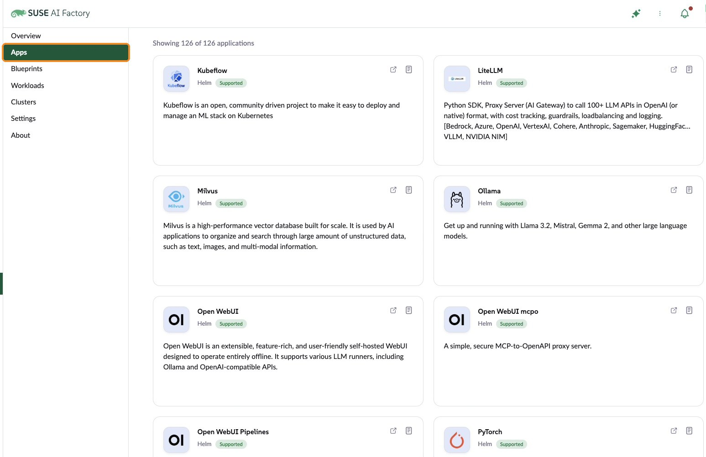

NVIDIA [AI Cluster Runtime](https://github.com/NVIDIA/aicr) (AICR) captures known-good
combinations of GPU drivers, operators and system settings as version-locked
**recipes**, then turns a recipe into a deployable **bundle**. Until now, those bundles
targeted Helm, Argo CD, Flux, Helmfile and Terraform.

[AICR v1.1.0](https://github.com/NVIDIA/aicr/releases/tag/v1.1.0), released today,
adds two features I contributed, both named in the release's opening line:

- **A Rancher Fleet deployer**, so Rancher users can roll an NVIDIA-validated GPU stack
  out to many clusters with Fleet ([aicr#3043](https://github.com/NVIDIA/aicr/pull/3043)).
- **SUSE Linux Enterprise Server on RKE2**, including SUSE's precompiled NVIDIA driver
  containers ([aicr#3040](https://github.com/NVIDIA/aicr/pull/3040)).

## The Fleet deployer

```bash
aicr bundle --recipe recipe.yaml --deployer fleet \
  --repo https://github.com/my-org/gpu-fleet.git \
  --output ./bundles
```

Fleet is Rancher's GitOps engine: it watches a Git repository, or a set of HelmOp
objects, and installs what it finds onto every matching downstream cluster. AICR's deployer
supports both styles:

| Mode | Flag | Output | Best for |
|---|---|---|---|
| GitRepo (default) | `--fleet-mode gitrepo` | one `fleet.yaml` per component folder, plus a root `gitrepo.yaml` | committing the bundle to Git |
| HelmOp | `--fleet-mode helmop` | a single `helmops.yaml`, one HelmOp per component, values inlined | applying directly, large charts |

```text
fleet/ (--fleet-mode gitrepo)        fleet/ (--fleet-mode helmop)
  001-cert-manager/                    001-cert-manager/
    values.yaml ...                    002-nfd/
    fleet.yaml                         helmops.yaml
    .fleetignore                       recipe.yaml
  002-nfd/                             bundle-info.yaml
  gitrepo.yaml                         checksums.txt
  recipe.yaml                          README.md
  bundle-info.yaml
  checksums.txt
  README.md
```

How it fits Fleet's model:

- **Installation order:** each component's bundle `dependsOn` the previous one, so Fleet
  installs strictly in recipe order and starts each component only after its
  predecessor is `Ready`.
- **Opt-in targeting:** clusters receive the stack only when labeled
  `aicr.nvidia.com/bundle=<app-name>`. Nothing lands on a cluster by accident.
- **Workspaces:** `--fleet-namespace` defaults to `fleet-default`, which targets
  downstream clusters; use `fleet-local` for Rancher's own cluster.
- **Install-time values:** `--dynamic` works through per-folder `cluster-values.yaml`.
- **Upgrade checks:** `aicr upgrade-check --from cluster --deployer fleet` reads the Helm
  releases that Fleet's agent wrote on the downstream cluster.

### Why there are two modes

I found this one the hard way while testing against a real Rancher cluster. In GitRepo
mode, Fleet embeds each Helm chart in a Bundle object. kube-prometheus-stack compresses
to about 1.4 MB, which deploys fine from a GitRepo but is rejected when `fleet apply`
posts it through Rancher's 1 MiB request-body limit. HelmOps *reference* charts instead
of embedding them, so chart size stops mattering. In exchange, HelmOp mode
can't carry local charts or raw manifests, and it needs Fleet v0.13 or later.

## SLES on RKE2

```bash
aicr recipe --service rke2 --os sles --accelerator h100 --intent training -o recipe.yaml
```

SLES support adds `--os sles`, an `os-sles` mixin, and a shared `rke2-sles` base that
matches SUSE's documented GPU Operator setup on RKE2:

- SUSE's **precompiled NVIDIA driver containers** from the SUSE registry, instead of
  compiling the driver on every node.
- The NVIDIA Container Toolkit pointed at **RKE2's own containerd socket**.

I validated it on three Ampere Altra nodes running SLES 16 and RKE2 with NVIDIA A2
GPUs. Note that AICR marks RKE2 recipes as **Preview**: an early-adopter path, not yet
fully qualified for production support.

## NVSentinel and GPU Operator fixes

Deploying AICR's full stack on RKE2 surfaced a few problems in neighboring projects,
which I fixed upstream too:

- **[NVSentinel#1949](https://github.com/NVIDIA/NVSentinel/pull/1949) (merged):**
  NVSentinel's metadata collector couldn't start on clusters where the GPU Operator runs
  its NRI plugin, because that mode removes the `nvidia` runtime class it relied on. The
  collector can now request GPU access through a CDI device annotation instead. AICR
  v1.1.0 already builds on it: a maintainer follow-up
  ([aicr#3254](https://github.com/NVIDIA/aicr/pull/3254)) turns NRI mode on in RKE2
  recipes.
- **[NVSentinel#1956](https://github.com/NVIDIA/NVSentinel/pull/1956) (merged):** NIC
  topology parsing failed on single-GPU nodes, such as my A2 servers.
- **[gpu-operator#2988](https://github.com/NVIDIA/gpu-operator/pull/2988) (merged):** the
  GPU Operator now reports *which* operands are blocking a cluster's readiness, instead
  of just "not ready".

Still in review:

- [NVSentinel#1958](https://github.com/NVIDIA/NVSentinel/pull/1958): a guide for
  deploying NVSentinel on SUSE Linux Enterprise and RKE2.
- [NVSentinel#1959](https://github.com/NVIDIA/NVSentinel/pull/1959): SELinux options for
  enforcing nodes.
- [NVSentinel#1957](https://github.com/NVIDIA/NVSentinel/pull/1957): a design proposal
  for host diagnostics that don't depend on a cloud provider.

## What's next

On the Rancher side, I've proposed an importer for
[SUSE AI Factory](https://github.com/SUSE/aif) that turns AICR bundles into AI Factory
Blueprints ([aif#296](https://github.com/SUSE/aif/pull/296)), so an NVIDIA-validated
GPU stack becomes a one-click install from the Rancher UI.

SUSE AI Factory already offers a catalog of AI applications in Rancher, from Kubeflow
and Milvus to Ollama and Open WebUI, under its **Apps** menu. Blueprints build on that
catalog by grouping apps into a stack, which is where an imported AICR GPU stack would
live:

 It's in review, along with a
change that orders Blueprint components the same way the Fleet deployer does
([aif#298](https://github.com/SUSE/aif/pull/298)).

## Thanks

Thank you to the AICR maintainers, especially [Mark Chmarny](https://github.com/mchmarny),
[Yuan Chen](https://github.com/yuanchen8911) and
[Brian Lockwood](https://github.com/lockwobr), whose detailed reviews made the Fleet
deployer much better than my first draft. Thanks also to
[Lalit Adithya](https://github.com/lalitadithya) for NVSentinel and
[Rahul Sharma](https://github.com/rahulait) for the GPU Operator.
