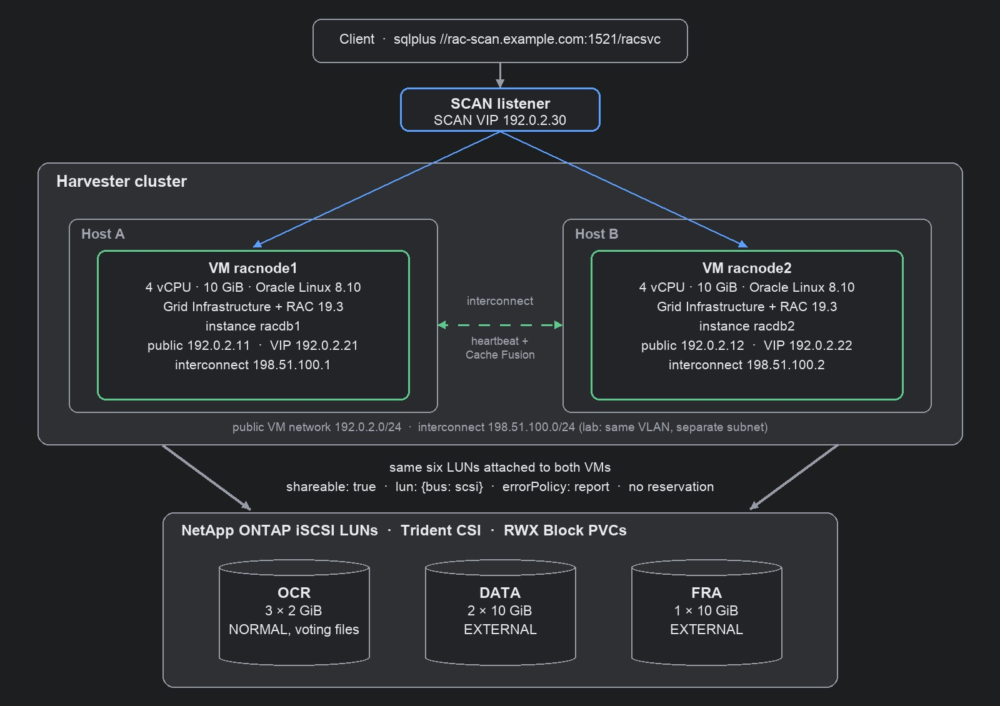
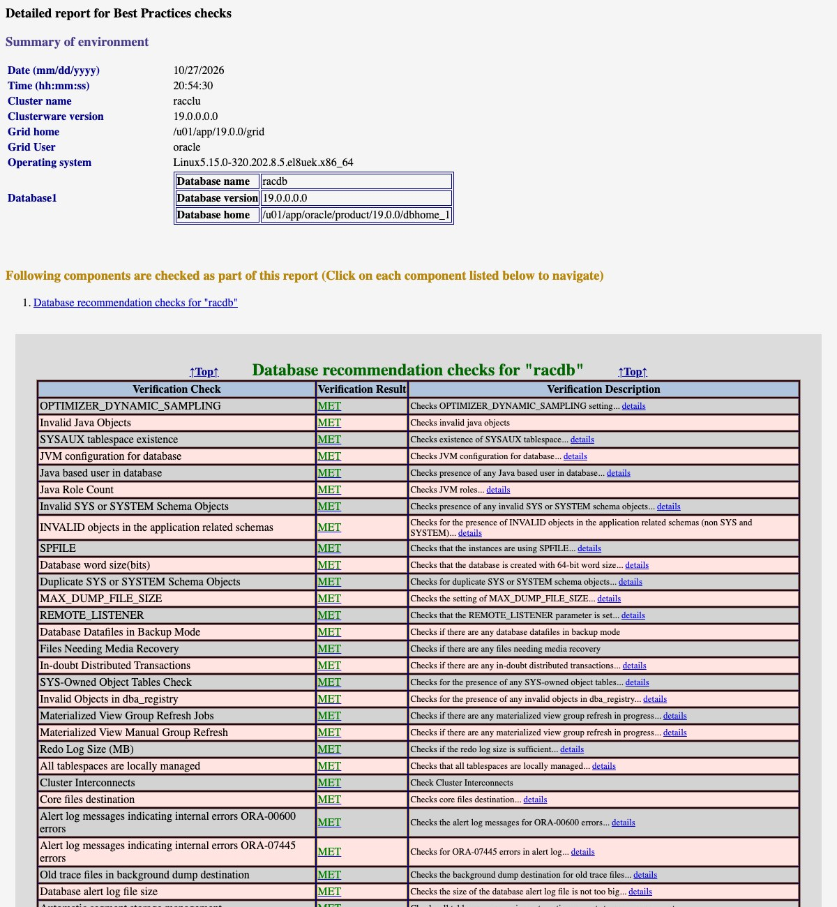

**TL;DR**

- Oracle Real Application Clusters (RAC) 19c runs as two Harvester VMs, one per host, with all cluster storage on
  NetApp iSCSI LUNs attached to **both** VMs as shared `lun` passthrough disks.
- RAC doesn't use SCSI-3 persistent reservations, so the shared disks are attached **without**
  `reservation: true`. Oracle Clusterware fences through its voting disks and network heartbeat.
- Force-stopping one VM from Harvester: the node is evicted after **31 s**, its virtual IP (VIP) and the SCAN VIP
  answer on the survivor at **32.7 s**, and new sessions through SCAN are served again at **38.5 s**.
- Oracle's own health check passes **33 of 33** database checks and 12 of 13 cluster checks (the miss is jumbo
  frames on the interconnect).
- Only one step is Harvester-specific: match the ASM disks on the LUN's WWN in udev, because KubeVirt's disk
  `serial:` doesn't apply to `lun` passthrough. Everything else that needed a workaround comes from installing the
  19.3 base release on Oracle Linux 8.

Customers moving database clusters off VMware usually ask the same question first: can the shared disks a RAC
cluster needs live on Harvester? They can. Two VMs on two Harvester hosts run Grid Infrastructure and a RAC
database on NetApp LUNs that both VMs write to at the same time, and the cluster survives losing a host-side VM in
under 40 seconds.

## Setup

| Component | Version / size |
|---|---|
| Harvester | v1.9.0 (KubeVirt 1.8.4), 2 hosts used |
| Guest OS | Oracle Linux 8.10 KVM template |
| Oracle | Grid Infrastructure and Database 19.3.0 Enterprise Edition |
| RAC VMs | 2 x (4 vCPU, 10 GiB RAM, 100 GiB root disk), one per Harvester host |
| Shared storage | NetApp ONTAP iSCSI LUNs through Trident CSI, RWX Block PVCs |



ASM disk groups (Automatic Storage Management) sit on six shared LUNs:

| Disk group | LUNs | Size each | Redundancy | Contents |
|---|---|---|---|---|
| OCR | 3 | 2 GiB | NORMAL | Oracle Cluster Registry and 3 voting files |
| DATA | 2 | 10 GiB | EXTERNAL | database files |
| FRA | 1 | 10 GiB | EXTERNAL | fast recovery area |

## Step 1: Attach the LUNs to both VMs

Each LUN is a ReadWriteMany Block PVC from the NetApp StorageClass. Both VMs reference the same PVCs. Three fields
matter on each shared disk:

```yaml
devices:
  disks:
  - name: ocr1              # same for ocr2/3, data1/2, fra1
    shareable: true         # attached to both RAC VMs
    errorPolicy: report     # errors go to the guest, VM keeps running
    lun: {bus: scsi}        # SCSI passthrough, no reservation
  interfaces:
  - {name: public,  bridge: {}, model: virtio}
  - {name: private, bridge: {}, model: virtio}   # RAC interconnect
```

`errorPolicy: report` is the setting to remember. With the default (`stop`), any I/O error pauses the whole VM.
A clustered database has to see the error and handle it itself.

Run the two VMs on different Harvester hosts with node affinity, and give each a fixed MAC address and static IPs.

## Step 2: Let udev find the disks by WWN

With `lun` passthrough the guest sees the array's own SCSI identity, so both VMs see the same NetApp WWNs:

```console
$ lsblk -d -o NAME,SIZE,VENDOR,MODEL,WWN        # identical on racnode1 and racnode2
NAME SIZE VENDOR   MODEL            WWN
sda    2G NETAPP   LUN C-Mode       0x600a0980…3543
sdb   10G NETAPP   LUN C-Mode       0x600a0980…352d
sdc   10G NETAPP   LUN C-Mode       0x600a0980…3544
sdd   10G NETAPP   LUN C-Mode       0x600a0980…3542
sde    2G NETAPP   LUN C-Mode       0x600a0980…3541
sdf    2G NETAPP   LUN C-Mode       0x600a0980…3539
```

KubeVirt's `serial:` field only applies to emulated disks, so it isn't visible here. A udev rule per LUN keys on the
WWN instead, which is also what Oracle recommends on bare metal: it's stable and identical on every node.

```text
KERNEL=="sd*", SUBSYSTEM=="block", ENV{DEVTYPE}=="disk", ENV{ID_SERIAL}=="3600a0980…3543", SYMLINK+="oracleasm/ocr1", OWNER="oracle", GROUP="asmadmin", MODE="0660", ATTR{queue/scheduler}="mq-deadline"
```

ASM then uses `/dev/oracleasm/*` as its disk string.

## Step 3: Install Grid Infrastructure and the database

A standard silent RAC install works unchanged: `gridSetup.sh` with a response file, `root.sh` on each node,
the database software with `runInstaller`, then `dbca` for a container database (CDB) with one pluggable database
(PDB). `root.sh` needed no changes on Harvester.

| Step | Time |
|---|---|
| Grid Infrastructure software (silent) | ~6 min |
| `root.sh` node 1 / node 2 | 8 min / 3 min |
| Database software (silent) | ~5 min |
| `dbca` RAC CDB + 1 PDB | ~50 min |

```console
$ sqlplus system@//rac-scan.example.com:1521/racsvc
SQL> select inst_id, instance_name, host_name, status from gv$instance order by 1;
   INST_ID INSTANCE_NAME    HOST_NAME              STATUS
---------- ---------------- ---------------------- ------------
         1 racdb1           racnode1.example.com   OPEN
         2 racdb2           racnode2.example.com   OPEN
```

## Step 4: Validate

Oracle's Cluster Verification Utility (CVU) ships a health check with best-practice rules:

```console
$ cluvfy comp healthcheck -collect database -bestpractice -html
$ cluvfy comp healthcheck -collect cluster -bestpractice -html
```

| Scope | Result |
|---|---|
| Database | 33 of 33 checks met |
| Cluster | 12 of 13 met; not met: jumbo frames on the interconnect |



## Failover: force-stop a node

With an insert running through SCAN every two seconds, one RAC VM was force-stopped from Harvester
(`virtctl stop --force --grace-period 0`, the same as **Force Stop** in the UI):

| Seconds | Event |
|---|---|
| 0 | Force Stop of racnode1 |
| 15.6 | CSS: heartbeat missing for 50% of the timeout |
| 31.0 | racnode1 removed from the cluster |
| 32.7 | racnode1's VIP and the SCAN VIP answer on racnode2 |
| 32.9 | racdb2 finished instance recovery |
| 38.5 | first new session through SCAN, served by racdb2 |

```console
CRS-1612: Network communication with node racnode1 (1) has been missing for 50% of the timeout interval.
CRS-1632: Node racnode1 is being removed from the cluster in cluster incarnation 688599014
CRS-1601: CSSD Reconfiguration complete. Active nodes are racnode2 .
```

Eviction at 31 s matches Clusterware's default heartbeat timeout (`misscount`, 30 s). After a restart, racnode1 rejoined
the cluster in 74 s and served sessions again about 2.5 minutes after it was started.

## Planned maintenance: roll, don't migrate

KubeVirt reports the RAC VMs as live-migratable, because no persistent reservations are involved. With KubeVirt's
default settings, a live migration of a RAC VM under a steady insert load didn't converge: the guest dirtied memory
about as fast as it was copied (about 450 vs 480 Mbit/s), and the migration gave up after six minutes. RAC didn't
notice: no missed heartbeats, 194 of 194 inserts succeeded, and the VM kept running on its original host.

For planned host maintenance, use the same rolling procedure as on bare metal instead: drain and stop one instance
with Clusterware (`srvctl stop instance -node racnode1 -drain_timeout <seconds>`), let Harvester shut that VM down,
service the host, start the VM again and let the instance rejoin, then do the next node. Clients keep working
through SCAN on the remaining instance. To make Harvester's maintenance mode shut a RAC VM down and start it again
afterwards, instead of trying to migrate it, label the VM:

```yaml
metadata:
  labels:
    harvesterhci.io/maintain-mode-strategy: ShutdownAndRestartAfterDisable
```

## A note on versions

19.3 is the 2019 base release of 19c. Oracle Linux 8 support arrived later in the 19c Release Updates, so
installing the base release on OL8 needs a few workarounds:

| Symptom | Workaround used | Avoid it with |
|---|---|---|
| Installer rejects the OS | `CV_ASSUME_DISTID=OL7` | a 19c Release Update applied at install time (`-applyRU`) |
| Remote copy fails with OpenSSH 8 | `scp -T` wrapper (MOS 2555697.1) | a current Release Update |
| Prerequisite checks fail on `compat-libcap1` and `ntpd` (chrony keeps time) | ignore those checks | a current Release Update |

None of these are caused by Harvester. A matched pairing, 19c with a current Release Update or a newer Oracle release
on its certified OS, installs without them.

Two choices in this setup are lab shortcuts, not recommendations: one SCAN IP instead of three in DNS, and the
interconnect on the same VLAN as the public network (which is also why the jumbo-frame check fails). In production,
put the interconnect on its own Harvester VM network.

## Takeaways

- RAC on Harvester needs shared `lun` disks with `errorPolicy: report`, and no persistent reservations.
- Match ASM disks on the LUN WWN; KubeVirt's `serial:` doesn't reach `lun` passthrough.
- Losing a node costs about 40 s of new connections, which is Clusterware's own timeout, not anything added by the
  hypervisor.
- For host maintenance, roll through the RAC nodes and label the VMs
  `harvesterhci.io/maintain-mode-strategy: ShutdownAndRestartAfterDisable` rather than live-migrating them.
- Use a matched Oracle and OS pairing, and the installer needs no workarounds.

## Addendum: guest settings used

Settings applied in both RAC VMs, with the reason for each. Most of them come from Oracle's installation guide or
from the CVU health check, and apply to any RAC deployment, virtual or not.

| Area | Setting | Why |
|---|---|---|
| Packages | `oracle-database-preinstall-19c` | creates the `oracle` user and groups, kernel parameters and limits |
| Users | one software owner (`oracle`) for Grid Infrastructure and Database, plus the `asmadmin`/`asmdba`/`asmoper` groups | lab simplification; production usually separates a `grid` owner |
| SSH | passwordless SSH for the software owner between both nodes, short names, FQDNs and IPs | required by the installer and by Clusterware tools |
| Swap | 12 GiB (4 GiB from the image plus an 8 GiB swap file) | Oracle asks for swap equal to RAM on 2-16 GiB hosts |
| Memory | Transparent HugePages off (`transparent_hugepage=never` on the kernel command line) | Oracle recommendation for database hosts |
| Memory | HugePages for the SGA (`vm.nr_hugepages=1100` for a 2 GiB SGA) | keeps the SGA in pinned large pages; allocate at boot, or drop caches before setting it at runtime |
| Time | chrony | keeps time; Oracle's Cluster Time Synchronization Service runs in observer mode |
| DNS | a resolver that returns the SCAN and node names, plus all names in `/etc/hosts` | CVU checks that SCAN, VIPs and nodes resolve |
| Disks | udev rules on the LUN WWN: `/dev/oracleasm/<name>`, owner `oracle:asmadmin`, mode 0660 | stable ASM device names on both nodes |
| Disks | I/O scheduler `mq-deadline` on the ASM LUNs (in the same udev rule) | CVU recommends deadline for ASM disks; the guest default is `none` |
| Database | `filesystemio_options=setall` | health-check recommendation (ASM already does direct and asynchronous I/O) |
| Network | public and interconnect on separate subnets, MTU 1500 | lab shortcut: same VLAN; use a dedicated interconnect network with jumbo frames in production |

Prerequisite checks that still report on this install, and why:

| Check | Status | Reason |
|---|---|---|
| NTP (`ntpd` not running) | ignored | 19.3's CVU only knows `ntpd`; chrony is running (version pairing) |
| `compat-libcap1` | ignored | OL7-only package, checked because of `CV_ASSUME_DISTID=OL7` (version pairing) |
| SCAN resolves to 3 IPs | warning | lab uses one SCAN IP |
| Jumbo frames on the interconnect | not met | interconnect shares a 1500-MTU network in the lab |

Oracle software was used under its development and test license. Shared NetApp storage on Harvester is covered in
[NetApp Trident on Harvester](/posts/netapp-trident-harvester-yamls/).
