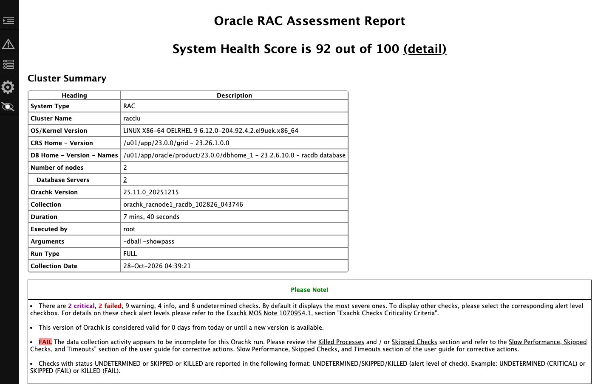

**TL;DR**

- Shared disks can be attached in two ways, and both were tested on the same cluster: **SCSI passthrough**
  (`lun:`, like a VMware RDM) or **emulated shareable disks with a serial** (`disk:` + `serial:`, like VMware
  multi-writer VMDKs). Switching between them is a VM spec change plus new udev rules, with no reinstall.
- This lab reuses the infrastructure of the [19c RAC lab](/posts/oracle-rac-19c-harvester/): two Harvester VMs with
  their network configuration and six shared NetApp LUNs. Only the guest OS changes, from Oracle Linux 8.10 to
  **Oracle Linux 9.8** (UEK8), which is certified for Oracle AI Database **26ai** (23.26.1).
- On a certified OS, Grid Infrastructure and the database install without any of the 19c workarounds. The
  pre-installation check (`cluvfy`) reports **0 failures and 0 warnings**; the only installer warning left is the
  lab's single SCAN address.
- When either VM is force-stopped from Harvester, Clusterware evicts the node after **~31 s**, moves its VIP and the
  SCAN VIP to the surviving node after **~33 s**, and accepts new SCAN sessions again after **~38 s**. These are the
  19c timings, set by Clusterware's 30 s heartbeat timeout rather than by the hypervisor.
- **ORAchk 25.11**, included with 26ai, rates the cluster **92/100**. One of its failures, for Transparent
  HugePages, contradicts Oracle's 26ai installation guide.
- For Oracle licensing, Harvester is *soft partitioning*: every core of every host that can run a RAC VM needs a
  licence. Required node affinity, disabled live migration and a maintenance-mode label keep that set of hosts small
  and auditable.

The 19c lab showed that RAC's shared disks work on Harvester. It also needed several installer workarounds, none of
them caused by Harvester: they came from installing the 2019 base release of 19c on Oracle Linux 8, which 19c
supports only from a later Release Update. This post repeats the build with the current Oracle release on its certified OS, to separate
platform issues from version issues.

## Lab environment

| Component | 19c lab | 26ai lab (this post) |
|---|---|---|
| Harvester | v1.9.0, 2 hosts used | same |
| Guest OS | Oracle Linux 8.10, UEK7 5.15 | **Oracle Linux 9.8, UEK8 6.12** (`OL9U8_x86_64-kvm-b293`) |
| Oracle | GI + Database 19.3.0 EE | **GI + Database 23.26.1 EE** (Oracle AI Database 26ai) |
| Preinstall RPM | `oracle-database-preinstall-19c` | `oracle-ai-database-preinstall-26ai` |
| RAC VMs | 2 x (4 vCPU, 10 GiB, 100 GiB root), one per host | same VMs, same MACs and IPs, new root disks |
| Shared storage | 6 NetApp iSCSI LUNs (Trident, RWX Block PVCs) | same PVCs, ASM headers wiped |


### Two ways to attach the shared disks

Both RAC VMs reference the same six ReadWriteMany Block PVCs. KubeVirt can present each PVC to the guest in one of two
ways, which correspond to the two common ways of attaching RAC storage on VMware:

| | Option A: SCSI passthrough | Option B: emulated shareable disk |
|---|---|---|
| VMware equivalent | Raw Device Mapping (RDM) | multi-writer VMDK |
| VM disk spec | `lun: {bus: scsi}` | `disk: {bus: scsi}` + `serial: <name>` |
| QEMU device | `scsi-block` | `scsi-hd`, cache `none` |
| Guest sees | array's vendor, serial and WWN (`NETAPP LUN C-Mode`) | `QEMU HARDDISK` with the serial from the VM spec |
| udev rule matches | the LUN's WWN, read from the storage system | the serial, chosen in the VM spec |
| SCSI-3 persistent reservations | refused without `reservation: true` | not implemented |
| Storage backends | SAN LUNs passed through | any RWX Block storage Harvester allows for shareable disks (not Longhorn) |

Both options use `shareable: true`, `errorPolicy: report` and **no** `reservation`. RAC doesn't use SCSI-3
persistent reservations; Clusterware fences nodes through its voting files and network heartbeat.

```yaml
# Option A: SCSI passthrough (RDM-like)
- name: ocr1                # same for ocr2/3, data1/2, fra1
  shareable: true
  errorPolicy: report
  lun: {bus: scsi}
# Option B: emulated shareable disk (multi-writer-VMDK-like)
- name: ocr1
  shareable: true
  errorPolicy: report
  serial: ocr1              # visible in the guest as the disk serial
  disk: {bus: scsi}
```

In the guest, `sg_persist` confirms that neither option offers a reservation path:

```console
$ sudo sg_persist -k /dev/oracleasm/ocr1          # Option A
PR in (Read keys): Aborted command
sg_persist failed: Aborted command
  NETAPP    LUN C-Mode        9161
  Peripheral device type: disk
$ sudo sg_persist -k /dev/oracleasm/ocr1          # Option B
PR in (Read keys): command not supported
sg_persist failed: Illegal request, Invalid opcode
  QEMU      QEMU HARDDISK     2.5+
  Peripheral device type: disk
```

I installed the cluster on Option A, then switched the same cluster to Option B: stop the database and Clusterware,
stop both VMs, change the six disk entries, start the VMs, and replace the udev rules. ASM found the same disks (the
voting files kept their IDs), and the data was unchanged. No reinstall is needed in either direction.

**Performance.** I didn't benchmark the two options. Passthrough is expected to have less overhead: QEMU hands SCSI
commands directly to the host's iSCSI device, while the emulated disk sends every request through QEMU's block
layer. Measure with your own storage and workload before choosing on performance alone.

## Step 1: Replace the guest OS and keep the shared storage

Moving the cluster to Oracle Linux 9 takes three changes in Harvester:

1. Import the OL 9.8 KVM template as a Harvester image (`sourceType: download`).
2. Delete the two VMs and their root disk PVCs, but **keep** the six shared LUN PVCs.
3. Recreate the VMs from the same generator with the new image: same names, MAC addresses, static IPs, node affinity
   and DHCP reservations.

Before installing, clear the old 19c ASM disk headers by zeroing the start of each LUN:

```bash
for d in /dev/oracleasm/*; do dd if=/dev/zero of=$d bs=1M count=100 oflag=direct; done
```

Grid Infrastructure identifies the public and private networks by interface name (`networkInterfaceList`), so the
names must be identical on every node. Pin them by MAC address in the cloud-init network configuration:

```yaml
ethernets:
  eth0: {match: {macaddress: "<public-mac>"}, set-name: eth0, addresses: ["192.0.2.11/24"]}
  eth1: {match: {macaddress: "<private-mac>"}, set-name: eth1, addresses: ["198.51.100.1/24"]}
```

## Step 2: Configure the guest OS for 26ai

Oracle's *Grid Infrastructure Installation and Upgrade Guide 26ai for Linux* changes several recommendations that
applied to 19c. Settings carried over from the 19c lab had to be adjusted:

| Setting | 19c lab | 26ai guide says | Used now |
|---|---|---|---|
| Transparent HugePages | `never` | **`madvise`** on UEK7 and later, "not disable ... as was recommended in prior releases" | `transparent_hugepage=madvise` on the kernel command line |
| I/O scheduler on ASM disks | `mq-deadline` (CVU wanted it) | `none` for SSD/NVMe, `mq-deadline` for rotating disks | `none`: the LUNs report `rotational=0` |
| ASM device group | `asmadmin` | OSDBA for ASM (`asmdba`), as in the guide's udev example | `GROUP="asmdba"` |
| Time sync | chrony, CTSS observer | chrony or ntpd required: **CTSS is desupported** | chrony |
| nscd | off | enable it | on |

Persistent ASM device names come from udev, and the rule depends on the attachment option. With Option A the guest
sees the array's SCSI identity, not KubeVirt's disk `serial:`, so the rule matches the LUN's WWN. With Option B the
rule matches the serial set in the VM spec, so no lookup on the storage system is needed:

```text
# Option A: match the LUN WWN
KERNEL=="sd*", SUBSYSTEM=="block", ENV{DEVTYPE}=="disk", ENV{ID_SERIAL}=="3600a0980…3543", SYMLINK+="oracleasm/ocr1", OWNER="oracle", GROUP="asmdba", MODE="0660", ATTR{queue/scheduler}="none"
# Option B: match the KubeVirt serial
KERNEL=="sd*", SUBSYSTEM=="block", ENV{DEVTYPE}=="disk", ENV{ID_SERIAL}=="0QEMU_QEMU_HARDDISK_ocr1", SYMLINK+="oracleasm/ocr1", OWNER="oracle", GROUP="asmdba", MODE="0660", ATTR{queue/scheduler}="none"
```

Kernel device names differ between the nodes (`fra1` was `sdf` on one VM and `sdd` on the other), so always match an
identifier, never a `sdX` name.

Two settings needed extra attention:

- **Device ownership on first boot.** udev loads its rules before cloud-init creates the Oracle groups, so the
  devices kept `root:disk` ownership. Reloading the rules (`udevadm control --reload-rules`) isn't enough; restart
  `systemd-udevd` instead. Later boots are unaffected because the groups already exist.
- **Transparent HugePages across reboots.** According to the guide, the preinstallation RPM sets THP to `madvise`,
  but `oracle-ai-database-preinstall-26ai-1.0-3` contains no such setting, and THP returns to `always` after a
  reboot. Set the kernel argument explicitly:

```bash
grubby --update-kernel=ALL --args=transparent_hugepage=madvise
```

Other memory settings follow the guide: 1100 HugePages (2 MiB each) for a 2 GB SGA, swap of at least RAM minus
HugePages, and `memlock` above 90% of RAM.

## Step 3: Install Grid Infrastructure and the database

**Pre-installation check.** `runcluvfy.sh` verifies memory, swap, users and groups, limits, kernel parameters,
packages, connectivity, multicast and time synchronization:

```console
$ ./runcluvfy.sh stage -pre crsinst -n racnode1,racnode2 -verbose
...
  Physical Memory ...PASSED
  Swap Size ...PASSED
  OS Kernel Version ...PASSED
  OS Kernel Parameter: semmsl ...PASSED
  ...
  Node Connectivity ...PASSED
  Multicast or broadcast check ...PASSED
  Network Time Protocol (NTP) ...PASSED

Pre-check for cluster services setup was successful.
CVU version:                  23.26.1.0.0 (010926x8664)
Operating system:             Linux6.12.0-204.92.4.2.el9uek.x86_64
```

On Oracle Linux 8 with 19.3, seven checks failed at this stage. With 26ai on Oracle Linux 9, none fail.

**Response files.** 26ai response files use flat keys such as `installOption`, `clusterUsage` and `diskList`. The
dotted keys from earlier releases still work but are deprecated. Grid Infrastructure response file for this cluster:

```properties
oracle.install.responseFileVersion=/oracle/install/rspfmt_crsinstall_response_schema_v23.0.0
installOption=CRS_CONFIG
clusterUsage=RAC
ORACLE_BASE=/u01/app/grid
OSDBA=asmdba
OSOPER=asmoper
OSASM=asmadmin
scanType=LOCAL_SCAN
scanName=rac-scan.example.com
clusterName=racclu
clusterNodes=racnode1.example.com:racnode1-vip.example.com,racnode2.example.com:racnode2-vip.example.com
networkInterfaceList=eth0:192.0.2.0:1,eth1:198.51.100.0:5
storageOption=FLEX_ASM_STORAGE
diskGroupName=OCR
redundancy=NORMAL
auSize=4
diskList=/dev/oracleasm/ocr1,/dev/oracleasm/ocr2,/dev/oracleasm/ocr3
diskString=/dev/oracleasm/*
managementOption=NONE
```

In the dbca response file, specify disk groups without the `+` prefix (`diskGroupName=DATA`,
`recoveryGroupName=FRA`).

**Installation sequence.** Run `gridSetup.sh -silent`, then `root.sh` on the first node, and on the second node only
after the first completes. Oracle's guide requires that order, although the installer says the scripts can run in
parallel. Then run `gridSetup.sh -executeConfigTools`, create the DATA and FRA disk groups with `asmca`, install the
database home with `runInstaller`, and create the database with `dbca`.

```console
CLSRSC-4002: Successfully installed Oracle Autonomous Health Framework (AHF).
CLSRSC-343: Successfully started Oracle Clusterware stack
CLSRSC-325: Configure Oracle Grid Infrastructure for a Cluster ... succeeded
```

| Step | 19.3 on OL 8.10 | 26ai on OL 9.8 |
|---|---|---|
| Workarounds | `CV_ASSUME_DISTID=OL7`, `scp -T` wrapper, `-ignorePrereqFailure` | **none** |
| `cluvfy stage -pre crsinst` | 7 failing checks | **passed, 0 failures, 0 warnings** |
| `root.sh` node 1 / node 2 | 8 min / 3 min | **3 min 43 s / ~1.5 min**, including the AHF install |
| `gridSetup.sh -executeConfigTools` | exit code 255 (INS-43080: SCAN DNS + ntpd post-check) | **exit code 0**, post-install check passed |
| `dbca` RAC CDB + 1 PDB | ~50 min | **~23 min** |
| Remaining warning | SCAN resolves to 1 IP | SCAN resolves to 1 IP |

A single SCAN address is a lab simplification; production clusters use three addresses in DNS. It's the only
prerequisite warning in the 26ai installation. dbca also reports that the 8 GB fast recovery area is smaller than
three times the database size.

## Step 4: Verify the cluster and the database

```console
$ crsctl check cluster -all
**************************************************************
racnode1:
CRS-4537: Cluster Ready Services is online
CRS-4529: Cluster Synchronization Services is online
CRS-4533: Event Manager is online
**************************************************************
racnode2:
CRS-4537: Cluster Ready Services is online
CRS-4529: Cluster Synchronization Services is online
CRS-4533: Event Manager is online
**************************************************************
$ crsctl query css votedisk
##  STATE    File Universal Id                File Name Disk group
--  -----    -----------------                --------- ---------
 1. ONLINE   4d6fce95658a4f28bf31ca03713bbfb8 (/dev/oracleasm/ocr3) [OCR]
 2. ONLINE   d2c2912a972f4f10bf6163b4a1dbc9a8 (/dev/oracleasm/ocr1) [OCR]
 3. ONLINE   e6188191653d4fd6bf02e74ab93ba6c3 (/dev/oracleasm/ocr2) [OCR]
Located 3 voting disk(s).
$ srvctl status database -db racdb -verbose
Instance racdb1 is running on node racnode1 with online services racdb_pdb1,racsvc. Instance status: Open,HOME=/u01/app/oracle/product/23.0.0/dbhome_1.
Instance racdb2 is running on node racnode2 with online services racdb_pdb1,racsvc. Instance status: Open,HOME=/u01/app/oracle/product/23.0.0/dbhome_1.
```

Both ASM instances see all six shared disks:

```console
SQL> select inst_id, path, header_status, mode_status, state from gv$asm_disk order by path, inst_id;
   INST_ID PATH                   HEADER_STATU MODE_ST STATE
---------- ---------------------- ------------ ------- --------
         1 /dev/oracleasm/data1   MEMBER       ONLINE  NORMAL
         2 /dev/oracleasm/data1   MEMBER       ONLINE  NORMAL
         1 /dev/oracleasm/data2   MEMBER       ONLINE  NORMAL
         2 /dev/oracleasm/data2   MEMBER       ONLINE  NORMAL
...
         1 /dev/oracleasm/ocr3    MEMBER       ONLINE  NORMAL
         2 /dev/oracleasm/ocr3    MEMBER       ONLINE  NORMAL
12 rows selected.
```

SCAN distributes new sessions across both instances:

```console
conn 1 -> racdb1 on racnode1 con=PDB1
conn 2 -> racdb2 on racnode2 con=PDB1
conn 3 -> racdb1 on racnode1 con=PDB1
conn 4 -> racdb2 on racnode2 con=PDB1

   INST_ID INSTANCE_NAME    HOST_NAME              STATUS       VERSION_FULL
---------- ---------------- ---------------------- ------------ --------------
         1 racdb1           racnode1.example.com   OPEN         23.26.1.0.0
         2 racdb2           racnode2.example.com   OPEN         23.26.1.0.0
```

## Step 5: Test failover with a Harvester Force Stop

This test matches the 19c run. A client on the surviving node opens a new SCAN session and inserts a row about once
per second, and a host on the LAN pings the stopped VM, its VIP and the SCAN VIP every 0.2 s. Harvester force-stops
the VM (`virtctl stop --force --grace-period 0`, equivalent to **Force Stop** in the UI) and restarts it 90 s later.
In both runs the stopped node held the SCAN VIP, which is the worst case.


| Event (seconds after Force Stop) | racnode1 stopped | racnode2 stopped | 19c (racnode1) |
|---|---|---|---|
| CRS-1612: heartbeat missing for 50% of the timeout | +17 | +16 | +15.6 |
| CRS-1632: node removed from the cluster | **+31.4** | **+30.9** | +31.0 |
| Instance recovery of the dead node's redo thread done | +33.5 | +32.4 | +32.9 |
| VIP and SCAN VIP answer on the survivor | +35.2 (33.8 s without replies) | +33.6 (32.5 s without replies) | +32.7 |
| First new SCAN session served | **+38.2** | **+37.6** | +38.5 |
| After restart: node back in the cluster | 81 s | 79 s | 74 s |
| After restart: its instance serving again | 2 min 49 s | 2 min 6 s | ~2.5 min |

Timings come from the surviving node's Grid Infrastructure and database alert logs, the ping logs and the client
log. The Force Stop time was recorded with one-second resolution, so offsets from it are accurate to about ±1 s.
Durations without replies come directly from the ping logs.

After the switch to Option B, the same Force Stop test gave the same result. Measured from the stopped VM's last
ping reply:

| Seconds after the VM stopped responding | Option A, racnode1 | Option A, racnode2 | Option B, racnode1 |
|---|---|---|---|
| Node removed from the cluster | 30.0 | 29.8 | 29.8 |
| Instance recovery done | 32.1 | 31.3 | 31.4 |
| VIP and SCAN VIP answer on the survivor | 33.9 | 32.6 | 32.9 |
| First new SCAN session served | 36.8 | 36.5 | 35.6 |

Live migration of a RAC VM under the insert workload didn't converge with KubeVirt's default settings in either
mode. With Option B it ran for 4 min 40 s and then failed; RAC was unaffected (all inserts succeeded, no heartbeat
warnings). For RAC, roll through the nodes for host maintenance instead, as described in the 19c post.

In 26ai, a new process, `ONMD`, logs the heartbeat messages that `ocssd` logged in earlier releases:

```console
2026-10-28 04:26:41.349 [ONMD(52289)] CRS-1612: Network communication with node racnode1 (1) has been missing for 50% of the timeout interval.
2026-10-28 04:26:48.350 [ONMD(52289)] CRS-1611: Network communication with node racnode1 (1) has been missing for 75% of the timeout interval.
2026-10-28 04:26:53.352 [ONMD(52289)] CRS-1610: Network communication with node racnode1 (1) has been missing for 90% of the timeout interval.
2026-10-28 04:26:55.364 [ONMD(52289)] CRS-1632: Node racnode1 is being removed from the cluster in cluster incarnation 688606344
2026-10-28 04:26:55.490 [ONMD(52289)] CRS-1601: CSSD Reconfiguration complete. Active nodes are racnode2(2) .
```

During the outage, the client received the errors a RAC client typically sees while a node is being evicted:

```console
04:26:25.984 FAIL lat=20.272  ORA-12170     # TNS connect timeout: SCAN VIP is down, client waits 20 s
04:26:47.269 FAIL lat=13.925  ORA-12543     # destination host unreachable
04:27:02.206 ok   lat=0.067   inst=racdb2   # survivor took over the SCAN VIP and the listener
```

When racnode2 was stopped, the SCAN VIP came up about 3 s before the SCAN listener, and three attempts failed with
`ORA-12541` (no listener) before the first success. Every insert that reported success is in the table. My test
client used default connection settings; a shorter connect timeout with retries, or Application Continuity, can
reduce the outage an application sees (not tested here).

## Step 6: Validate the configuration

### Run ORAchk

`root.sh` installs Oracle Autonomous Health Framework (AHF), which includes ORAchk 25.11. The 19c lab only had
the bundled ORAchk 18.4, which ran no checks. A full run on this cluster takes 7 min 40 s:

```console
$ sudo orachk -silentforce -dball -showpass -clusternodes racnode1,racnode2
```



Across both nodes, 171 check results pass, including ASM disk permissions, I/O scheduler, `pam_limits`, network
configuration files, DNS consistency, interconnect naming and software version consistency. One check, "Verify no
orphaned files exist in ASM", exceeded its 90 s timeout on the 4-vCPU guests. ORAchk shows the database home as
"23.2.6.10.0"; the database itself reports `23.26.1.0.0`. Findings that didn't pass:

| Finding | ORAchk | Cause | Fix |
|---|---|---|---|
| Transparent HugePages are not disabled | FAIL | THP is `madvise`, as the 26ai installation guide requires on UEK7+ | none: guide and ORAchk disagree, I follow the guide |
| `rngd` service | FAIL | `rng-tools` isn't in the OL9 KVM template | `dnf install rng-tools && systemctl enable --now rngd` |
| Kernel/user core dump configuration | CRITICAL | kdump disabled in the template | configure kdump and `crashkernel=` |
| ORAchk scheduler across the cluster | CRITICAL | AHF's periodic ORAchk run isn't configured | `orachk -autostart` |
| OCR backup location | WARNING | OCR backups go to the OCR disk group | `ocrconfig -backuploc +FRA` |
| Jumbo frames, NIC bonding for interconnect and VIP | WARNING | lab: one 1500-MTU NIC per network | dedicated interconnect VLAN, MTU 9000, two NICs |
| `ip_local_port_range` | WARNING | preinstall RPM sets 9000-65535, ORAchk wants an upper bound of 65500 | adjust the sysctl |
| `libaio-devel`, `libstdc++-devel` | WARNING | not pulled in by the preinstall RPM | `dnf install` both |
| ASM disk group `compatible.rdbms` | WARNING | `asmca -silent` left DATA and FRA at 19.0.0.0.0 | `-compatible.rdbms 23.0.0.0.0` at creation |
| Database memory allocation | WARNING | 10 GiB guests | lab sizing |

Transparent HugePages is the notable conflict. ORAchk states that "Oracle strongly advises to disable the use of
Transparent HugePages", while the 26ai guide recommends `madvise` and explicitly advises against disabling THP as in
earlier releases. Because the SGA uses standard HugePages, the database memory doesn't use THP in either case.

### Compare the configuration with the installation guide

| Guide requirement | This cluster | Status |
|---|---|---|
| Oracle Linux 9.6+ with UEK8 6.12.0-1.23.3.2 or later | OL 9.8, UEK8 6.12.0-204.92.4.2 | met |
| Oracle AI Database preinstallation RPM | installed | met |
| At least 8 GB RAM | 9.5 GiB | met (minimum) |
| Swap equal to RAM minus HugePages (4-16 GB RAM) | 14 GiB, needed ~7.3 | met |
| At least 1 GB free in `/tmp` | 70 GB | met |
| THP `madvise` on UEK7+, HugePages for all SGAs | `madvise`, 1100 pages, 1016 in use | met |
| `memlock` at least 90% of RAM with HugePages | 128 GiB | met |
| NTP on all nodes, same time zone (CTSS desupported) | chrony, UTC | met |
| nscd enabled | active | met |
| I/O scheduler: `none` for SSD/NVMe | `none` | met |
| Persistent ASM device names, owned by OSDBA for ASM | udev on WWN or serial, `oracle:asmdba` 0660 | met |
| `root.sh` on the first node, then the others | yes | met |
| SCAN: 3 IPs in DNS, or GNS | 1 IP | lab shortcut |
| Interconnect: private, no firewall, jumbo frames, redundant (HAIP) | private subnet, 1500 MTU, one NIC, same VLAN as public | partly (lab) |
| SELinux supported | disabled | lab shortcut |
| Job role separation (`grid` and `oracle` owners) | single `oracle` owner | lab shortcut |
| Supported virtualization (Oracle's virtualization matrix) | Harvester/KubeVirt isn't listed | not certified |

This cluster meets every OS and storage requirement in the guide. A production build would add network redundancy
and role separation. Certification remains open: Harvester isn't listed in Oracle's virtualization matrix.

## Step 7: Restrict the Oracle VMs to licensed hosts

*This is an engineering reading of Oracle's public policy documents, not legal advice. Your Oracle agreement is what
counts; get Oracle's or a licensing specialist's written position before running this in production.*

**Partitioning.** Oracle's Partitioning Policy accepts only the hard-partitioning technologies it names. For KVM
that is Oracle Linux KVM managed by Oracle Linux Virtualization Manager, with cores pinned by its own tool and no live
migration. Harvester (KubeVirt on KVM) isn't on the list, and KubeVirt CPU pinning (`dedicatedCpuPlacement`)
doesn't change that. So this is *soft partitioning*: every physical core of every host where the Oracle VMs are
installed or running has to be licensed. In audits of VMware clusters, Oracle has extended that to every host a VM
*could* run on, according to licensing consultants.

**Node boundary.** Oracle's paper *Running and Licensing Programs in Containers and Kubernetes* recommends node
labels and `nodeSelector` to limit licensing to certain nodes, and says other hosts with access to the same storage
don't count. It covers containers, not VMs, so treat it as a strong argument rather than a guarantee. Make the
boundary hard to cross and easy to audit:

```yaml
# 1. Label only the licensed hosts (add the taint once unlicensed compute nodes exist)
#    kubectl label node <host-a> <host-b> oracle.licensing/licensed=true
# 2. VM: required affinity, no live migration, maintenance mode shuts down instead of migrating
metadata:
  labels:
    oracle.licensing/workload: "true"
    harvesterhci.io/maintain-mode-strategy: ShutdownAndRestartAfterDisable
spec:
  template:
    spec:
      evictionStrategy: None
      affinity:
        nodeAffinity:
          requiredDuringSchedulingIgnoredDuringExecution:
            nodeSelectorTerms:
            - matchExpressions:
              - {key: oracle.licensing/licensed, operator: In, values: ["true"]}
              - {key: kubernetes.io/hostname, operator: In, values: ["<host-a>"]}   # racnode2: <host-b>
```

Supporting controls:

- **Admission policy.** A `ValidatingAdmissionPolicy` rejects Oracle-labelled VMs that lack the affinity,
  `evictionStrategy: None` or the maintenance label, and rejects `VirtualMachineInstanceMigration` objects in the
  Oracle namespace.
- **RBAC.** Only a licensing-admin group may change the node label or export, clone or restore Oracle VMs.
- **Storage.** A Longhorn node tag and StorageClass keep replicas of the root disks (the Oracle homes) on the
  licensed hosts.
- **Evidence.** Keep VM placement history (`kubevirt_vmi_info` metrics, API audit log, daily `kubectl get vmi -o wide`
  snapshots) and the hosts' CPU inventory. Kubernetes events expire after about an hour.

After a host failure, Harvester restarts a VM only on hosts that satisfy its affinity, so a pinned RAC VM stays on
its host. RAC handles the outage itself, as the failover test shows.

**Licence count.** The x86 core factor is 0.5, and RAC must be licensed on every node that runs an instance. Each
of the two hosts has one 8-core AMD Ryzen 9 5900HX:

| Layout | Cores | Processor licences (EE and RAC, each) | Named User Plus minimum |
|---|---|---|---|
| Fenced to 2 hosts | 16 | 8 | 25 per processor = 200 |
| Unfenced, a third 8-core host could run the VMs | 24 | 12 | 300 |

**Licensing considerations in a default installation.**

- **Management packs.** Enterprise Edition enables the Diagnostics and Tuning Packs by default
  (`control_management_pack_access = DIAGNOSTIC+TUNING`, confirmed on this database). Both are extra-cost options.
  If they aren't licensed, set the parameter to `NONE` and review `DBA_FEATURE_USAGE_STATISTICS`.
- **Multitenant.** Up to three user PDBs per CDB are included; more require the Multitenant option.
- **10-day failover rule.** The rule covers one idle standby node, not an active RAC node.
- **Lab licence.** Oracle offers the same 26ai Enterprise Edition download on OTN under the developer licence, for
  non-production development and testing. Oracle AI Database Free doesn't include RAC and can't replace this lab.

## Takeaways

- Attach RAC's shared disks either as SCSI passthrough (`lun:`, RDM-like, udev on the WWN) or as emulated shareable
  disks (`disk:` + `serial:`, multi-writer-VMDK-like, udev on the serial). Failover behaves the same, and a cluster
  can switch between them without reinstalling.
- On a certified OS, 26ai installs without workarounds. Pre-checks pass, and the only warning is the lab's single
  SCAN address.
- Failover timings match 19c: about 31 s to evict a node and about 38 s until new sessions succeed. Clusterware's
  30 s heartbeat timeout sets these values, not Harvester.
- Review the 26ai guide before reusing 19c settings: THP `madvise`, I/O scheduler `none` on SSD-backed LUNs,
  `asmdba` ownership of ASM devices, and chrony instead of CTSS.
- Run the ORAchk included with 26ai (92/100 here) and check its findings against the guide; its THP check
  contradicts it.
- Oracle licensing on Harvester is per host. Pin RAC VMs with required affinity, disable live migration, set the
  maintenance-mode label, and keep placement records.

## Addendum: guest settings used

| Area | Setting | Why |
|---|---|---|
| Packages | `oracle-ai-database-preinstall-26ai`, plus `nscd`, `chrony`, `sg3_utils` | users, groups, kernel parameters and limits; guide requirements |
| Users | one software owner `oracle` with `asmadmin`/`asmdba`/`asmoper` | lab simplification (production separates `grid`) |
| Memory | THP `madvise` (kernel argument), `vm.nr_hugepages=1100`, `use_large_pages=TRUE` | 26ai guide; SGA in HugePages |
| Swap | 4 GiB LVM + 10 GiB swap file | at least RAM minus HugePages |
| Disks | udev on the LUN WWN (Option A) or the KubeVirt serial (Option B), `oracle:asmdba` 0660, scheduler `none` | stable names on both nodes; SSD-backed LUNs |
| Network | `eth0` public, `eth1` interconnect (separate subnet, MTU 1500), names pinned with `set-name` | `networkInterfaceList` needs identical names |
| DNS | public resolvers that return the SCAN and node records, plus `/etc/hosts` | the lab router doesn't serve the cluster zone |
| Database | RAC CDB `racdb` + `pdb1`, SGA 2 GB, PGA 512 MB, service `racsvc` on both instances | lab sizing |

For the shared-disk details and the live-migration test, see
[Oracle RAC 19c on Harvester](/posts/oracle-rac-19c-harvester/). For the NetApp configuration, see
[NetApp Trident on Harvester](/posts/netapp-trident-harvester-yamls/).
