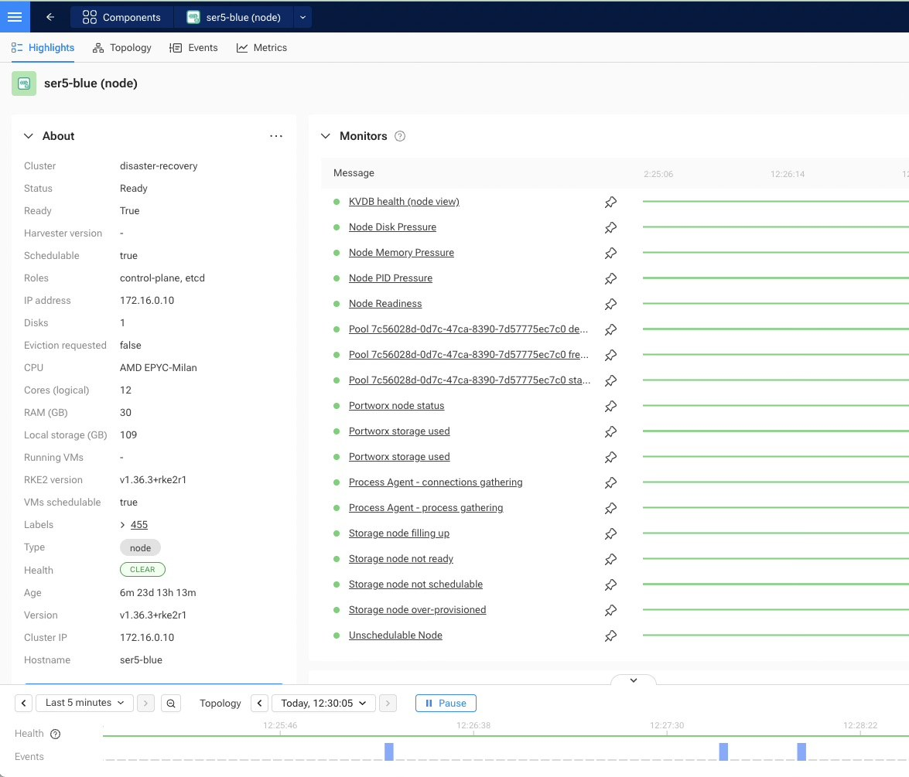

Portworx Enterprise 3.7.1 now runs on a three-node SUSE Virtualization (Harvester) 1.9
cluster in my lab. Each node has exactly one spare SATA SSD, so I split it into a
64 GiB metadata partition and a data partition. Portworx's newer datastore, PX-StoreV2,
accepted that layout even though every example in the docs uses a whole disk. A
sysprepped Windows Server 2022 golden image now lives on a Portworx volume, and a VM
cloned from it live-migrates between nodes in 23 seconds.

This post covers the install step by step, including the parts the Portworx docs
leave out, and explains how the Windows image is built.

## Setup

| Item | Value |
|---|---|
| Nodes | 3× Beelink SER5 mini PCs (6 cores / 12 threads, 28 GiB RAM) |
| OS disk | 512 GB NVMe (SUSE Virtualization) |
| Portworx disk | 1× Samsung 870 EVO 500 GB SATA SSD per node |
| SUSE Virtualization | v1.9.0 (RKE2 v1.36.3, kernel `6.12.0-160000.37-default`) |
| Portworx | Enterprise 3.7.1, operator 26.4.0, internal KVDB |

Pick the Portworx version from the kernel, not the other way round. Portworx's
[supported kernels](https://docs.portworx.com/portworx-enterprise/support-matrix/supported-kernels)
page lists SUSE Linux Micro 6.2 with kernel `6.12.0-160000.37` only for Portworx 3.6.2,
3.7.0 and 3.7.1. Older releases don't list SUSE Linux Micro at all, so compare
`uname -r` on a node against that page first.

Before this, the SSDs held LINBIT SDS (LINSTOR and DRBD). If you're replacing another
storage stack, make sure the disk is really free: the LINBIT operator leaves DRBD
devices up and its out-of-tree kernel modules loaded after it's removed. I ran
`drbdsetup down all` from a privileged pod (SUSE Virtualization doesn't ship
`drbd-utils`), unloaded the modules with `rmmod`, and then wiped the disk with
`vgremove`, `wipefs` and `blkdiscard`.

## Step 1: Partition the disk

PX-StoreV2 needs a metadata device of at least 64 GB on every node. With the internal
KVDB (the key-value database Portworx uses for cluster state), KVDB data lives on that
device too. With one disk per node, the metadata device has to be a partition:

```bash
sgdisk -o -n1:0:+64G -t1:8300 -c1:px-meta \
          -n2:0:0    -t2:8300 -c2:px-data /dev/sda
```

Refer to the partitions by label in the StorageCluster, not as `/dev/sdaN`. On SUSE
Virtualization, Longhorn v1 volumes attached to a node also appear as `sdX` devices, so
device names can change between boots. `/dev/disk/by-partlabel/px-meta` and `px-data`
stay the same on every node, which also keeps the spec to a single storage block.

Portworx documents partitions as valid *data* devices; for the metadata device the docs
only say "dedicated drive". A partition works on 3.7.1, as the output in step 4 shows.

## Step 2: Prepare the hosts

**Multipath denylist.** The
[SUSE Virtualization install page](https://docs.portworx.com/portworx-enterprise/platform/install/suse-virtualization)
asks you to keep multipath away from Portworx devices. SUSE Virtualization's root
filesystem is immutable, so host files are written at boot through a Harvester
`CloudInit` resource. This one writes the denylist on every node:

```yaml
apiVersion: node.harvesterhci.io/v1beta1
kind: CloudInit
metadata:
  name: portworx-multipath
spec:
  matchSelector:
    harvesterhci.io/managed: "true"
  filename: 95_portworx.yaml
  contents: |
    name: "Portworx multipath denylist"
    stages:
      initramfs:
        - files:
            - path: /etc/multipath/conf.d/99-portworx.conf
              permissions: 0644
              owner: 0
              group: 0
              content: |
                blacklist {
                  devnode "^pxd[0-9]*"
                  devnode "^pxd*"
                  device {
                    vendor "Pure"
                    product "PX-*"
                  }
                }
```

Harvester copies the file to `/oem/95_portworx.yaml` on each matching node, and the
`initramfs` stage recreates `/etc/multipath/conf.d/99-portworx.conf` on every boot. I
confirmed the file was in place after a node rebooted. Check the rollout with
`kubectl get cloudinit portworx-multipath -o jsonpath='{.status}'`.

**Containerd socket path.** The operator bind-mounts RKE2's socket,
`/run/k3s/containerd/containerd.sock`, onto `/run/containerd/containerd.sock` in the
Portworx pod. If that host path exists as a directory, which an earlier pod's hostPath
mount can leave behind, every Portworx pod crash-loops with:

```console
error mounting "/run/k3s/containerd/containerd.sock" to rootfs at
"/run/containerd/containerd.sock": ... not a directory
```

Check each node with `stat /run/containerd/containerd.sock` and remove an empty
directory with `sudo rmdir`. `/run` is tmpfs, so a reboot clears it too.

**Host packages.** PX-StoreV2 needs `mdadm`, `dmsetup`, `lvm2` and the thin
provisioning tools. SUSE Virtualization 1.9 already includes all of them.

## Step 3: Install the operator and the StorageCluster

Generate the operator manifest from `install.portworx.com` and apply it:

```bash
curl -o px-operator.yaml \
  "https://install.portworx.com/3.7?comp=pxoperator&kbver=1.36.3&ns=portworx"
kubectl apply -f px-operator.yaml
```

Then create the StorageCluster:

```yaml
kind: StorageCluster
apiVersion: core.libopenstorage.org/v1
metadata:
  name: px-cluster
  namespace: portworx
  annotations:
    portworx.io/misc-args: "-T px-storev2"
spec:
  image: docker.io/portworx/oci-monitor:3.7.1
  imagePullPolicy: IfNotPresent
  kvdb:
    internal: true
  storage:
    devices:
      - /dev/disk/by-partlabel/px-data
    systemMetadataDevice: /dev/disk/by-partlabel/px-meta
  secretsProvider: k8s
  stork:
    enabled: true
    args:
      webhook-controller: "true"
  autopilot:
    enabled: false
  csi:
    enabled: true
  monitoring:
    telemetry:
      enabled: false
    prometheus:
      enabled: false
      exportMetrics: true
```

Three settings in that spec matter on SUSE Virtualization:

- **`-T px-storev2`** selects PX-StoreV2. On bare metal the operator skips its
  pre-install check, and only that check selects V2 automatically. I found this in
  the [operator source](https://github.com/libopenstorage/operator), not in the docs.
  (`-T dmthin` is a deprecated alias for V2, not a way to get V1.)
- **Bundled Prometheus and Autopilot are off.** SUSE Virtualization's monitoring add-on
  already ships prometheus-operator, and running a second one alongside it invites
  conflicts over the same CRDs. `exportMetrics: true` still creates the ServiceMonitors
  for whatever monitoring stack you use.
- **No default I/O profile is set.** See [StorageClasses and I/O profiles](#storageclasses-and-io-profiles).

## Step 4: Verify the cluster

All three nodes came up with PX-StoreV2, `sda1` as the metadata device and a healthy
three-member KVDB (output trimmed, addresses replaced):

```console
$ sudo /opt/pwx/bin/pxctl status
Status: PX is operational
 	Local Storage Pool: 1 pool
	POOL	IO_PRIORITY	RAID_LEVEL	USABLE	USED	STATUS	ZONE	REGION
	0	HIGH		raid0		383 GiB	16 GiB	Online	default	default
	Local Storage Devices: 1 device
	Device	Path		Media Type		Size
	0:0	/dev/sda2	STORAGE_MEDIUM_SSD	402 GiB
	Metadata Device:
	1	/dev/sda1	STORAGE_MEDIUM_SSD	64 GiB
	* Internal kvdb on this node is using this dedicated metadata device to store its data.
Cluster Summary
	Total Nodes: 3 node(s) with storage (3 online)
	IP		SchedulerNodeName	StorageNode	Capacity	Status	Version		OS
	192.0.2.11	ser5-green		Yes(PX-StoreV2)	383 GiB		Online	3.7.1.0-49ddf57	Harvester v1.9.0
	192.0.2.10	ser5-blue		Yes(PX-StoreV2)	383 GiB		Online	3.7.1.0-49ddf57	Harvester v1.9.0
	192.0.2.12	ser5-purple		Yes(PX-StoreV2)	383 GiB		Online	3.7.1.0-49ddf57	Harvester v1.9.0
Global Storage Pool
	Total Capacity	:  1.1 TiB
```

On the data partition, PX-StoreV2 builds an `md` array with an LVM thin pool on top
(trimmed):

```console
$ lsblk -o NAME,SIZE,PARTLABEL /dev/sda
NAME                          SIZE PARTLABEL
sda                         465.8G
├─sda1                         64G px-meta
└─sda2                      401.8G px-data
  └─md127                   401.6G
    ├─pwx0-pxpool_tmeta         2G
    │ └─pwx0-pxpool-tpool   382.6G
    └─pwx0-pxpool_tdata     382.6G
```

## Step 5: Activate the license

A new install runs a 30-day trial. Activation is one command from any Portworx pod and
needs outbound HTTPS to Portworx's license server
(`flex1327.compliance.flexnetoperations.com`):

```bash
kubectl -n portworx exec <px-pod> -c portworx -- \
  /opt/pwx/bin/pxctl license activate <activation-id>
```

Run it once; it applies to the whole cluster. Confirm with `pxctl license list`.

If the license server doesn't answer, the command blocks. Portworx retries up to six
times, 60 seconds each, while holding the cluster license lock, and after 5 minutes the
daemon on that node panics with `Lock held beyond configured timeout` and restarts. On
my first attempt that happened even though `curl` from the same node reached the server
in 0.3 seconds. Both other nodes kept serving I/O, and a retry the next day succeeded in
2 seconds. Treat a hung activation as a node outage and don't retry it in a loop.

## StorageClasses and I/O profiles

Portworx's operator creates eight StorageClasses, all combinations of three settings:

| Setting | Classes |
|---|---|
| Replicas | `px-csi-replicated*` = 2, `px-csi-db*` = 3 |
| Encryption (`secure: "true"`) | `*-encrypted` |
| Daily Stork snapshot, kept for 7 days | `*-local-snapshot*`, `*-cloud-snapshot*` |

Three of them work without further setup: `px-csi-replicated`, `px-csi-db` and
`px-csi-db-local-snapshot`. Encrypted classes need a cluster-wide key first
(`pxctl secrets set-cluster-key`), and cloud snapshots need object-store credentials
(`pxctl credentials create`). Until you add those, expect encrypted volumes not to
provision and cloud snapshots to fail.

Each `px-csi-db*` class also sets `io_profile: db_remote`. That profile coalesces the
syncs that arrive within 100 ms and acknowledges them once the data is in memory on
every replica. It cuts sync latency for databases and Windows guests, and it assumes
that all replicas won't fail within the same 100 ms. In a small lab where every node
shares the same power and switch, weigh that before using it. See
[IO profiles](https://docs.portworx.com/portworx-enterprise/concepts/io-profiles).

Classes without an `io_profile` use the cluster default. Portworx documents `auto`
(which picks `db_remote` for volumes with two or more replicas), but my cluster came up
with `none` because the StorageCluster didn't set one. Check with
`pxctl cluster options list` and set the default explicitly either way.

## Building a Windows golden image on Portworx

A golden image is a generalized Windows install that every new VM clones. I build mine
with the [harvester-windows-cloudbase](https://github.com/abonillabeeche/harvester-windows-cloudbase)
pipeline. Its VM templates are described in
[Windows VMs on SUSE Virtualization](/posts/windows-vms-hyperv-enlightenments/).

### How the pipeline works

1. **Unattended install.** A build VM boots the Windows Server 2022 evaluation ISO with
   an `autounattend.xml` answer file, delivered through KubeVirt's `sysprep` volume. The
   answer file loads the virtio drivers from SUSE's VMDP (Virtual Machine Driver Pack)
   CD and installs onto a virtio-scsi disk, here a 36 GiB `px-csi-replicated` volume.
2. **First-logon bootstrap.** A PowerShell script embedded in the answer file installs
   VMDP and Cloudbase-Init, the Windows counterpart of cloud-init.
3. **Generalize.** The script runs `sysprep /generalize /oobe /shutdown`, which strips
   the machine identity so every clone gets its own. Once it's done, the VM powers off,
   about 17 minutes after boot.
4. **Shrink and register.** A Kubernetes Job attaches the stopped disk, shrinks the NTFS
   partition to its minimum, converts it to a compact qcow2 and uploads it as a
   CDI-backed image on `px-csi-replicated`.

### Keep the build frozen until sysprep

`sysprep /generalize` refuses to run if any Microsoft Store (AppX) app is installed for
one user but not provisioned for all users; the error is `0x80073cf2` in
`C:\Windows\System32\Sysprep\Panther\setuperr.log`. A fresh install is consistent, but
the build VM has internet access, and anything that updates an app for the logged-on
Administrator breaks that consistency.

Windows Update and the Store are the obvious updaters. Chromium Edge has a third one,
Edge Update, with its own services (`edgeupdate`, `edgeupdatem`) and
`MicrosoftEdgeUpdate*` scheduled tasks. On Server 2022 it updated Edge mid-build. My
answer file now stops Edge Update and Windows Update in the `specialize` pass, which
runs as SYSTEM before the first logon, and the bootstrap script also blocks Store
updates. A `SetupComplete.cmd` script turns all of them back on in every clone.

### Mind the sector size

Portworx block devices report 4096-byte logical sectors on the host. Inside the VM,
Windows still sees 512-byte sectors (the QEMU default), so it writes the partition
table in 512-byte units. Windows boots fine, but host-side Linux tools such as
`parted` and `kpartx` read every partition offset as eight times too large. Any tool
that edits the image from the host needs a 512-byte view of the volume:

```bash
loop=$(losetup -f)
losetup --sector-size 512 "$loop" /dev/src   # /dev/src = the PVC attached as a block device
```

My shrink Job does this automatically when the device isn't 512. Both changes are in
[commit 3c13551](https://github.com/abonillabeeche/harvester-windows-cloudbase/commit/3c13551).

### Use it

Out came a 12.3 GiB image (9.27 GiB on disk). A test VM cloned it onto a 40 GiB
`ReadWriteMany` block volume. On first boot, Cloudbase-Init extended `C:` to 39.5 GiB
and applied the hostname from its cloud-config, which takes effect at the next reboot.
Next, the VM live-migrated from one node to another in 23 seconds. Live migration needs
`ReadWriteMany` block access, and Portworx provides it as a shared block device with no
extra setup.

## Observability with SUSE Observability

Portworx's own dashboards are Grafana dashboards fed by Prometheus. My cluster sends
telemetry to SUSE Observability instead, so I wrote a Portworx StackPack for it:
[StackVista/contrib-stackpacks#35](https://github.com/StackVista/contrib-stackpacks/pull/35),
currently in review.

It reads the StorageCluster and StorageNode custom resources for topology
and scrapes Portworx metrics through the agent's OpenTelemetry collector, so no
Prometheus server is needed. Storage nodes merge into their Kubernetes nodes, and
Portworx volumes merge into their persistent volumes. It adds 20 monitors, most of them
ports of the Portworx operator's alert rules, plus cluster, volume and node dashboards
modelled on Portworx's Grafana ones.



Portworx monitors such as KVDB health, pool state and storage usage appear on the
Kubernetes node itself, next to the standard node checks.

## Troubleshooting

**`/etc/pwx` on the tmpfs overlay.** SUSE Virtualization keeps `/etc` on a tmpfs overlay
and persists only a fixed list of paths, and `/etc/pwx` isn't on it. I tried adding it
with a second `CloudInit` file that overrides `PERSISTENT_STATE_PATHS`. After a node
rebooted, the boot log showed the step running, but Harvester's own list won and
`/etc/pwx` came back empty. Portworx recovered anyway: the node rejoined with the same
node ID and cluster UUID, rebuilt `config.json` from the StorageCluster spec and found
its pool on the disk. Don't copy that override; it has no effect.

**Longhorn space during image builds.** CDI stages uploads in a scratch volume on the
cluster's default StorageClass, `harvester-longhorn`. If Longhorn is short on space,
size the ISO clone just above the ISO itself (6 GiB for the 4.7 GiB Server 2022 ISO,
not 20 GiB) and delete the clone before the upload.

**Image display names.** SUSE Virtualization 1.9 copies an image's display name into a
label, so a display name with spaces is rejected. Keep it short.

## Takeaways

- One disk per node is enough for PX-StoreV2: give it a 64 GiB metadata partition and
  the rest for data, and refer to both by partition label.
- Choose the Portworx version from the kernel table, force `-T px-storev2` on bare
  metal, and turn off the bundled Prometheus on SUSE Virtualization.
- Set the default I/O profile explicitly, and create the encryption key and cloud
  credentials before using those StorageClasses.
- For Windows images, freeze every updater, Edge Update included, until sysprep has
  run, and use a 512-byte view when editing Portworx volumes from the host.
