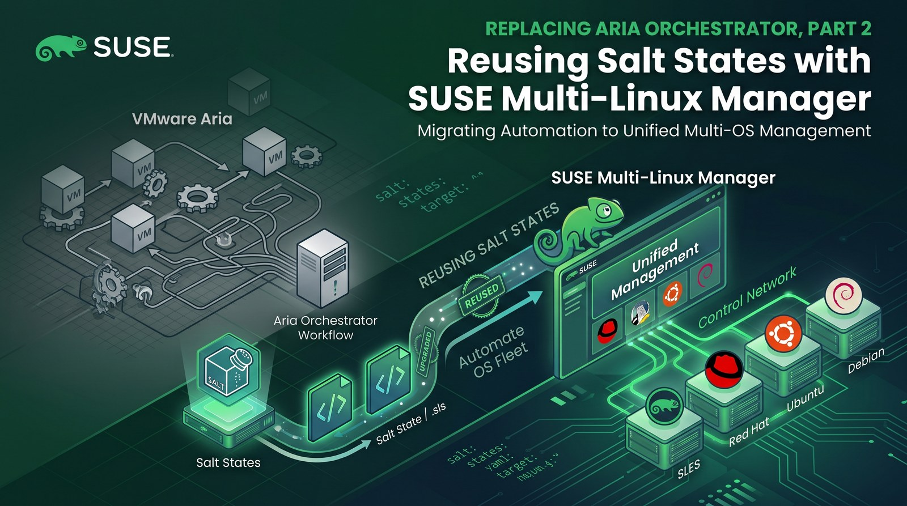

**TL;DR**

- Aria Automation Config is Salt, so a state written for an Aria cloud template runs unchanged from SUSE Multi-Linux Manager. Existing Salt content moves over as-is. All files are in the [demo repo](https://github.com/abonillabeeche/vro-to-suse-gitops-demo).
- For the sample I used the classic Aria **WordPress** blueprint: Apache, PHP 8 and MariaDB from the server's SLES 16.1 channel, and WordPress 7.1.4 from wordpress.org through WP-CLI. Passwords are generated on the VM and never stored in Git.
- A VM defined in Git (Part 1) boots on SUSE Virtualization, and its **cloud-config** runs the server's **bootstrap script**. That script registers the VM with activation key `1-wordpress`, which assigns the software channels and the `wordpress` state channel. Registration then applies a highstate automatically.
- **Day 2**: a title change was committed to Git, published to the state channel and applied with one *Apply Highstate* click. Exactly one state changed on the VM. A later manual edit on the VM was reverted by the next highstate.
- openSUSE Leap 16.1 VMs used the SLES 16.1 channels with one zypper setting and one bootstrap-repository symlink. Troubleshooting covers the missing PHP packages and the memory limit that the first runs exposed.

[Part 1](/posts/gitops-vm-automation-aria-suse-virtualization/) replaced the Aria Orchestrator resize workflow: VM shape lives in Git, changes go through a pull request, and Fleet applies them to SUSE Virtualization. That covers the machine, not what runs inside it.

In Aria environments, guest configuration usually lives in Aria Automation Config (formerly SaltStack Config), so it is already written in Salt. This post takes one such state, runs it from SUSE Multi-Linux Manager without changes, and then uses SUSE Multi-Linux Manager for the rest of the application's lifecycle: first install, day-2 changes and drift correction.

## Same Salt, different control plane

In Aria Automation, a cloud template attaches Salt to a machine with the `Cloud.SaltStack` resource ([Broadcom docs](https://techdocs.broadcom.com/us/en/vmware-cis/aria/aria-automation/8-17/add-the-ssc-resource-to-the-cloud-template.html); the older `saltConfiguration` property is deprecated):

```yaml
# aria/wordpress-cloud-template.yaml (for comparison)
resources:
  Cloud_vSphere_Machine_1:
    type: Cloud.vSphere.Machine
    properties:
      image: sles-16
      cpuCount: 2
      totalMemoryMB: 4096
  Cloud_SaltStack_1:
    type: Cloud.SaltStack
    properties:
      masterId: saltstack_enterprise_installer
      hosts:
        - ${resource.Cloud_vSphere_Machine_1.id}
      saltEnvironment: base
      stateFiles:
        - /wordpress/init.sls
```

SUSE Multi-Linux Manager also runs a Salt master, so the state file stays the same. What changes is how a machine is attached to it:

| Aria Automation / Automation Config | SUSE Multi-Linux Manager |
|---|---|
| `Cloud.SaltStack` resource in the cloud template | Activation key used by the bootstrap script |
| `stateFiles` / file server content | State (configuration) channel |
| Minion install over SSH at day 0 | Bootstrap script run by cloud-init on first boot |
| Minion key acceptance | *Salt > Keys* (or the `saltkey.accept` API call) |
| Highstate job | Highstate at registration, then *Apply Highstate* or the API |
| Pillar | Pillar or formula forms (not needed for this sample) |
| Package repositories outside Aria | Software channels, Content Lifecycle Management, patching |

That last row is the reason to move rather than just port: SUSE Multi-Linux Manager also controls the repositories that the state installs from.

## How it fits together

1. **Content**: `salt/wordpress/` in Git is plain Salt. A script publishes it as the `wordpress` state channel and creates activation key `1-wordpress`.
2. **Bootstrap script**: `mgr-bootstrap` on the server generates `bootstrap-wordpress.sh` for that key.
3. **VM**: Fleet creates `wp-01` from `vms/wp-01.yaml` (Part 1). SUSE Virtualization hands its cloud-config to the guest, which runs the bootstrap script.
4. **Approval**: the minion key appears as pending and an administrator accepts it.
5. **Registration**: the activation key assigns the SLES 16.1 channels and the state channel, and the server schedules a highstate that builds WordPress.
6. **Day 2**: changes to the state in Git are published and applied with a highstate from SUSE Multi-Linux Manager.

Lab versions: SUSE Multi-Linux Manager 5.2.1 (containerized, on a SL Micro 6.2 VM), SUSE Linux Enterprise Server 16.1 x86_64 (beta) channel with 7,900 packages, openSUSE Leap 16.1 Minimal-VM Cloud image, Salt bundle `venv-salt-minion` 3006.0, SUSE Virtualization v1.9.0 on a single-node x86_64 cluster, Rancher v2.15.1 with Fleet v0.16.1.

## Step 1: Write the state once

`salt/wordpress/init.sls` uses only standard Salt modules. A `map.jinja` file next to it holds the per-OS package and service names, so the same state can target the SUSE, Debian and Red Hat families (only SUSE is tested here):

```yaml
# salt/wordpress/map.jinja (excerpt)
{% set os_map = salt['grains.filter_by']({
    'Suse': {
        'pkgs': ['apache2', 'apache2-mod_php8', 'php8', 'php8-cli', 'php8-mysql', 'php8-gd', 'php8-mbstring', 'php8-zip',
                 'php8-curl', 'php8-xmlreader', 'php8-xmlwriter', 'php8-intl', 'php8-openssl', 'php8-fileinfo',
                 'php8-exif', 'php8-phar', 'php8-ctype', 'php8-dom', 'php8-iconv', 'php8-sodium', 'php8-tokenizer',
                 'mariadb', 'mariadb-client', 'curl', 'openssl'],
        'web_service': 'apache2', 'db_service': 'mariadb', 'web_user': 'wwwrun',
        'vhost_dir': '/etc/apache2/vhosts.d', 'docroot': '/srv/www/wordpress', 'php_module': 'php8',
    },
    # 'Debian': {...}, 'RedHat': {...}
}, grain='os_family') %}
```

SLES 16 does not package WordPress, and it does not need to: the platform comes from the server's channel and the application from upstream. Here is the complete state:

```yaml
# salt/wordpress/init.sls

{# WP-CLI extracts the WordPress archive in memory; the 128M CLI default is not enough. #}


wordpress-packages:
  pkg.installed:
    - pkgs: {{ os_map.pkgs | json }}

wordpress-db-service:
  service.running:
    - name: {{ os_map.db_service }}
    - enable: True
    - require:
      - pkg: wordpress-packages

wordpress-secrets:
  cmd.run:
    - name: |
        umask 077; mkdir -p /etc/wordpress
        [ -s /etc/wordpress/db.pass ] || openssl rand -hex 16 > /etc/wordpress/db.pass
        [ -s /etc/wordpress/admin.pass ] || openssl rand -hex 12 > /etc/wordpress/admin.pass
    - creates:
      - /etc/wordpress/db.pass
      - /etc/wordpress/admin.pass
    - require:
      - pkg: wordpress-packages

wordpress-database:
  cmd.run:
    - name: |
        mysql -e "CREATE DATABASE IF NOT EXISTS \`{{ wp.db_name }}\`;
                  CREATE USER IF NOT EXISTS '{{ wp.db_user }}'@'localhost' IDENTIFIED BY '$(cat /etc/wordpress/db.pass)';
                  GRANT ALL PRIVILEGES ON \`{{ wp.db_name }}\`.* TO '{{ wp.db_user }}'@'localhost'; FLUSH PRIVILEGES;"
    - unless: mysql -N -e "SELECT 1 FROM mysql.user WHERE user='{{ wp.db_user }}'" | grep -q 1
    - require:
      - service: wordpress-db-service
      - cmd: wordpress-secrets

wp-cli:
  file.managed:
    - name: /usr/local/bin/wp
    - source: https://raw.githubusercontent.com/wp-cli/builds/gh-pages/phar/wp-cli.phar
    - source_hash: https://raw.githubusercontent.com/wp-cli/builds/gh-pages/phar/wp-cli.phar.sha512
    - mode: '0755'
    - require:
      - pkg: wordpress-packages

wordpress-core:
  cmd.run:
    - name: mkdir -p {{ os_map.docroot }} && {{ wpcli }} core download
    - creates: {{ os_map.docroot }}/wp-load.php
    - require:
      - file: wp-cli

wordpress-config:
  cmd.run:
    - name: {{ wpcli }} config create --dbname={{ wp.db_name }} --dbuser={{ wp.db_user }} --dbpass="$(cat /etc/wordpress/db.pass)" --dbhost=localhost
    - creates: {{ os_map.docroot }}/wp-config.php
    - require:
      - cmd: wordpress-core
      - cmd: wordpress-database

wordpress-install:
  cmd.run:
    - name: >-
        {{ wpcli }} core install --url="{{ wp.url }}" --title="{{ wp.site_title }}"
        --admin_user="{{ wp.admin_user }}" --admin_password="$(cat /etc/wordpress/admin.pass)"
        --admin_email="{{ wp.admin_email }}" --skip-email
    - unless: {{ wpcli }} core is-installed
    - require:
      - cmd: wordpress-config

# Day-2 settings: kept equal to the values above on every highstate (drift is corrected).
wordpress-site-identity:
  cmd.run:
    - name: >-
        {{ wpcli }} option update blogname "{{ wp.site_title }}" &&
        {{ wpcli }} option update blogdescription "{{ wp.tagline }}"
    - unless: >-
        test "$({{ wpcli }} option get blogname)" = "{{ wp.site_title }}" &&
        test "$({{ wpcli }} option get blogdescription)" = "{{ wp.tagline }}"
    - require:
      - cmd: wordpress-install

wordpress-ownership:
  file.directory:
    - name: {{ os_map.docroot }}
    - user: {{ os_map.web_user }}
    - group: {{ os_map.web_user }}
    - recurse: [user, group]
    - require:
      - cmd: wordpress-install


wordpress-php-module:
  cmd.run:
    - name: a2enmod {{ os_map.php_module }}
    - unless: a2enmod -q {{ os_map.php_module }}
    - require:
      - pkg: wordpress-packages
    - watch_in:
      - service: wordpress-web-service


wordpress-vhost:
  file.managed:
    - name: {{ os_map.vhost_dir }}/wordpress.conf
    - contents: |
        # Managed by Salt (state: wordpress)
        <VirtualHost *:80>
            DocumentRoot {{ os_map.docroot }}
            <Directory {{ os_map.docroot }}>
                Options FollowSymLinks
                AllowOverride All
                Require all granted
                DirectoryIndex index.php
            </Directory>
        </VirtualHost>
    - require:
      - pkg: wordpress-packages

wordpress-web-service:
  service.running:
    - name: {{ os_map.web_service }}
    - enable: True
    - watch:
      - file: wordpress-vhost
    - require:
      - file: wordpress-ownership


wordpress-firewall:
  firewalld.present:
    - name: public
    - services: [http]
    - prune_services: False

```

Every `cmd.run` has a `creates` or `unless` guard, so running the state again changes nothing unless something has drifted. This idempotency is what makes day-2 management safe. You can dry-run the state without a server, for example in a Leap 16.1 container:

```console
$ salt-call --local --file-root=salt state.apply wordpress test=True
Succeeded: 13 (unchanged=12, changed=4)
Failed:     0
```

## Step 2: Publish it to SUSE Multi-Linux Manager

[`suma/wordpress.py`](https://github.com/abonillabeeche/vro-to-suse-gitops-demo/blob/main/suma/wordpress.py) drives the server's XML-RPC API. Its `setup` command creates the state channel, uploads `init.sls` (with `map.jinja` inlined, so the channel holds a single file) and creates the activation key. These are the relevant calls:

```python
api.configchannel.create(sk, "wordpress", "WordPress (Salt state)", "...", "state")
api.configchannel.updateInitSls(sk, "wordpress", {"contents": channel_sls()})
key = api.activationkey.create(sk, "wordpress", "WordPress VMs: SLES 16.1 channels + wordpress state",
                               "sle-product-sles-16.1-x86_64", [], False)        # returns "1-wordpress"
api.activationkey.addChildChannels(sk, key, ["multi-linux-managertools-sle-16-x86_64-sles-16.1"])
api.activationkey.addConfigChannels(sk, [key], ["wordpress"], True)
api.activationkey.enableConfigDeployment(sk, key)
```

```console
$ SUMA_PASSWORD_FILE=~/secrets/admin-password suma/wordpress.py setup
state channel wordpress: init.sls updated
activation key 1-wordpress: base sle-product-sles-16.1-x86_64, children ['multi-linux-managertools-sle-16-x86_64-sles-16.1'], config channel wordpress, config deployment on
```

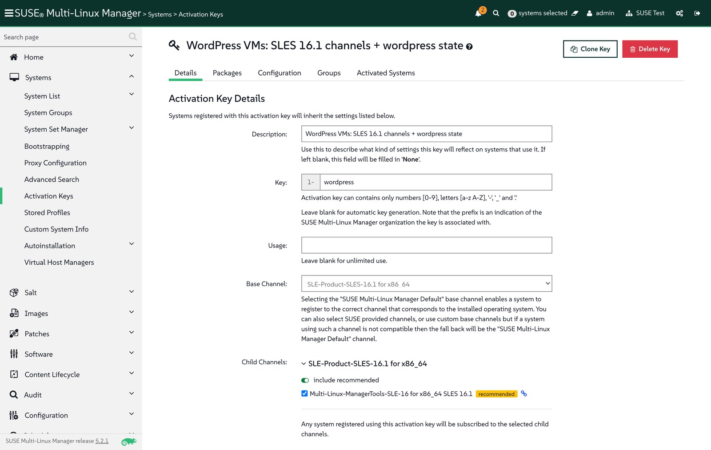

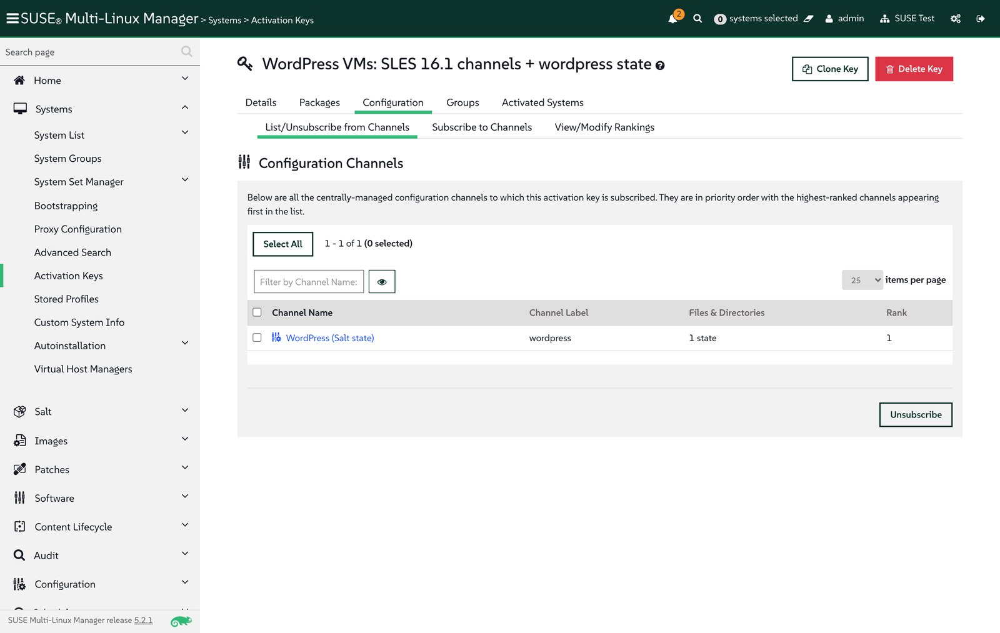

This script is also the GitOps hook for Salt content: run it from a pipeline after each merge (on a runner that can reach the server) and the state channel always matches Git.

## Step 3: Create the bootstrap script

Generate a bootstrap script for the activation key inside the server container, as described in the [bootstrap documentation](https://documentation.suse.com/multi-linux-manager/5.2/en/docs/client-configuration/registration-bootstrap.html):

```console
$ mgrctl exec -- mgr-bootstrap --activation-keys=1-wordpress --script=bootstrap-wordpress.sh
* bootstrap script (written):
    '/srv/www/htdocs/pub/bootstrap/bootstrap-wordpress.sh'
```

On the client, the script installs the Salt bundle (`venv-salt-minion`) from a **bootstrap repository**. SUSE Multi-Linux Manager builds that repository when a product and its client tools channel finish syncing; here it was published at `/pub/repositories/sle/16/1/bootstrap/` with `venv-salt-minion-3006.0`.

It picks the repository path from the client's `/etc/os-release`, and openSUSE Leap 16.1 resolves to `opensuse/16/1`. Because Leap 16.1 and SLES 16.1 share a code base, a symlink lets the same bootstrap repository serve both:

```console
$ mgrctl exec -- mkdir -p /srv/www/htdocs/pub/repositories/opensuse/16/1
$ mgrctl exec -- ln -sfn ../../../sle/16/1/bootstrap /srv/www/htdocs/pub/repositories/opensuse/16/1/bootstrap
```

## Step 4: Bootstrap from cloud-config on SUSE Virtualization

SUSE Virtualization passes a VM's cloud-init user data to the guest as a NoCloud data source. Everything the guest must do on first boot therefore lives in Git next to the VM definition, in `vms/wordpress-cloudinit.secret.yaml`:

```yaml
apiVersion: v1
kind: Secret
metadata:
  name: wordpress-cloudinit
  namespace: vm-demo
type: Opaque
stringData:
  userdata: |
    #cloud-config
    write_files:
      - path: /etc/venv-salt-minion/minion.d/wordpress.conf
        content: |
          grains:
            role: wordpress
            wordpress:
              url: http://<node-ip>:30880
    runcmd:
      - zypper -n modifyrepo --disable --all
      - '[ -f /etc/zypp/zypp.conf ] || cp /usr/etc/zypp/zypp.conf /etc/zypp/zypp.conf'
      - echo 'solver.allowVendorChange = true' >> /etc/zypp/zypp.conf
      - curl -Sks https://<smlm-server>/pub/bootstrap/bootstrap-wordpress.sh | /bin/bash
```

On first boot, cloud-init does three things:

- **Grains**: writes the values the state needs (the public URL and a `role`) to the Salt bundle's configuration directory before the minion starts.
- **Repositories**: disables the image's own openSUSE repositories and sets `solver.allowVendorChange`, so Leap accepts packages from the SLES 16.1 channel.
- **Bootstrap**: runs the documented `curl … | /bin/bash` command, which registers the VM with activation key `1-wordpress`.

Note that the documented command uses `curl -k`, which skips certificate verification. That is acceptable in a lab with a self-signed server certificate; in production, use a certificate the guests trust, or add the server's CA to the image.

The VM itself is a Part 1 manifest (hot-plug shape, pinned MAC) that references that secret, and a NodePort Service publishes port 80:

```yaml
# vms/wp-01.yaml (excerpt)
metadata:
  name: wp-01
  annotations:
    harvesterhci.io/enableCPUAndMemoryHotplug: "true"
    harvesterhci.io/volumeClaimTemplates: '[{"metadata":{"name":"wp-01-rootdisk","annotations":{"harvesterhci.io/imageId":"default/leap-16-1-minimal-vm"}},"spec":{"accessModes":["ReadWriteMany"],"resources":{"requests":{"storage":"10Gi"}},"volumeMode":"Block","storageClassName":"longhorn-v2"}}]'
spec:
  template:
    spec:
      domain:
        cpu: {cores: 1, sockets: 2, threads: 1, maxSockets: 8}
        memory: {guest: 4Gi}
      volumes:
        - name: cloudinit
          cloudInitNoCloud:
            secretRef:
              name: wordpress-cloudinit
---
# vms/wp-01-service.yaml
apiVersion: v1
kind: Service
metadata:
  name: wp-01-http
  namespace: vm-demo
spec:
  type: NodePort
  selector:
    harvesterhci.io/vmName: wp-01
  ports:
    - {name: http, port: 80, targetPort: 80, nodePort: 30880}
```

On the infrastructure side, merging the pull request that added these files was the only manual step. The VM was running 84 seconds after the merge, and its minion key reached the server after 138 seconds.

## Step 5: Accept, register, highstate

A new minion's key waits in *Salt > Keys* until it is accepted, which makes a natural approval gate before a machine is managed:

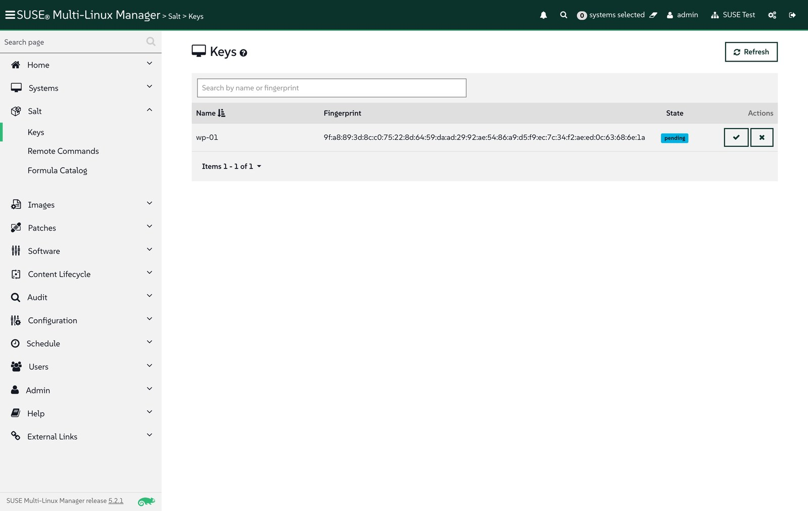

```console
$ suma/wordpress.py accept wp-01
accepted wp-01
```

Registration applied the activation key: the system reports openSUSE Leap 16.1 as its installed product and is subscribed to the SLES 16.1 base channel and the tools child channel:

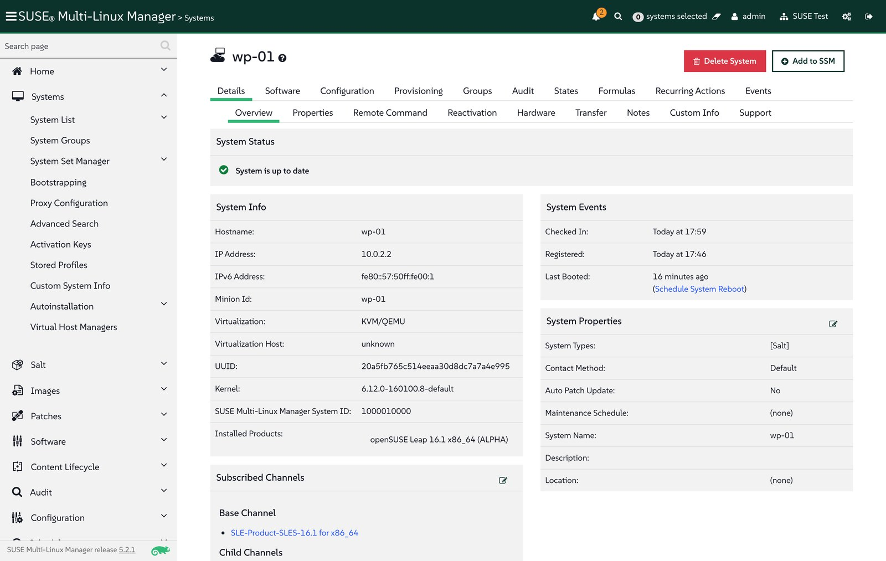

Right after registration, the server scheduled **Apply highstate** by itself (the history shows "scheduled by (system)"), so the state channel from the activation key is applied without an extra call. My first two runs failed because the state was missing PHP packages (see Troubleshooting); after the fix, the third run built the site. Platform packages came from the SLES 16.1 channel, at version `8.5.12-160100.1.1`:

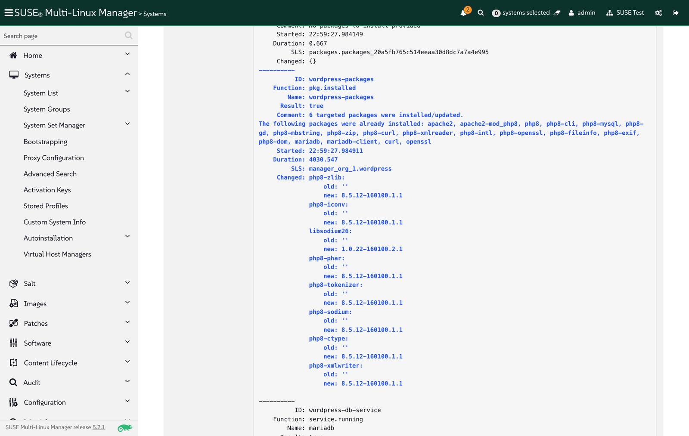

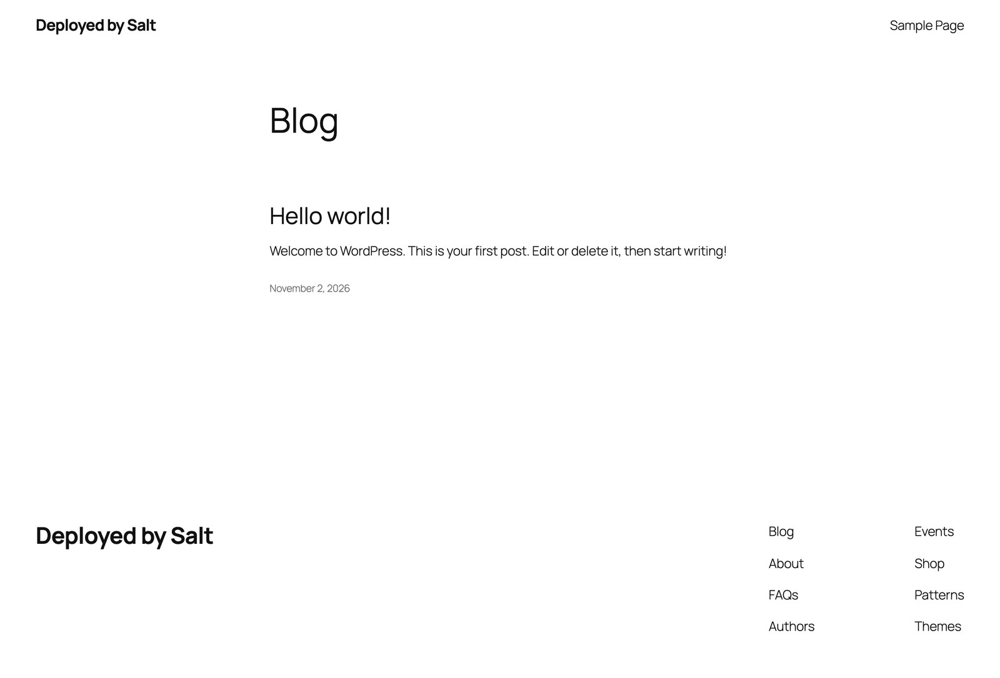

## Day 2: change it from SUSE Multi-Linux Manager

Installing is the easy part; what matters to Aria customers is what happens afterwards. The `wordpress-site-identity` state keeps the site title and tagline equal to the values in `map.jinja`, so changing them is a commit:

```diff
-    'site_title': wp.get('site_title', 'Deployed by Salt'),
-    'tagline': wp.get('tagline', 'Same Salt state as the Aria blueprint'),
+    'site_title': wp.get('site_title', 'Managed by SUSE Multi-Linux Manager'),
+    'tagline': wp.get('tagline', 'Day-2 change rolled out with Salt'),
```

`suma/wordpress.py setup` published the new revision to the state channel, and **Apply Highstate** (*Systems > wp-01 > States > Highstate*) in the web UI rolled it out. Of the 13 WordPress states, only `wordpress-site-identity` reported a change:

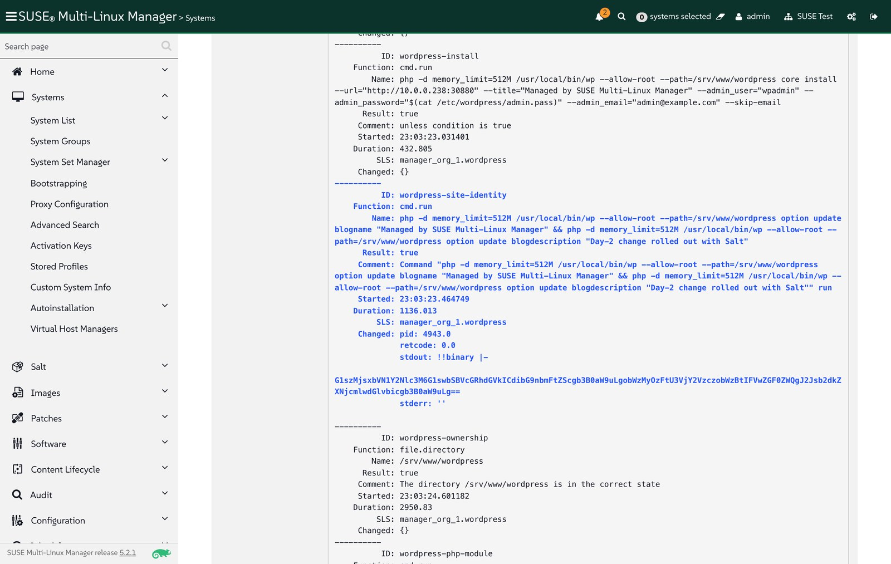

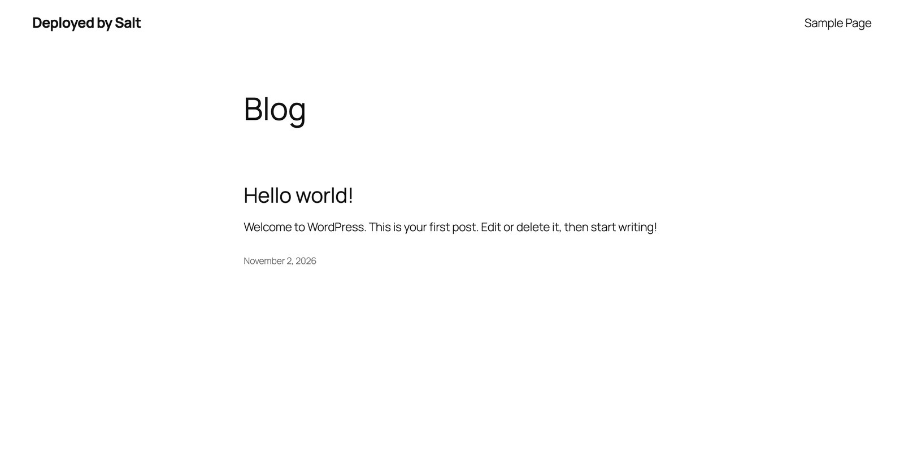

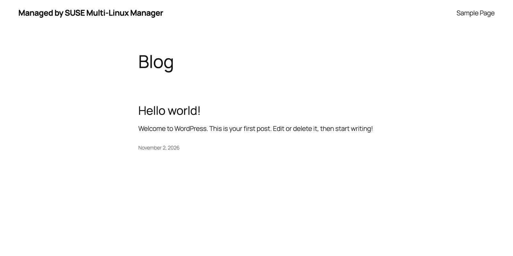

## Drift: someone edits the VM by hand

To simulate an operator changing something directly on the VM, I changed the title with a SUSE Multi-Linux Manager remote command, which also leaves an entry in the system's history:

```sh
php -d memory_limit=512M /usr/local/bin/wp --allow-root --path=/srv/www/wordpress option update blogname 'Edited by hand on the VM'
```

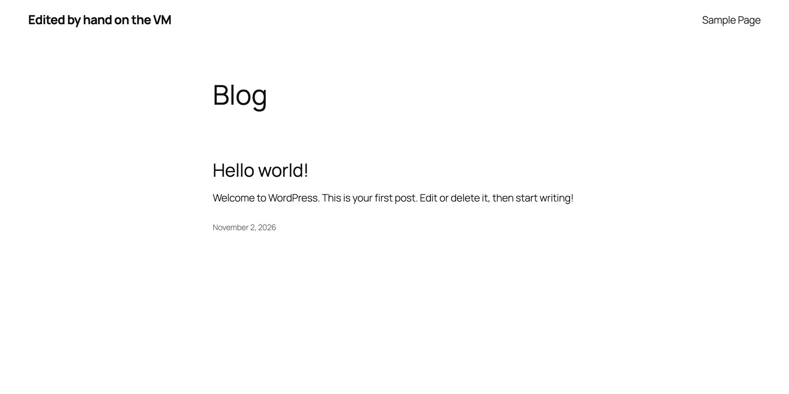

On the next highstate, Salt detected the difference and restored the managed value. Scheduled regularly as a *Recurring Action* in SUSE Multi-Linux Manager, this gives drift control that a run-once workflow cannot provide:

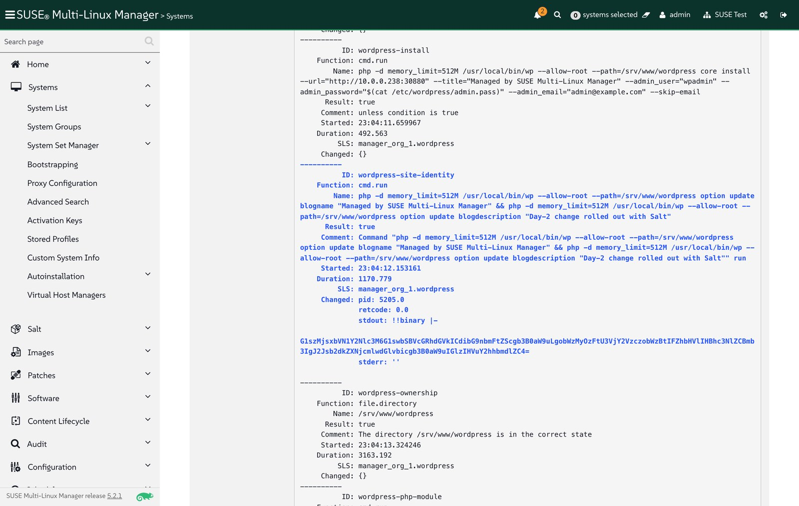

In the system history, the whole sequence is recorded: registration, the automatic highstate, the fixes, the day-2 change, the remote command and the correction:

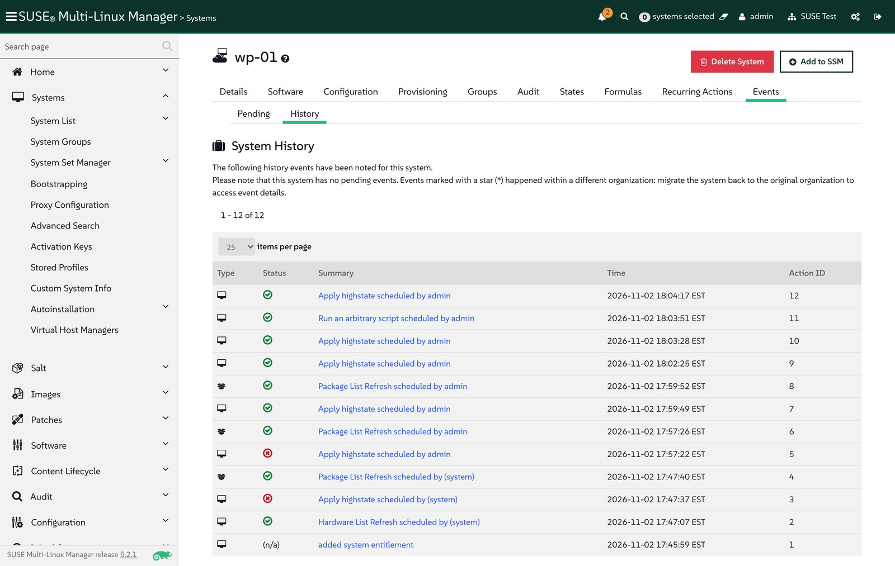

## Troubleshooting

- **No bootstrap repository after the product sync.** The client tools child channel had 0 packages until I synced it explicitly (`channel.software.syncRepo`); the bootstrap repository appeared right after.
- **Bootstrap script looks for `opensuse/16/1`.** openSUSE Leap is not a synced product on this server; publish the SLES 16.1 bootstrap repository under that path (Step 3).
- **`env: 'php': No such file or directory`.** WP-CLI starts with `#!/usr/bin/env php`, and on SLES and Leap 16.1 the `php` command is in `php8-cli`. A dry run with `test=True` does not execute commands, so it cannot catch this.
- **`Class "Phar" not found`.** PHP is split into small packages: WP-CLI needs `php8-phar`, and WordPress needs `php8-ctype`, `php8-dom`, `php8-iconv`, `php8-sodium`, `php8-tokenizer` and `php8-xmlwriter`. Running WP-CLI for real in a Leap 16.1 container found the complete list in one pass.
- **`Allowed memory size of 134217728 bytes exhausted` during `wp core download`.** WP-CLI unpacks the archive in memory, and the default CLI limit is 128 MB. Run it as `php -d memory_limit=512M`.
- **SUSE Virtualization UI shows empty user data** for the Fleet-created cloud-init secret, although the guest received and ran it. Read the cloud-config from Git instead.

## Takeaways

- Salt content written for Aria Automation Config runs as-is in SUSE Multi-Linux Manager; the migration work is in the wiring (activation key, bootstrap script, state channel), not in rewriting states.
- SUSE Virtualization's cloud-init support and the bootstrap script let a VM register and configure itself on first boot; accepting its key is the only manual step, and it is a deliberate one.
- SUSE Multi-Linux Manager adds what a provisioning workflow lacks: control of the repositories the state installs from, day-2 changes with a precise change report, and drift correction.
- Together with Part 1, the whole flow is driven from Git: VM shape through Fleet, and guest configuration through the state channel.

## What's next

[Part 3: forms, schedules, approved content and workflows](/posts/replacing-aria-orchestrator-part-3-day-2-suse-multi-linux-manager/) covers the day-2 patterns that Aria users rely on, on the same WordPress VM: a Salt formula with a web form, a recurring highstate on a system group, dev and prod content snapshots with Content Lifecycle Management, and an action chain that upgrades an outdated package, reapplies the state and runs a smoke test.
