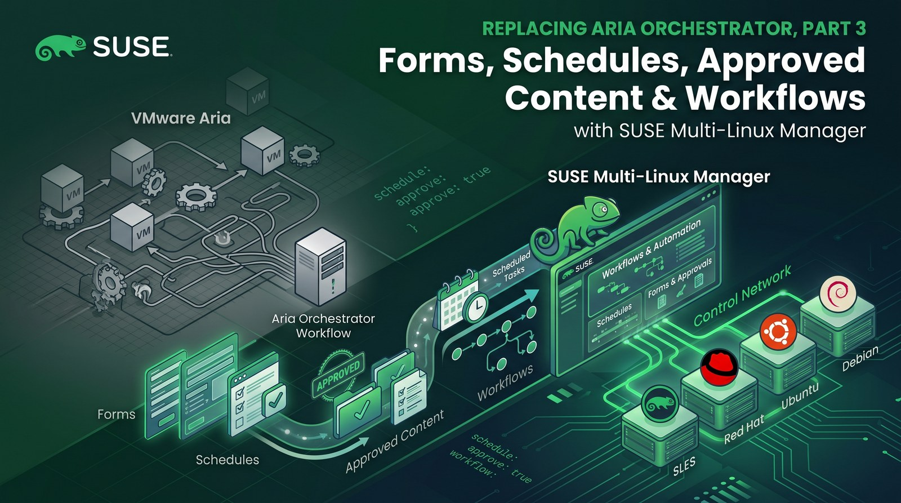
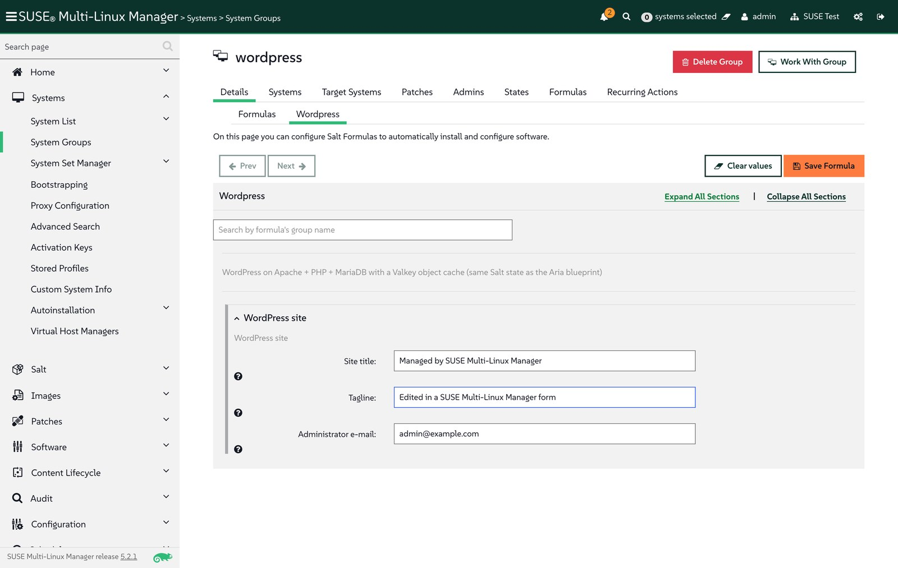
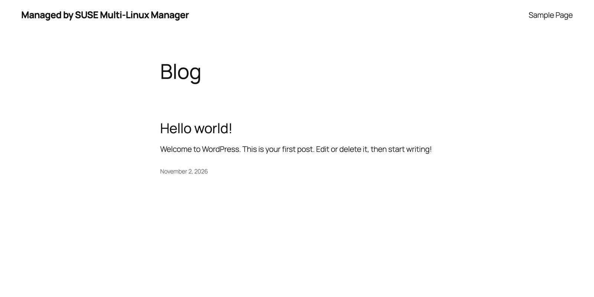
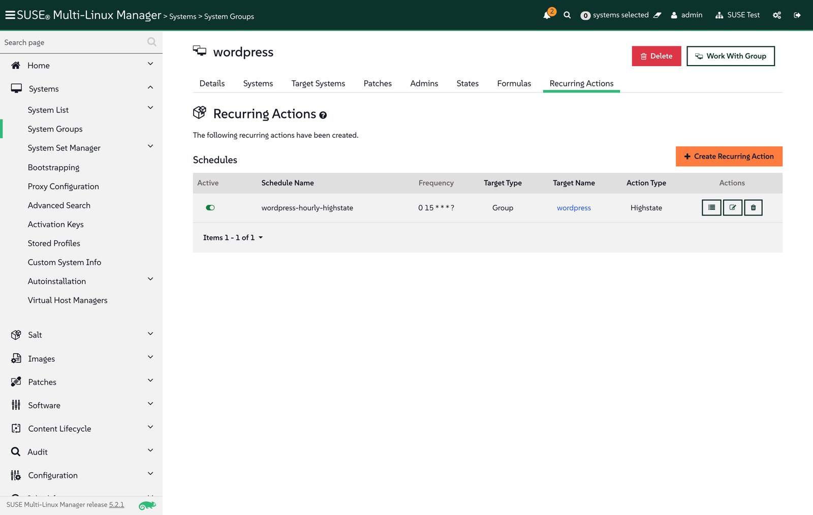
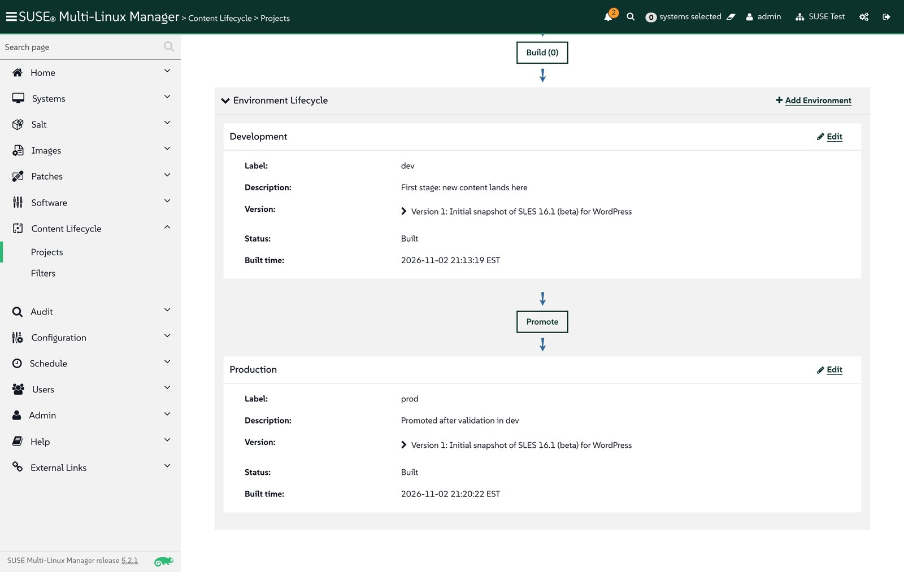
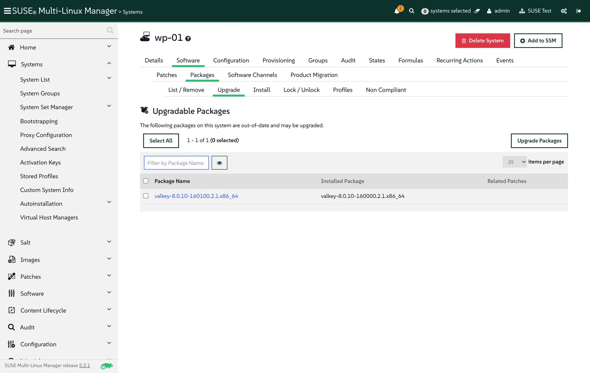
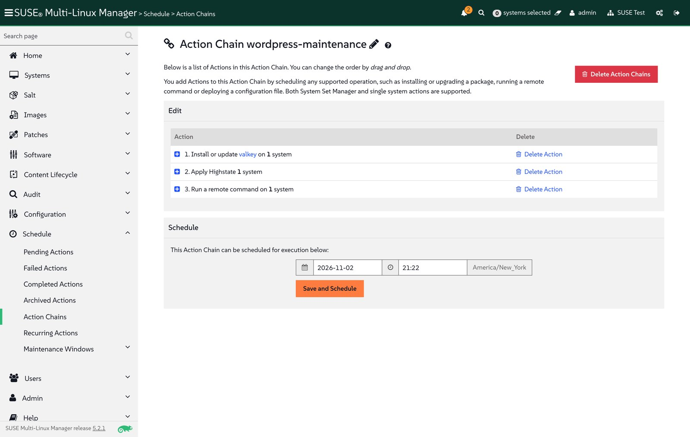
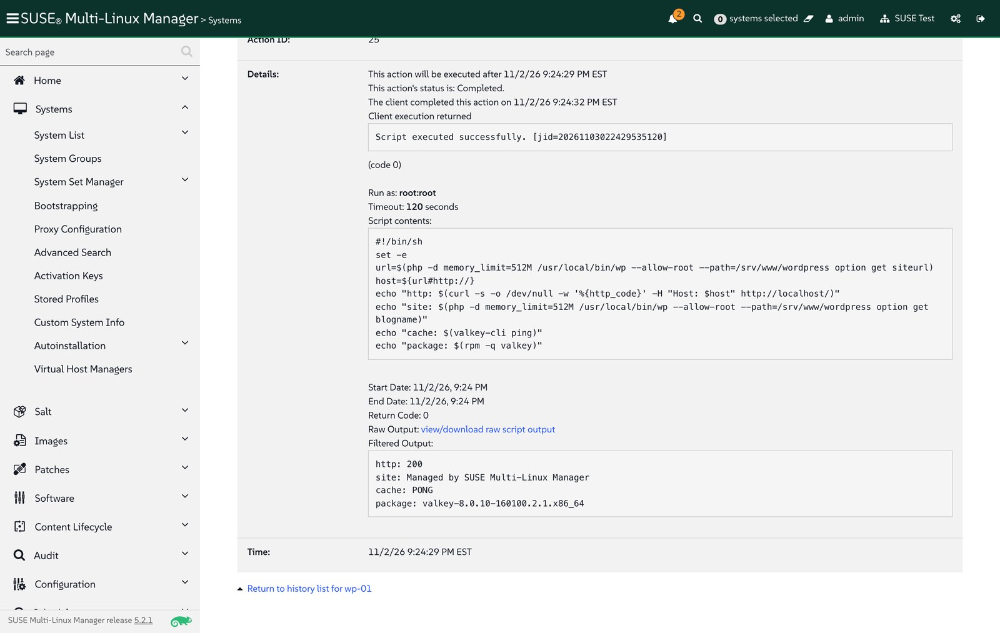

**TL;DR**

- Four Aria day-2 patterns map directly to SUSE Multi-Linux Manager features: catalog forms to **formulas with forms**, scheduled jobs to **recurring actions**, approved content per stage to **Content Lifecycle Management**, and orchestration workflows to **action chains**.
- The WordPress Salt state from [Part 2](/posts/replacing-aria-orchestrator-part-2-salt-suse-multi-linux-manager/) became a formula by adding one `form.yml`; the state files did not change. Editing the form and applying a highstate changed the site's tagline.
- A recurring highstate on the `wordpress` system group runs every hour and keeps every VM in the group at its defined state.
- A frozen SLES 16.1 snapshot was built in `dev` and promoted to `prod`. Against that snapshot, SUSE Multi-Linux Manager flagged exactly one outdated package on the VM: a Valkey build taken from openSUSE Leap 16.0.
- One action chain upgraded Valkey, reapplied the state and ran a smoke test, in that order. All files are in the [demo repo](https://github.com/abonillabeeche/vro-to-suse-gitops-demo).

[Part 1](/posts/gitops-vm-automation-aria-suse-virtualization/) moved VM shape to Git, and [Part 2](/posts/replacing-aria-orchestrator-part-2-salt-suse-multi-linux-manager/) moved the guest configuration to SUSE Multi-Linux Manager with the same Salt state an Aria cloud template uses. What keeps customers on Aria after the first deployment, though, is day 2: self-service forms, scheduled jobs, approved content and multi-step workflows. This post rebuilds those four patterns on the same WordPress VM.

## Aria patterns and their SUSE Multi-Linux Manager equivalents

| Aria pattern | SUSE Multi-Linux Manager feature | In this demo |
|---|---|---|
| Custom form / catalog inputs (Service Broker) | Formula with forms | WordPress site settings form on the `wordpress` group |
| Scheduled workflow or Automation Config job | Recurring action | Hourly highstate on the `wordpress` group |
| Approved content per environment | Content Lifecycle Management | SLES 16.1 snapshot, `dev` then `prod` |
| Orchestrator workflow with ordered steps | Action chain | Upgrade, highstate, smoke test |

As the demo VM I reused `wp-01` from Part 2: openSUSE Leap 16.1 on SUSE Virtualization, registered to SUSE Multi-Linux Manager 5.2.1 and running WordPress, Apache, PHP 8 and MariaDB. Every step below was done with the server's XML-RPC API; [`suma/part3.py`](https://github.com/abonillabeeche/vro-to-suse-gitops-demo/blob/main/suma/part3.py) contains the calls.

## Step 1: Add an object cache from an older build

To give the later steps something to upgrade, I added an object cache to the WordPress stack: Valkey, the Redis-compatible store that ships in SLES 16. In `salt/wordpress/init.sls` (SUSE family only), the state now installs the package, creates a configuration file from the shipped example and runs the `valkey@default` service:

```yaml
wordpress-cache-config:
  file.copy:
    - name: {{ os_map.cache_conf }}            # /etc/valkey/default.conf
    - source: {{ os_map.cache_conf }}.example
    - user: root
    - group: {{ os_map.cache_group }}
    - mode: '0640'
    - require:
      - pkg: wordpress-packages

wordpress-cache-service:
  service.running:
    - name: {{ os_map.cache_service }}         # valkey@default
    - enable: True
    - watch:
      - file: wordpress-cache-config
```

Before the state ran, a SUSE Multi-Linux Manager remote command installed Valkey from the openSUSE Leap 16.0 repository, as if the VM had been built from an older image:

```sh
zypper -n --gpg-auto-import-keys install --allow-vendor-change \
  https://download.opensuse.org/distribution/leap/16.0/repo/oss/x86_64/valkey-8.0.10-160000.2.1.x86_64.rpm
```

`pkg.installed` accepts any installed version, so the highstate configured and started the cache without upgrading it. The VM now runs `valkey-8.0.10-160000.2.1`, while the server's SLES 16.1 channel carries `8.0.10-160100.2.1`.

## Step 2: Turn the state into a formula with a form

Aria users change application settings through catalog forms, not by editing code. SUSE Multi-Linux Manager does the same with **formulas with forms**: a Salt state plus a `form.yml` that renders as a web form, whose values become pillar data ([custom formulas documentation](https://documentation.suse.com/multi-linux-manager/5.2/en/docs/specialized-guides/salt/salt-formulas-custom.html)). The WordPress state already reads its settings from the `wordpress` pillar, so the formula is the unchanged state plus this file (`formulas/wordpress/form.yml`):

```yaml
wordpress:
  $type: group
  $name: WordPress site
  site_title:
    $name: Site title
    $default: Managed by SUSE Multi-Linux Manager
  tagline:
    $name: Tagline
    $default: Day-2 change rolled out with Salt
  admin_email:
    $name: Administrator e-mail
    $default: admin@example.com
```

[`suma/install-formula.sh`](https://github.com/abonillabeeche/vro-to-suse-gitops-demo/blob/main/suma/install-formula.sh) copies the state to `/srv/salt/wordpress/` and the form to `/srv/formula_metadata/wordpress/` inside the server container with `mgrctl cp`. After that, the formula appears in the server's formula list.

Formulas are assigned to systems or system groups. A `wordpress` group now carries the formula, and activation key `1-wordpress` adds every new WordPress VM to the group:

```python
gid = api.systemgroup.create(sk, "wordpress", "WordPress VMs: wordpress formula")["id"]
api.systemgroup.addOrRemoveSystems(sk, "wordpress", [sid], True)
api.formula.setFormulasOfGroup(sk, gid, ["wordpress"])
api.system.config.removeChannels(sk, [sid], ["wordpress"])            # the formula replaces the state channel
api.activationkey.removeConfigChannels(sk, ["1-wordpress"], ["wordpress"])
api.activationkey.addServerGroups(sk, "1-wordpress", [gid])
```

The Part 2 state channel had to go: the formula and the channel define the same state IDs, and Salt refuses to run a highstate with duplicate IDs. On the next highstate, all WordPress states ran from the formula (`SLS: wordpress`), and only the new cache configuration and service changed.

Changing the site is now a form edit. Under *Systems > System Groups > wordpress > Formulas > Wordpress*, I changed the tagline and saved:



SUSE Multi-Linux Manager answered "Formula saved. Apply the Highstate for the changes to take effect." After the highstate, one state had changed, `wordpress-site-identity`:



## Step 3: Enforce the state on a schedule

Aria customers schedule workflows and Automation Config jobs to keep systems in line. In SUSE Multi-Linux Manager, a **recurring action** on the group runs the highstate on every member, so a manual change on any WordPress VM is reverted within the hour (as shown in Part 2):

```python
api.recurring.highstate.create(sk, {"entity_type": "group", "entity_id": gid,
                                    "name": "wordpress-hourly-highstate",
                                    "cron_expr": "0 15 * * * ?", "test": False})
```

Schedules use Quartz cron syntax: `0 15 * * * ?` runs at a quarter past every hour. Setting `"test": True` instead turns the same schedule into a recurring dry run that only reports drift.



## Step 4: Promote approved content from dev to prod

Production systems should only see packages that someone has approved. **Content Lifecycle Management** builds frozen copies of channels for each environment and promotes them in order. The `wordpress` project uses the SLES 16.1 base and tools channels as sources, with two environments:

```python
api.contentmanagement.createProject(sk, "wordpress", "WordPress platform", "Frozen SLES 16.1 content, dev -> prod")
for ch in ("sle-product-sles-16.1-x86_64", "multi-linux-managertools-sle-16-x86_64-sles-16.1"):
    api.contentmanagement.attachSource(sk, "wordpress", "software", ch)
api.contentmanagement.createEnvironment(sk, "wordpress", "", "dev", "Development", "New content lands here")
api.contentmanagement.createEnvironment(sk, "wordpress", "dev", "prod", "Production", "Promoted after validation")
api.contentmanagement.buildProject(sk, "wordpress", "Initial snapshot of SLES 16.1 (beta) for WordPress")
api.contentmanagement.promoteProject(sk, "wordpress", "dev")
```

Building the project created `wordpress-dev-*` channels with all 7,900 SLES 16.1 packages and 59 tools packages, and promotion copied them to `wordpress-prod-*`:



`wp-01` and activation key `1-wordpress` then moved to the prod channels, so new WordPress VMs also start on approved content:

```python
api.system.scheduleChangeChannels(sk, sid, "wordpress-prod-sle-product-sles-16.1-x86_64",
                                  ["wordpress-prod-multi-linux-managertools-sle-16-x86_64-sles-16.1"], now)
api.activationkey.setDetails(sk, "1-wordpress", {"base_channel_label": "wordpress-prod-sle-product-sles-16.1-x86_64"})
```

After a package list refresh, the server compared the VM with the prod snapshot and found exactly one outdated package, the Valkey build from Step 1:



In a real lifecycle, new updates land in `dev` with the next build, get validated there, and reach `prod` systems only after promotion.

## Step 5: Run maintenance as an action chain

An Aria Orchestrator workflow often strings steps together: patch, reconfigure, verify. An **action chain** does the same in SUSE Multi-Linux Manager: actions run in order on one or more systems, and each action depends on the one before it, so later steps do not run if an earlier one fails. The `wordpress-maintenance` chain has three steps:

```python
api.actionchain.createChain(sk, "wordpress-maintenance")
api.actionchain.addPackageUpgrade(sk, sid, upgradable_package_ids, "wordpress-maintenance")
api.actionchain.addApplyHighstate(sk, sid, "wordpress-maintenance")
api.actionchain.addScriptRun(sk, sid, "wordpress-maintenance", "root", "root", 120,
                             base64.b64encode(smoke_test).decode())    # chain scripts are base64-encoded
api.actionchain.scheduleChain(sk, "wordpress-maintenance", now)
```



A smoke test ([`suma/smoke-test.sh`](https://github.com/abonillabeeche/vro-to-suse-gitops-demo/blob/main/suma/smoke-test.sh)) checks the site, the cache and the package version:

```sh
#!/bin/sh
# Calls the site with its configured Host header (WordPress redirects other host names to siteurl).
set -e
wp="php -d memory_limit=512M /usr/local/bin/wp --allow-root --path=/srv/www/wordpress"
host=$($wp option get siteurl); host=${host#http://}
echo "http: $(curl -s -o /dev/null -w '%{http_code}' -H "Host: $host" http://localhost/)"
echo "site: $($wp option get blogname)"
echo "cache: $(valkey-cli ping)"
echo "package: $(rpm -q valkey)"
```

All three steps succeeded. Valkey moved to the prod snapshot's build, the highstate confirmed the rest of the stack, and the smoke test reported a healthy site:



Afterwards, the system had no upgradable packages left.

## Troubleshooting

- **Highstate fails after adding the formula.** If the state channel from Part 2 is still assigned, the formula and the channel define the same state IDs. Remove the channel from the systems and from the activation key before assigning the formula.
- **`Illegal base64 character` from `actionchain.addScriptRun`.** Unlike `system.scheduleScriptRun`, the action chain call expects the script body base64-encoded.
- **Smoke test prints an empty page.** WordPress redirects any host name other than its configured site URL, so `curl http://localhost/` returns a redirect with no body. Send the site's host name in the `Host` header, or read values through WP-CLI.
- **Form fields are not visible in automated UI tests.** The formula page renders its sections collapsed; select *Expand All Sections* first.

## Takeaways

- Formulas with forms give operators an Aria-style form in front of the same Salt state that developers keep in Git.
- System groups are the unit of day-2 management: formulas, recurring highstates and activation keys all point at the `wordpress` group, so new VMs get the same treatment automatically.
- Content Lifecycle Management answers "which packages are approved for production?" with frozen, promoted snapshots, and the server shows exactly which systems lag behind them.
- Action chains cover the ordered, multi-step maintenance that teams currently build as Aria Orchestrator workflows.
- Together with Parts 1 and 2, the full lifecycle of a VM and its application now runs on SUSE Virtualization, Fleet and SUSE Multi-Linux Manager, with Git and Salt as the shared languages.
