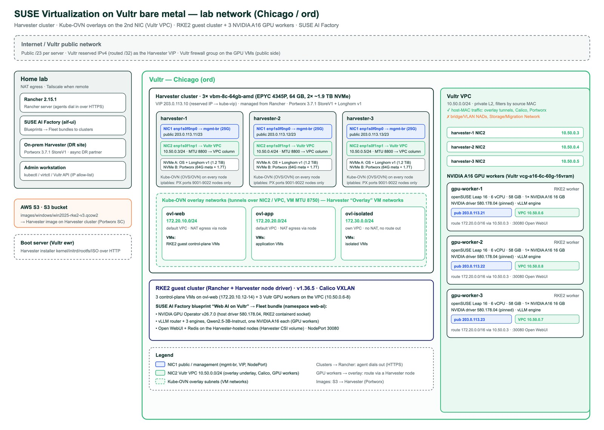
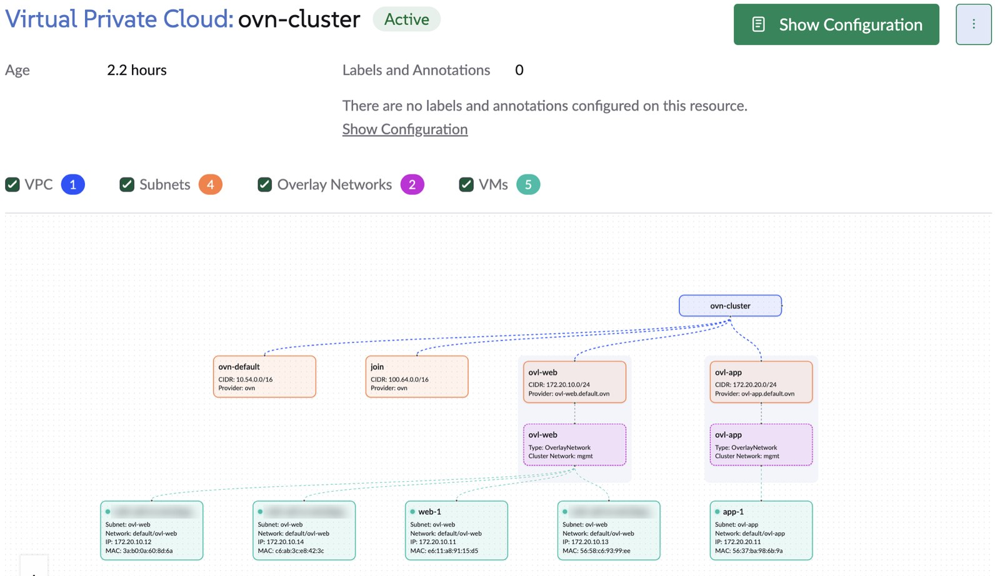
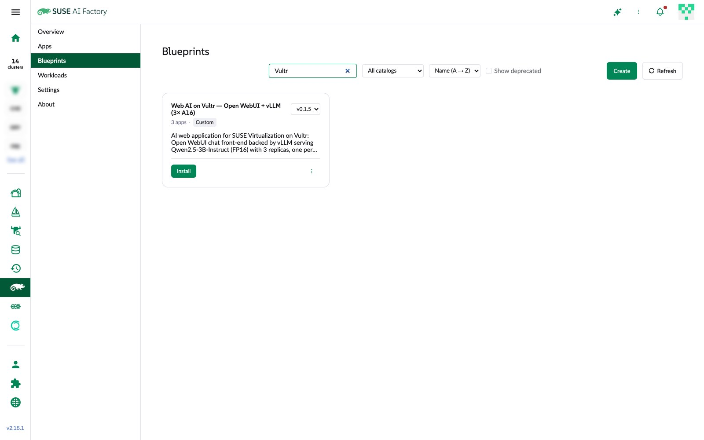
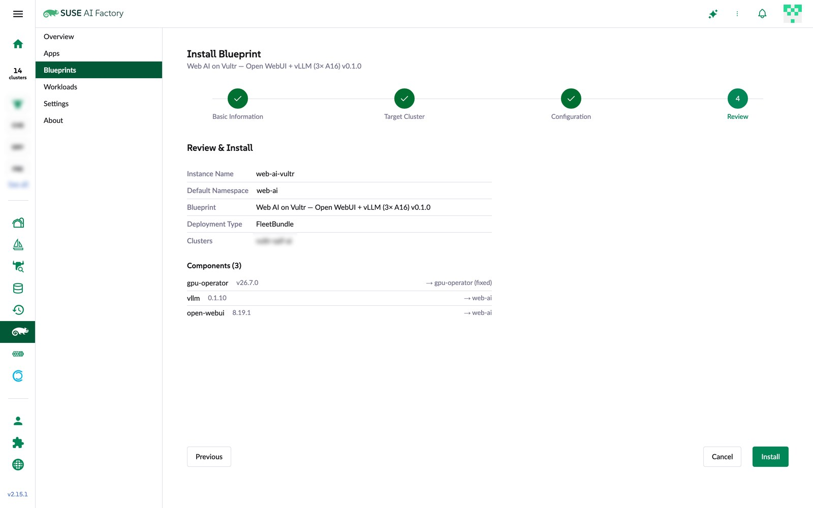
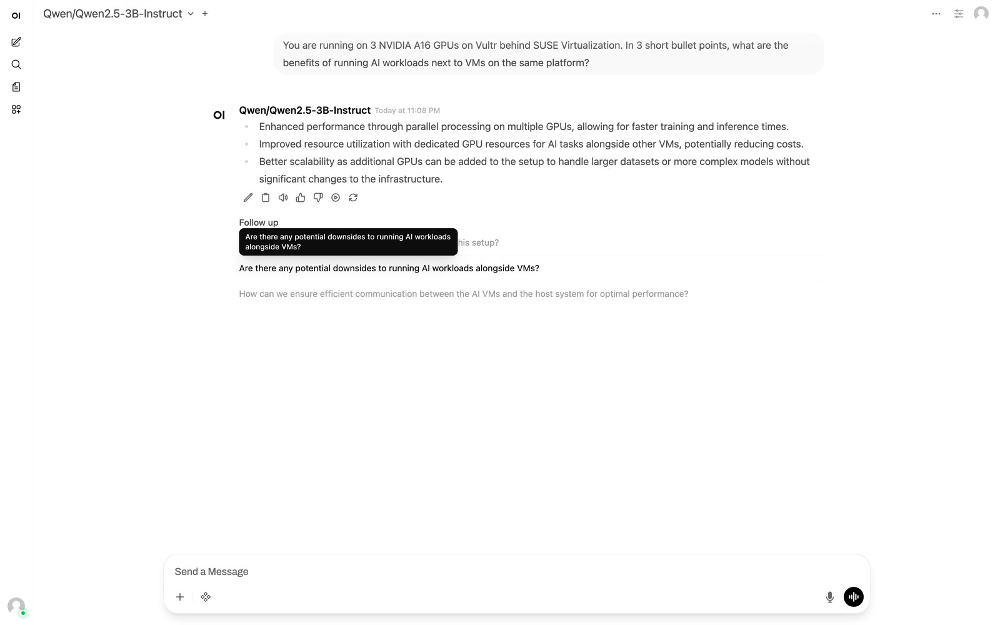

[![Infographic with Harvey the mascot (in his miner's hard hat and safety gear) next to the SUSE chameleon: AI web app on Vultr bare metal. Layer 1, three Vultr bare-metal servers with OS plus Longhorn and a dedicated Portworx disk on a Vultr VPC with a Kube-OVN overlay; layer 2, SUSE Virtualization with the RKE2 guest cluster and three NVIDIA A16 GPU VMs; layer 3, the SUSE AI Factory blueprint with Open WebUI, a round-robin router and vLLM engines; Portworx DR to an on-premises cluster; cost about $3.09 per hour](hero.jpg)](hero-full.jpg "Open full size")

**TL;DR**

- SUSE Virtualization (Harvester) runs on three Vultr bare-metal servers (AMD EPYC 4345P, 64 GB, 2× ~1.9 TB NVMe each). One NVMe disk holds the OS plus a 1.2 TiB Longhorn pool; the other is a dedicated Portworx disk.
- VM networks are **Kube-OVN overlays** that tunnel over the Vultr private network (VPC). The VPC only forwards frames from each server's own MAC address, so bridged and VLAN VM networks can't use it, but overlays can.
- An RKE2 guest cluster from Rancher runs its control plane as VMs on an overlay network, plus three **Vultr NVIDIA A16 GPU VMs** (16 GB each, $0.47/h) that join as workers over the same VPC.
- A **SUSE AI Factory blueprint** (GPU Operator + vLLM + Open WebUI) installs from Rancher in four wizard steps. It serves Qwen2.5-3B-Instruct from three vLLM engines, one per A16, behind a round-robin router.
- VMs replicate between my on-premises SUSE Virtualization cluster and Vultr with **Portworx asynchronous DR**, orchestrated by [harvey](https://github.com/abonillabeeche/harvey). Planned failover took **86 s with no data loss**, and failback **119 s with no data loss**. An unplanned failover started the VM on Vultr in 3 s.
- All of it costs about **$3.09 per hour**: about $1.65 for the bare metal, $1.41 for the GPUs, and a few cents for the VIP, boot server and tunnel VM, plus a $18/month object storage bucket.

I wanted to see how far a cloud bare-metal provider can go as a SUSE Virtualization site: VM networking that isn't limited to the management network, a real GPU tier, and an AI application deployed with SUSE AI Factory instead of by hand. Vultr's Chicago region had all the pieces. This post describes the end configuration and how each layer is implemented.

## Architecture

[](network-diagram-full.jpg "Open full size")

| Layer | Implementation | Version |
|---|---|---|
| Hypervisor cluster | SUSE Virtualization on 3× Vultr `vbm-8c-64gb-amd` | Harvester v1.9.0 |
| Management | Rancher (imported cluster, Virtualization Management) | Rancher v2.15.1 |
| VM networks | Kube-OVN overlays over the Vultr VPC (second NIC) | `kubeovn-operator` addon 1.16.2 |
| Storage | Longhorn v1 on NVMe A, Portworx on NVMe B | Portworx 3.7.1, operator 26.4.0 |
| Guest Kubernetes | RKE2 via the Harvester node driver + 3 custom GPU workers | v1.36.5+rke2r1, Calico VXLAN |
| GPU workers | Vultr `vcg-a16-6c-60g-16vram`, openSUSE Leap 16 | NVIDIA driver 580.178.04, CUDA 13.0 |
| AI application | SUSE AI Factory blueprint → Fleet bundle | GPU Operator v26.7.0, vLLM chart 0.1.10, Open WebUI 8.19.1 |

Each Harvester node has two 25 GbE ports, and each has a job:

- **First port: public and management.** It carries Harvester's management bridge, the node's public address and the cluster VIP. It's the path for the UI and Kubernetes API, image downloads and outbound NAT for VMs.
- **Second port: Vultr VPC (10.50.0.0/24, MTU 8800).** It's the underlay for the Kube-OVN overlay tunnels, and it's also where the GPU VMs attach.

Four traffic paths cross this design:

| Path | From → to | Carried by |
|---|---|---|
| VM ↔ VM | Overlay VM → overlay VM on another node | Kube-OVN tunnel over the VPC |
| VM → internet | Overlay VM → public internet | Kube-OVN gateway, then source NAT on the node's public port |
| Guest cluster ↔ GPU workers | Control-plane VMs (172.20.10.x) ↔ GPU VMs (10.50.0.x) | Calico VXLAN, routed between the overlay and the VPC by a Harvester node |
| User → AI app | Browser → Open WebUI | NodePort on the GPU VMs' public addresses, behind a Vultr firewall group |

Harvester's **Virtual Private Cloud** view shows the overlay side of this: the default Kube-OVN VPC, its subnets, the two overlay VM networks, and the VMs attached to each.

[](harvester-vpc-topology-full.jpg "Open full size")

## How the components are orchestrated

Nothing in this stack is configured by hand on a node. Each layer is driven by the one above it:

1. **Vultr API → bare metal.** A script orders the servers, attaches the reserved IP and the VPC, and starts the unattended Harvester install. A second script sets the admin password immediately, because the UI is on a public address.
2. **Harvester → node configuration.** Per-node `CloudInit` resources write the VPC NIC profile, the Portworx multipath denylist and the Portworx port guard. Harvester reapplies them on every boot.
3. **Harvester addons and operators.** The `kubeovn-operator` addon runs Kube-OVN, the Portworx operator runs the storage cluster, and Harvester's `csi-driver-config` setting tells VM snapshots and backups which snapshot class to use.
4. **Rancher → guest cluster.** Rancher imports the Harvester cluster and uses the Harvester node driver to create the RKE2 control-plane VMs on `ovl-web`. A provisioning script adds the GPU VMs as custom workers with Rancher's registration command.
5. **SUSE AI Factory → Fleet → applications.** The blueprint becomes a Fleet bundle on the guest cluster. The GPU Operator then advertises `nvidia.com/gpu` on each A16 node, vLLM schedules one engine per GPU, and Open WebUI points at the vLLM router.

Everything in that list lives in a Git repository laid out for Fleet: scripts, Harvester manifests, guest-cluster settings and the blueprint. A rebuild is a replay, not a rediscovery.

## Step 1: Build the Harvester cluster on Vultr bare metal

Each node is a `vbm-8c-64gb-amd` plan: an 8-core EPYC 4345P, 64 GB of RAM, two ~1.9 TB NVMe drives and two 25 GbE ports, at $0.55 per hour. Each node boots a stock OS first, then `kexec`s into the Harvester installer kernel with an automatic configuration file. This configuration is for the first node; join nodes use `mode: join` and the cluster VIP.

> [!NOTE] Why the install goes through a stock OS, as of November 2026
> Harvester's installer requires UEFI. As of today, a Vultr bare-metal server deployed with the iPXE / Custom OS option boots in legacy BIOS mode, while the same server deployed with a stock OS boots in UEFI, and the API has no boot-mode setting. So each node is deployed with Ubuntu, which comes up in UEFI, and `kexec` hands the running firmware session to the Harvester installer. If Vultr adds UEFI for iPXE deployments, iPXE straight into the installer becomes the simpler path.

```yaml
scheme_version: 1
token: <cluster-token>
os:
  hostname: harvester-1
  password: '<sha512-crypt hash>'
install:
  mode: create
  management_interface:
    interfaces:
      - name: enp1s0f0np0
        hwAddr: "<nic1-mac>"
    method: static
    ip: 203.0.113.11
    subnet_mask: 255.255.254.0
    gateway: 203.0.113.1
  device: /dev/nvme0n1
  persistent_partition_size: 500Gi   # OS + 500 GiB; the rest of this disk becomes the Longhorn default disk
  iso_url: http://<boot-server>/<random-path>/harvester-v1.9.0-amd64.iso
  vip: 203.0.113.10
  vip_mode: static
  tty: tty1
```

- **VIP.** A Vultr reserved IPv4 address, attached to the first node, becomes the cluster VIP that kube-vip announces.
- **Disk layout.** `persistent_partition_size` leaves about 1.2 TiB per node for Longhorn v1 on the OS disk, and the second NVMe stays raw for Portworx.
- **Management.** The cluster is imported into Rancher. The Rancher agent dials out over HTTPS, so nothing on the Vultr side has to accept inbound connections from Rancher.

> [!NOTE] Pin disks by ID
> NVMe device names can swap between boots on these servers. Anything that targets a specific disk (Portworx partitions, Longhorn v2) should use `/dev/disk/by-id/…` paths.

## Step 2: Build VM networks as Kube-OVN overlays over the Vultr VPC

Attaching a Vultr VPC to a bare-metal server enables its second port, and Vultr assigns that port a private address. These are the rules the VPC enforces, and what each one allows or rules out:

| Traffic on the VPC | Result |
|---|---|
| Frames from the server's own MAC, any IP | ✅ Forwarded |
| Frames from any other MAC (bridge, macvlan, VM) | ❌ Dropped |
| 802.1Q VLAN-tagged frames | ❌ Dropped |
| Jumbo frames | ✅ Up to ~8800 bytes |

So bridged and VLAN VM networks can't use the VPC, and neither can the Harvester Storage Network and VM Migration Network settings, because all of them put new MAC addresses on the wire. An overlay is different: it wraps VM traffic in packets sent between host IPs, from the host's own MAC. Kube-OVN, the `kubeovn-operator` addon in Harvester v1.9, does exactly that.

Each node first gets its VPC address persistently, through a `CloudInit` resource per node that writes a NetworkManager profile with MTU 8800. Then the tunnel interface points at the VPC NIC:

```bash
kubectl -n kube-system patch configurations.kubeovn.io kubeovn --type merge \
  -p '{"spec":{"networking":{"interface":"enp1s0f1np1"}}}'
```

Three overlay subnets cover the usual cases. VMs in the default VPC reach the internet through source NAT on the node, and the isolated subnet lives in its own Kube-OVN VPC with no route out:

```yaml
apiVersion: kubeovn.io/v1
kind: Subnet
metadata:
  name: ovl-web
spec:
  vpc: ovn-cluster
  cidrBlock: 172.20.10.0/24
  gateway: 172.20.10.1
  provider: ovl-web.default.ovn
  natOutgoing: true
  natOutgoingPolicyRules:            # keep real source IPs towards the VPC (GPU workers)
    - match: {dstIPs: "10.50.0.0/24"}
      action: forward
  enableDHCP: true
  mtu: 8750
  dhcpV4Options: "lease_time=3600,router=172.20.10.1,server_id=169.254.0.254,server_mac=0a:58:a9:fe:00:fe,dns_server=1.1.1.1,mtu=8750"
```

| Overlay | CIDR | Kube-OVN VPC | Outbound |
|---|---|---|---|
| `ovl-web` | 172.20.10.0/24 | default | NAT through the node |
| `ovl-app` | 172.20.20.0/24 | default | NAT through the node |
| `ovl-isolated` | 172.30.0.0/24 | `isolated-vpc` | none |

> [!WARNING] One DNS server per subnet
> Kube-OVN splits `dhcpV4Options` on commas. A list such as `dns_server={1.1.1.1,8.8.8.8}` is stored as a broken option, and DHCP then fails for every VM on that subnet.

On an earlier cluster built with the same design, VM-to-VM traffic across two hosts reached **7.2 Gbit/s** with 1.6 ms latency over the overlay, and jumbo 8000-byte pings passed unfragmented.

## Step 3: Give Portworx its own disk

Each node's second NVMe gets two GPT partitions, `px-meta` (64 GB) and `px-data` (the rest). Portworx runs as a three-node cluster with internal KVDB:

```yaml
kind: StorageCluster
apiVersion: core.libopenstorage.org/v1
metadata:
  name: px-cluster
  namespace: portworx
spec:
  image: docker.io/portworx/oci-monitor:3.7.1
  kvdb:
    internal: true
  storage:
    devices:
      - /dev/disk/by-partlabel/px-data
    systemMetadataDevice: /dev/disk/by-partlabel/px-meta
  secretsProvider: k8s
  stork:
    enabled: true
  csi:
    enabled: true
```

Portworx reports 5.1 TiB of capacity. Two more pieces finish the integration:
- **Harvester.** An entry for `pxd.portworx.com` in Harvester's `csi-driver-config` setting lets VM snapshots and backups use the `px-csi-snapclass` class.
- **Host firewall.** An `iptables` rule, also delivered by `CloudInit`, keeps Portworx ports 9001–9022 reachable only from the cluster's own nodes.

My on-premises SUSE Virtualization cluster runs the same Portworx version and store type, so the two can later pair for asynchronous replication.

## Step 4: Create the RKE2 guest cluster and add GPU workers

Rancher creates the guest cluster with the Harvester node driver: three control-plane VMs from an openSUSE Leap 16 image, attached to `ovl-web`.

The GPU tier is three Vultr `vcg-a16-6c-60g-16vram` VMs deployed with Vultr's **openSUSE Leap 16** image, the same OS family as the control-plane VMs. Each has 6 vCPUs, 58 GiB of RAM and **one NVIDIA A16 GPU passed through as a full PCI device** (`10de:25b6`, 16 GB). Because it's a whole GPU rather than a vGPU slice, the standard open driver works and no vGPU licence is involved. A small provisioning script creates each VM and joins it to the cluster:

1. **Create the VM.** It calls the Vultr API with the openSUSE Leap 16 image (`openSUSE Leap 16 x64` in `/v2/os`) and the cluster's VPC attached, so the VM's second NIC gets an address in 10.50.0.0/24.
2. **Set the node up in cloud-init.** Set MTU 8800 and a route for the overlays (`172.20.0.0/16 via` a Harvester node's VPC address), disable `firewalld` (RKE2 needs it off), and install `tar` and `iptables`. Then install a **pinned** NVIDIA version, so the kernel module and user-space packages always match, and lock it:

   ```bash
   V=580.178.04
   zypper -n install nvidia-open-driver-G06-signed-kmp-default=<kmp-version-for-$V> \
     nvidia-compute-G06=$V nvidia-compute-utils-G06=$V nvidia-common-G06=$V
   zypper addlock 'nvidia-*'
   ```

3. **Join over SSH.** It runs Rancher's registration command with `--worker --address <vpc-ip> --internal-address <vpc-ip>`. Its registration token never goes into instance user-data, which other users of a shared cloud account could read.

   Rancher only shows a registration command in the UI for *custom* clusters. This guest cluster was provisioned by Rancher with the Harvester node driver, so the UI doesn't offer one. That command still exists on Rancher's management cluster, in the guest cluster's `ClusterRegistrationToken`. In Rancher 2.15 its `nodeCommand` carries a `{token}` placeholder, and the real token sits in a secret next to it:

   ```bash
   # On the Rancher management (local) cluster
   CID=$(kubectl -n fleet-default get clusters.provisioning.cattle.io <guest-cluster> -o jsonpath='{.status.clusterName}')
   TOKEN=$(kubectl -n $CID get secret crt-token-default-token -o jsonpath='{.data.token}' | base64 -d)
   CMD=$(kubectl -n $CID get clusterregistrationtokens.management.cattle.io default-token -o jsonpath='{.status.nodeCommand}')
   echo "${CMD//\{token\}/$TOKEN} --worker --address <vpc-ip> --internal-address <vpc-ip>"   # run this on the GPU VM
   ```

```console
$ kubectl get nodes -o custom-columns=NODE:.metadata.name,GPU:.status.allocatable.nvidia\.com/gpu,PRODUCT:.metadata.labels.nvidia\.com/gpu\.product,INTERNAL-IP:.status.addresses[0].address
NODE             GPU      PRODUCT      INTERNAL-IP
gpu-worker-1     1        NVIDIA-A16   10.50.0.6
gpu-worker-2     1        NVIDIA-A16   10.50.0.8
gpu-worker-3     1        NVIDIA-A16   10.50.0.7
control-plane-1  <none>   <none>       172.20.10.13
control-plane-2  <none>   <none>       172.20.10.12
control-plane-3  <none>   <none>       172.20.10.14
```

> [!IMPORTANT] External workers and the Harvester cloud provider
> A guest cluster created with the Harvester node driver runs the Harvester cloud provider. It only initialises nodes that are Harvester VMs, so external workers need `providerID: rke2://<node>` set and the `node.cloudprovider.kubernetes.io/uninitialized` taint removed; the script does both. Volumes from the Harvester CSI driver also attach only to Harvester VMs. For a GPU tier outside Harvester, a guest cluster without the Harvester cloud provider is the cleaner design.

## Step 5: Deploy the blueprint with SUSE AI Factory

SUSE AI Factory adds a blueprint catalogue to Rancher. A blueprint is a versioned list of Helm charts with values, installed as a Fleet bundle on the clusters you choose. This one combines three charts that already run in other SUSE AI Factory blueprints:

```yaml
apiVersion: ai-factory.suse.com/v1alpha1
kind: Blueprint
metadata:
  name: web-ai-on-vultr-open-webui-vllm-3-a16-0-1-5   # must be <slug of displayName>-<version>
spec:
  displayName: "Web AI on Vultr — Open WebUI + vLLM (3× A16)"
  version: 0.1.5
  source: Custom
  components:
    - chartRepo: nvidia
      chartName: gpu-operator
      chartVersion: v26.7.0
      targetNamespace: gpu-operator
      values:
        driver: {enabled: false}            # driver is pinned on the hosts
        toolkit:
          env:
            - {name: CONTAINERD_SOCKET, value: /run/k3s/containerd/containerd.sock}   # RKE2
    - chartRepo: application-collection
      chartName: vllm
      chartVersion: 0.1.10
      values:
        servingEngineSpec:
          runtimeClassName: nvidia
          nodeSelector: {nvidia.com/gpu.present: "true"}
          modelSpec:
            - name: qwen2-5-3b
              modelURL: Qwen/Qwen2.5-3B-Instruct
              replicaCount: 3
              requestGPU: 1
              vllmConfig:
                dtype: half
                maxModelLen: 16384
        routerSpec: {routingLogic: roundrobin}
    - chartRepo: application-collection
      chartName: open-webui
      chartVersion: 8.19.1
      values:
        ollama: {enabled: false}
        ingress: {enabled: false}
        service: {type: NodePort, nodePort: "30080"}
        extraEnvVars:
          - {name: OPENAI_API_BASE_URL, value: "http://vllm-router-service.web-ai.svc.cluster.local:80/v1"}
        affinity:                            # stateful: keep it on Harvester VMs (Harvester CSI volume)
          nodeAffinity:
            requiredDuringSchedulingIgnoredDuringExecution:
              nodeSelectorTerms:
                - matchExpressions:
                    - {key: nvidia.com/gpu.present, operator: DoesNotExist}
```

[](ai-factory-blueprint-catalog-full.jpg "Open full size")

Its install wizard has four steps: basic information, target cluster, configuration and review. Fleet Bundle is the deployment type, and its review step lists every component and the namespace it lands in:

[](ai-factory-install-review-full.jpg "Open full size")

Later changes ship as a new blueprint version and roll out through the workload's **Upgrade** action, which picks the target version and updates the Fleet bundle in place.

Once installed, each GPU worker runs one vLLM engine, and the stateful pieces sit on the Harvester-hosted nodes:

```console
$ kubectl -n web-ai get pods -o wide
NAME                                               READY  STATUS   NODE
open-webui-0                                       1/1    Running  control-plane-3
open-webui-redis-8666c98b8b-rsbbr                  1/1    Running  control-plane-1
vllm-deployment-router-689d55694d-qvbbv            1/1    Running  gpu-worker-2
vllm-qwen2-5-3b-deployment-vllm-65c9956868-k4ctb   1/1    Running  gpu-worker-1
vllm-qwen2-5-3b-deployment-vllm-65c9956868-ps2vb   1/1    Running  gpu-worker-3
vllm-qwen2-5-3b-deployment-vllm-65c9956868-zjd9k   1/1    Running  gpu-worker-2
```

```console
root@gpu-worker-2:~# nvidia-smi --query-gpu=name,driver_version,memory.used,memory.total,temperature.gpu --format=csv
name, driver_version, memory.used [MiB], memory.total [MiB], temperature.gpu
NVIDIA A16, 580.178.04, 13676 MiB, 15356 MiB, 35

root@gpu-worker-2:~# nvidia-smi --query-compute-apps=pid,process_name,used_memory --format=csv
pid, process_name, used_gpu_memory [MiB]
33784, VLLM::EngineCore, 13668 MiB
```

## Step 6: Expose Open WebUI safely

This cluster has no load-balancer IP pool yet, so Open WebUI is a NodePort service on port 30080. The GPU workers are the only guest-cluster nodes with public addresses. kube-proxy forwards the NodePort from any node to wherever the Open WebUI pod runs, so `http://<gpu-worker-public-ip>:30080` reaches it. A **Vultr firewall group** on the three GPU VMs allows TCP 22 and 30080 from a single trusted source address and drops all other inbound traffic on the public interface. Vultr firewalls don't filter the VPC, so cluster traffic is unaffected.

[](open-webui-chat-a16-full.jpg "Open full size")

## Step 7: Replicate VMs between on-premises and Vultr

My on-premises SUSE Virtualization cluster runs the same Portworx version and store type as the Vultr cluster, which is what Portworx asynchronous disaster recovery needs. [harvey](https://github.com/abonillabeeche/harvey), my VM disaster-recovery orchestrator for SUSE Virtualization, drives it. Version 0.3.0 on `main` split harvey's storage layer into backends:

- **Storage-independent part.** It copies everything about a VM except its disks: VM spec, Secrets, ConfigMaps, network attachment definitions, failover order, hooks, and RTO/RPO tracking.
- **Storage backends.** NetApp SnapMirror through Trident, and now Portworx through Stork. harvey picks the backend per VM from the persistent volume's CSI driver and records the choice on the VM, so an unplanned failover works even when the source site is down.

With Portworx, Stork moves only the disk data and the PV/PVC objects; harvey syncs the rest of the VM's objects, exactly as it does with NetApp. Data travels through an encrypted Vultr Object Storage bucket that both sites reach over HTTPS.

[](dr-flow-full.jpg "Open full size")

**Connectivity.** Replication from on-premises to Vultr works directly, since the on-premises cluster can reach Vultr's public addresses (with Vultr's Portworx ports allowed for that one source address). Failback is the other direction: the Vultr cluster has to reach the on-premises Portworx API, which sits behind the home NAT. A pair of Tailscale subnet routers solves that without opening anything at home:

- On premises, the DR VLAN's existing gateway VM advertises the DR subnet to the tailnet, with source NAT on.
- A small Vultr VM on the cluster's VPC accepts that route and masquerades the Harvester nodes' traffic into the tailnet.
- Each Vultr Harvester node gets one route for the DR subnet via that VM, on its VPC interface.

Both ends connect outbound only. The Kubernetes API of the on-premises cluster needs no tunnel at all, because Stork reaches it through Rancher's authenticated proxy.

**Commands.** The pair is created once per direction with `storkctl`; the secrets are redacted here:

```console
$ storkctl create clusterpair harvey-to-vultr -n harvey-px-demo \
    --src-kube-file onprem.yaml --dest-kube-file vultr.yaml \
    --dest-ep <VULTR_NODE_IP>:9001 --dest-token <vultr: pxctl cluster token show> \
    --provider s3 --s3-endpoint <S3_ENDPOINT> --s3-access-key <REDACTED> --s3-secret-key <REDACTED> \
    --s3-region us-east-1 --bucket harvey-px-dr --encryption-key <REDACTED> --unidirectional
…
ClusterPair harvey-to-vultr created successfully. Direction Source -> Destination
```

`harvey protect` sets up the 15-minute migration schedule, copies the first baseline, and creates the stopped replica VM on the other side:

```console
$ harvey protect px-demo-1 -n harvey-px-demo
──── protect harvey-px-demo/px-demo-1: on-prem → vultr ────
  waiting for the baseline migration on-prem → vultr ...
  storage backend: portworx (Portworx async DR)
  on-prem: labelled 2 PVC(s)+PV(s) harvey.io/vm=px-demo-1
  on-prem: migrationschedule harvey-px-demo/harvey-px-demo-1 updated (pair harvey-to-vultr, every 15 min)
  vultr: pvc/px-demo-1-root migrated (732700672 B)
  vultr: pvc/px-demo-1-data migrated (0 B)
  vultr: secret/px-demo-1-cloudinit created
  vultr: vm/px-demo-1 created (Halted)
  ✓ harvey-px-demo/px-demo-1 protected
```

A planned failover stops the VM, runs a final sync, promotes the replica and starts it, and reports where the time went:

```console
$ harvey failover vm px-demo-1 -n harvey-px-demo -y
Preflight
  harvey-px-demo/px-demo-1: 2 volume(s) ready (Portworx async DR)
Metadata sync
Stop on on-prem
  ✓ harvey-px-demo/px-demo-1 stopped
Final sync
  ✓ harvey-px-demo/px-demo-1-root: 0 B in 75.7s
  ✓ harvey-px-demo/px-demo-1-data: 0 B in 75.7s
Promote on vultr
  ✓ harvey-px-demo/px-demo-1: 2 volume(s) read-write
Start on vultr
  ✓ harvey-px-demo/px-demo-1 Running
──── Failover Complete ────
                Failover Summary                
╭──────────────────────────────┬───────────────╮
│ Metric                       │         Value │
├──────────────────────────────┼───────────────┤
│ VMs stopped on source        │             1 │
│ Volumes final-synced         │             2 │
│ VMs started on DR            │             1 │
│   stop                       │            6s │
│   final_sync                 │           75s │
│   promote                    │            0s │
│   start                      │            3s │
│ Total RTO                    │ 86s  (1m 26s) │
│ RPO harvey-px-demo/px-demo-1 │ 0s (lossless) │
╰──────────────────────────────┴───────────────╯
```

Failback is the same flow in the other direction, followed by a reprotect that turns replication around again:

```console
$ harvey failback px-demo-1 -n harvey-px-demo -y
…
──── Failover Complete ────
│   stop                       │             6s │
│   final_sync                 │           106s │
│   start                      │             6s │
│ Total RTO                    │ 119s  (1m 59s) │
│ RPO harvey-px-demo/px-demo-1 │  0s (lossless) │
```

**Results** with two small openSUSE Leap 16 VMs (5 GiB root disk and 1 GiB data disk each). A process inside each guest writes a UTC timestamp to both disks every 5 seconds, so data loss can be measured from the guest's own history:

| Test | Result |
|---|---|
| Protect (on-premises → Vultr) | 733 MB first copy in about 2 minutes |
| Planned failover | RTO 86 s (stop 6 s, final sync 75 s, promote 0 s, start 3 s), RPO 0 |
| Unplanned failover (on-premises treated as down) | VM running on Vultr in 3 s; 151 s of writes lost with a 15-minute schedule, both disks from the same point in time |
| Original site returns | Its replication schedule suspends itself instead of overwriting the promoted copy |
| Failback (Vultr → on-premises) | RTO 119 s (stop 6 s, final sync 106 s, promote 0 s, start 6 s), RPO 0 |

Across one full round trip, 366 timestamps written from on-premises to Vultr and back showed only the two planned outage gaps (94 s and 135 s of wall-clock time), with no writes lost.

Points worth knowing before relying on this (also in harvey's [Portworx notes](https://github.com/abonillabeeche/harvey/blob/main/docs/portworx.md#stork-behaviour-to-know-about-seen-with-stork-2642)):

- **Reverse migrations copy everything.** Portworx restores into a new volume (new ID, same name) and deletes the old one, so the first migration after a failover is a full copy (about 736 MB here). Later scheduled migrations in the new direction are incremental again.
- **Stork's KubeVirt cleanup can delete the replica VM.** After a failback, Stork 26.4 sees a volume-handle mismatch on the old PVs and removes them, together with any VM that uses them. It then expects the migration's included resources to recreate the VM. harvey runs volume-only migrations and re-syncs the VM spec right afterwards, so the VM comes back stopped. A plain volume-only Stork setup would lose the VM object.
- **"0 B" in the final sync is expected.** Stork reports a byte count only for full copies; incremental migrations, including the final sync in the failover output above, show 0 bytes even when they carried data.
- **Measure unplanned RPO from the trigger time.** Stork's PVC annotation `stork.libopenstorage.org/migrationTime` records when the migration was *applied*, which under-reported the loss in this test (43 s against 151 s real). Use the trigger time encoded in the migration name instead.
- **Split-brain protection uses Stork's own flag.** On failover, harvey marks the VM active on the destination with the same mechanism `storkctl perform failover` uses, which is why the returning site's schedule suspends itself.

## Packages and settings the base images need

Stock images got close but not all the way. Every gap below is now handled by cloud-init, a `CloudInit` resource or a chart value:

| Where | Gap in the stock image or chart | Fix |
|---|---|---|
| GPU VMs (openSUSE Leap 16 minimal) | `tar` and `iptables` missing; `firewalld` on (drops Calico VXLAN) | Install both, disable `firewalld` |
| GPU VMs (openSUSE Leap 16 minimal) | No NVIDIA driver | NVIDIA repo, open kernel module and user space at one pinned version (580.178.04), `zypper addlock 'nvidia-*'` |
| GPU VMs (openSUSE Leap 16 minimal) | VPC NIC at MTU 1500, no route to the overlays | NetworkManager profile: MTU 8800, `172.20.0.0/16 via` a Harvester node |
| Harvester nodes | Multipath can claim Portworx devices; Portworx ports exposed | `CloudInit`: multipath denylist + `iptables` guard (9001–9022 from cluster nodes only) |
| RKE2 guest cluster | `rke2-traefik` on every node | `HelmChartConfig`: GPU workers only |
| GPU Operator / Open WebUI charts | Own driver and standard containerd paths; OpenAI endpoint and cert-manager ingress | `driver.enabled: false` + RKE2 `CONTAINERD_SOCKET`; `OPENAI_API_BASE_URL` → vLLM router, ingress off |

## Design notes

- **Overlays are the only VM networking on a MAC-filtered VPC.** Plan Harvester VM networks as Kube-OVN overlay subnets from the start.
- **Keep stateful pods on Harvester VMs.** Harvester CSI volumes can't attach to an external VM, so anything with a persistent volume needs node affinity away from the GPU workers.
- **Match model and image.** The vLLM image used here serves FP16 models; Qwen2.5-3B-Instruct in FP16 uses about 13.7 GB of the A16's 16 GB with a 16K context.
- **No shared model volume.** Each vLLM replica caches the model on its own node. A single `ReadWriteOnce` volume can't follow three replicas onto three nodes.
- **Blueprint names follow the display name.** SUSE AI Factory looks blueprints up as `<slug of displayName>-<version>`.

## Cost

| Item | Plan | Rate |
|---|---|---|
| 3× Harvester nodes | `vbm-8c-64gb-amd` | 3 × $0.55/h |
| 3× GPU workers | `vcg-a16-6c-60g-16vram` | 3 × $0.47/h |
| VIP, boot server, tunnel VM | reserved IPv4, `vc2-1c-2gb`, `vc2-1c-1gb` | ~$0.03/h |
| DR object storage | Vultr Object Storage, Standard | $18/month |
| **Total** | | **≈ $3.09/h** + storage |

## What's next

- **A second build without the Harvester cloud provider in the guest cluster,** so external GPU workers join without the provider-ID step.
- **A load-balancer IP pool** backed by Vultr reserved IPs, to replace the NodePort.
- **Storage.** Decide what the dedicated NVMe disk serves long-term: Portworx with its NVMe-optimised store, or Longhorn v2 (SPDK). Move Portworx replication traffic onto the private VPC interface, and give the external GPU workers persistent storage of their own, since Harvester-provided volumes attach only to Harvester VMs.
