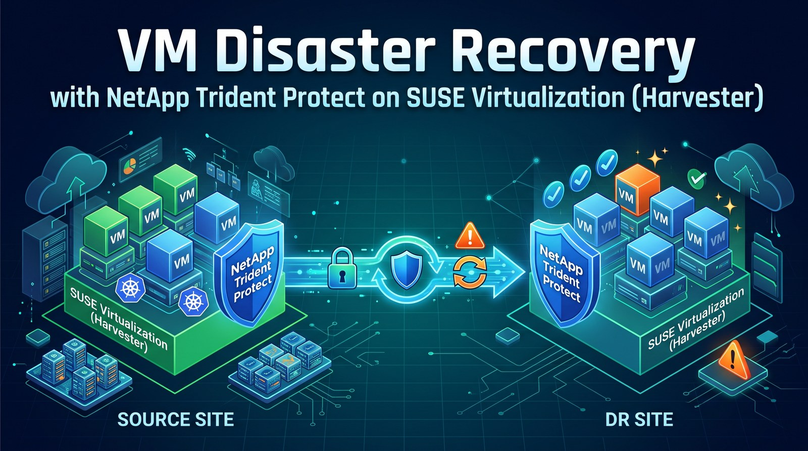

**TL;DR**

- **In plain terms:** if the site where your VMs run goes down, you want copies of them ready to start somewhere else. Trident Protect keeps such a copy for each protected VM: every five minutes it takes a consistent snapshot of the VM's disks, NetApp storage sends the changes to a second site, and the VM's definition goes to an S3 bucket. When you fail over, Trident Protect turns those copies into a running VM at the second site, and failback brings it home the same way. This post sets it up between two SUSE Virtualization (Harvester) clusters and measures how long that takes and whether any data is lost.
- [Trident Protect](https://docs.netapp.com/us-en/trident/trident-protect/trident-protect-kubevirt-vms.html) replicated a three-disk VM (an image-cloned root disk on iSCSI, an iSCSI data disk and an NFS data disk) from one SUSE Virtualization cluster to another and failed it over in **166 seconds** and back in **140 seconds**, with **no data lost** either way, checked inside the guest.
- Disk data moves array to array with SnapMirror; the VM definition and its Secrets travel through an S3 bucket (the AppVault). The DR cluster holds only replica PVCs until you promote, then Trident Protect recreates the VM.
- Every recovery point is one application snapshot of all the VM's disks, taken with the guest's filesystems frozen through the QEMU guest agent. On my SELinux-enforcing guest the freeze failed silently until I labelled the data-disk mount points.
- The AppMirrorRelationship only ships snapshots; something else has to take them. A `Schedule` on the source every five minutes did that.
- For a planned failover, disable that schedule **before** the `ShutdownSnapshot`. I did not, a newer snapshot got shipped, the promotion was rejected, and the DR copy was gone afterwards.

After I published how I replicated VMs between two SUSE Virtualization (Harvester) clusters with [NetApp SnapMirror and a small CLI called Harvey](/posts/harvey-vm-failover-netapp-snapmirror-suse-virtualization/), NetApp engineers pointed me to Trident Protect, which covers the same workflow without an extra tool. This post sets it up on the same two clusters and [the same two ONTAP simulators](/posts/netapp-snapmirror-two-ontap-simulators-suse-virtualization/), following NetApp's documentation and Yves at NetApp's [KubeVirt scenario](https://github.com/YvosOnTheHub/LabNetApp/tree/master/Kubernetes_v6/Trident_Protect_Scenarios/Scenario11), with the lab-only shortcuts (plain HTTP to S3, skipped certificate checks) left out.

## How it works

Two things travel between the sites, on two paths:

| What | Path | When |
|---|---|---|
| Disk data | ONTAP SnapMirror, array to array, only changed blocks | after every application snapshot (every 5 minutes here); the DR copy is always current up to the last one |
| VM definition, Secrets, PVC definitions | S3 bucket (the AppVault), a few KB per snapshot | written with every snapshot, read by the DR cluster when you promote |

On each tick, Trident Protect on the primary freezes the guest's filesystems through the QEMU guest agent, has ONTAP snapshot every disk of the VM at that instant, thaws, and writes the application's definition to the bucket. Trident Protect on DR then tells ONTAP to update the SnapMirror relationships, so vsim2 receives only the blocks that changed. Nothing is copied at failover time: promotion breaks the relationships (the replica volumes become read-write), recreates the VM and its Secrets from the bucket, and starts it.

Trident Protect also has a backup feature (Kopia or Restic) that does put disk data in S3. That is a different use case and not part of this setup.

## Setup

| Item | Primary site | DR site |
|---|---|---|
| SUSE Virtualization | 1.9.0, 3 nodes | 1.10.0-rc1, 3 nodes |
| Trident | 26.06.1 | 26.06.1 |
| Trident Protect | 26.06.0 (chart 100.2606.0) | 26.06.0 |
| ONTAP | simulator 9.16.1P1, SVM `svm0` | simulator 9.16.1P1, SVM `svm_dr` |
| Object storage | Ceph RGW (S3), shared by both sites | |

The ONTAP clusters and SVMs were already peered for SnapMirror ([how](/posts/netapp-snapmirror-two-ontap-simulators-suse-virtualization/)). Both clusters run the snapshot controller and have a VolumeSnapshotClass for `csi.trident.netapp.io`, which Trident Protect needs.

## Step 1: Give Trident Protect its own bucket

A dedicated S3 user and bucket keep Trident Protect's keys away from everything else in the object store. On Ceph RGW (Rook toolbox):

```console
$ radosgw-admin user create --uid=trident-protect --display-name="Trident Protect AppVault" --max-buckets=5
$ aws --endpoint-url https://s3.example.com s3api create-bucket --bucket trident-protect-appvault
```

## Step 2: Install Trident Protect on both clusters

```console
$ helm repo add netapp-trident-protect https://netapp.github.io/trident-protect-helm-chart
$ helm install trident-protect netapp-trident-protect/trident-protect --version 100.2606.0 \
    -n trident-protect --create-namespace -f values-primary.yaml
```

```yaml
# values-primary.yaml (values-dr.yaml uses clusterName: dr)
clusterName: primary
autoSupport:
  enabled: false     # lab without a support contract; leave it on for supported deployments
```

Each cluster needs a different `clusterName`. Its controller requests 2 GiB of memory and half a CPU. NetApp ships the `tridentctl-protect` CLI in [NetApp's releases](https://github.com/NetApp/tridentctl-protect/releases); everything below can also be done with plain YAML.

## Step 3: Create the same AppVault on both clusters

NetApp's examples use one bucket with an **identically named AppVault on both clusters**. The Secret holds the S3 keys and a random data-mover password, the same on both sides:

```console
$ kubectl -n trident-protect create secret generic s3-trident-protect \
    --from-literal=accessKeyID=... --from-literal=secretAccessKey=... --from-file=KOPIA_PASSWORD=datamover-password
```

```yaml
apiVersion: protect.trident.netapp.io/v1
kind: AppVault
metadata: {name: lab-vault, namespace: trident-protect}
spec:
  providerType: GenericS3
  providerConfig:
    s3:
      bucketName: trident-protect-appvault
      endpoint: s3.example.com
      secure: "true"
      skipCertValidation: "false"
  providerCredentials:
    accessKeyID: {valueFromSecret: {name: s3-trident-protect, key: accessKeyID}}
    secretAccessKey: {valueFromSecret: {name: s3-trident-protect, key: secretAccessKey}}
  dataMoverPasswordSecretRef: s3-trident-protect
```

Both reported `Available` within seconds. My endpoint uses a publicly signed certificate, so certificate validation stays on; for a private CA, the AppVault has a `rootCA` field.

## Step 4: Define the VM as an application

My test VM runs openSUSE Leap 16.0 from an image on the NetApp iSCSI StorageClass (its root disk is a FlexClone of the image volume), plus a 1 GiB iSCSI disk and a 1 GiB NFS disk, both formatted ext4 in the guest. A service in the guest appends a UTC timestamp to a file on each disk every 5 seconds, so any gap in those files is either an outage or lost data.

Trident Protect 26.06 can select virtual machines directly, which collects the VM, its PVCs and the Secrets it references:

```yaml
apiVersion: protect.trident.netapp.io/v1
kind: Application
metadata: {name: tp-demo-1, namespace: tp-demo}
spec:
  includedVirtualMachines:
    - namespace: tp-demo
      names: [tp-demo-1]
```

### Make sure the freeze really happens

Snapshots of a VM are application-consistent only if the QEMU guest agent can freeze the guest's filesystems (`vm.freeze` is on by default in the chart). My first snapshot reported `Completed`, but the controller log said otherwise:

```console
Error freezing VM, continuing with remaining VMs ...
guest agent command failed: unable to execute QEMU agent command 'guest-fsfreeze-freeze':
failed to open /mnt/nfs: Permission denied
```

Leap 16 runs SELinux in enforcing mode, and the freshly created ext4 filesystems on the data disks had no SELinux label on their mount points, so the agent was not allowed to open them. Labelling them like `/mnt` fixed it; the label is stored on the filesystem and survives reboots and failovers:

```console
$ sudo chcon -t mnt_t /mnt/iscsi /mnt/nfs
```

After that, the next snapshot froze and thawed the guest (`guest-fsfreeze called` at 19:04:31, `guest-fsthaw called` at 19:04:37 in the agent's journal). Check the controller log or the guest journal after your first snapshot; the snapshot status alone does not tell you.

## Step 5: Schedule snapshots and mirror them

The AppMirrorRelationship (AMR) mirrors application snapshots; it does not take them. Without a schedule on the source it ships whatever snapshots exist and then reports `RecurrenceRuleCompliant=False: A new source snapshot was expected based on the recurrence rule, but was still not found after 5 min`. So the primary gets a `Schedule`, every five minutes, the minimum NetApp supports for asynchronous SnapMirror:

```yaml
apiVersion: protect.trident.netapp.io/v1
kind: Schedule
metadata: {name: tp-demo-1-every-5min, namespace: tp-demo}
spec:
  applicationRef: tp-demo-1
  appVaultRef: lab-vault
  granularity: Custom
  recurrenceRule: |-
    DTSTART:20261103T000000Z
    RRULE:FREQ=MINUTELY;INTERVAL=5
  snapshotRetention: "3"
  backupRetention: "0"
```

The AMR lives on the DR cluster, in a namespace that must already exist, and needs the source application's UID:

```yaml
apiVersion: protect.trident.netapp.io/v1
kind: AppMirrorRelationship
metadata: {name: tp-demo-1, namespace: tp-demo}
spec:
  desiredState: Established
  sourceApplicationName: tp-demo-1
  sourceApplicationUID: <uid of the Application on the primary>
  sourceAppVaultRef: lab-vault
  destinationAppVaultRef: lab-vault
  namespaceMapping:
    - {source: tp-demo, destination: tp-demo}
  storageClassMapping:                 # per class, so iSCSI and NFS disks keep their protocol
    - {source: netapp-iscsi, destination: netapp-iscsi}
    - {source: netapp-nfs, destination: netapp-nfs}
  recurrenceRule: |-
    DTSTART:20261103T000000Z
    RRULE:FREQ=MINUTELY;INTERVAL=5
  transformations:                     # applied on promotion: DR-only placement rule
    - resource: {group: kubevirt.io, version: v1, kind: VirtualMachine, name: tp-demo-1}
      operations:
        - op: add
          path: /spec/template/spec/affinity
          value:
            nodeAffinity:
              requiredDuringSchedulingIgnoredDuringExecution:
                nodeSelectorTerms:
                  - matchExpressions:
                      - {key: kubernetes.io/hostname, operator: NotIn, values: [<reserved-dr-node>]}
```

Two fields are worth pointing out. `storageClassMapping` maps each source StorageClass separately; the single `storageClassName` field would put the NFS disk on the iSCSI class. `transformations` are JSON-patch operations applied to restored resources at promotion; here they keep the failed-over VM off a DR node I had reserved for other tests, without touching the VM on the primary.

My AMR reached `Established` in about four minutes, with one SnapMirror relationship per disk. In steady state a scheduled snapshot took about 14 seconds (19:20:00 to 19:20:14) and the following transfer 16 seconds. Interestingly, the relationships have no ONTAP schedule (`-` in `snapmirror show`): Trident Protect triggers every update itself. Freezing is not free on a slow simulator: during one scheduled snapshot the guest's writes paused for 28 seconds.

## Step 6: Planned failover

NetApp documents a `ShutdownSnapshot` on the primary, then promotion on DR with that snapshot. Order matters:

```console
# primary: stop taking scheduled snapshots FIRST
$ kubectl -n tp-demo patch schedule.protect.trident.netapp.io tp-demo-1-every-5min --type merge -p '{"spec":{"enabled":false}}'
# primary: final snapshot; this also removes the application from the primary
$ tridentctl-protect create shutdownsnapshot tp-failover-2 --app tp-demo-1 --appvault lab-vault -n tp-demo
# DR: promote with that snapshot (third segment of the ShutdownSnapshot's status.appArchivePath)
$ kubectl -n tp-demo patch amr tp-demo-1 --type merge \
    -p '{"spec":{"desiredState":"Promoted","promotedSnapshot":"20261103195456_tp-failover-2_899d11c8-..."}}'
```

A `ShutdownSnapshot` does more than stop the VM: it takes the final snapshot, switches the PVCs to `Retain`, and **deletes the application's resources on the primary**, including the `VirtualMachine` and its cloud-init Secret. Only the PVCs stay. Its definitions are safe in the AppVault, but plan for the VM object disappearing from the primary site.

| Phase | Time |
|---|---|
| ShutdownSnapshot complete | 40 s |
| AMR `Promoted` (final transfer, break, restore resources) | 158 s |
| VM `Running` on DR | 166 s |

Inside the guest on DR, its timestamps run up to 19:55:02, the moment the VM stopped on the primary, and continue at 19:57:45 after it booted on DR: nothing lost. Our transformation was applied (the VM landed on a different DR node than the reserved one) and the cloud-init Secret was recreated from the AppVault.

## Step 7: Failback

Failback is the same mechanism in the other direction, following the sequence in Yves's busybox scenario:

1. On DR: delete the (promoted) AMR, take a snapshot of the application, which now runs there, and give it its own five-minute schedule.
2. On the primary: delete the old `Application` and the PVCs that the `ShutdownSnapshot` retained. Set the PVs back to `Delete` first, or their ONTAP volumes stay behind.
3. On the primary: create a reverse AMR with the DR application's UID as the source. It reached `Established` in about three minutes (a full transfer, since the old primary volumes were deleted).
4. Disable the DR schedule, take a `ShutdownSnapshot` on DR, and promote the reverse AMR with it.

| Phase | Time |
|---|---|
| ShutdownSnapshot complete (DR) | 54 s |
| AMR `Promoted` on the primary | 130 s |
| VM `Running` on the primary | 140 s |

On the primary, the guest's timestamps run up to 20:10:08 and continue at 20:12:34: again nothing lost. To protect in the original direction again, repeat the same steps: delete the reverse AMR, re-create the primary's schedule, clear the DR namespace and create the forward AMR with the primary application's new UID.

## Gotchas

**Disable the source schedule before the ShutdownSnapshot.** On my first attempt the schedule took another snapshot two minutes after the `ShutdownSnapshot`, of an application that no longer had a VM, and the AMR shipped it. Promotion was then rejected with `The snapshot provided is invalid or older than the most recently transferred snapshot`. Worse, the AMR stayed in `Promoting`, could not be set back to `Established`, and the replica PVCs and their volumes on the DR side were gone. My primary was unaffected (its PVCs were retained, and recreating the VM from its manifest brought it back), but I had to delete the AMR and the DR namespace, release the stale SnapMirror destinations on the source array, and start the mirror again from a fresh baseline.

**Snapshot status does not show a failed freeze.** A snapshot whose freeze failed still completes, as a crash-consistent snapshot. Check the controller log or the guest agent's journal, especially on SELinux-enforcing guests.

**The AMR needs a source schedule.** It mirrors snapshots on its recurrence rule but never creates them.

**The ShutdownSnapshot removes the application from the source.** Expect the VM object to be gone from the primary after a planned failover, not just stopped.

**Placement and networks are yours.** Trident Protect restores the VM as it was. Site-specific changes (node placement, a different VLAN network attachment) go into AMR `transformations` or post-failover hooks.

## Trident Protect and Harvey

Both use the same SnapMirror data path; they differ in everything around it:

| | Trident Protect | Harvey |
|---|---|---|
| Disk replication | SnapMirror, triggered after each application snapshot | SnapMirror on an ONTAP schedule (Trident TMRs) |
| Recovery point | one frozen snapshot of all of a VM's disks | per disk, crash-consistent |
| VM definition on DR | in S3, created at promotion | a stopped copy of the VM always present |
| Planned failover | ShutdownSnapshot + promote | stop, final update, break, start |
| Failover / failback time here | 166 s / 140 s | 72–101 s / 75–95 s |
| Failback re-copy | full transfer in my run (old primary volumes deleted, as in NetApp's example) | reverse resync of changed blocks |
| Support | NetApp product | a lab tool |

> [!NOTE] About these times
> Treat the absolute numbers as lab numbers, not as what Trident Protect or Harvey can do. Both ONTAP systems are single-node simulators sharing one small host (4 CPU threads), and they were CPU- and memory-bound throughout these tests. My network between the two sites is also part of the lab setup for stretched-cluster testing, including latency induced on purpose between the clusters. Expect shorter snapshot, transfer and promotion times on real ONTAP systems and a direct inter-site network. Relative differences between the two approaches are the useful part.

An application-consistent recovery point across all disks is the clear advantage of Trident Protect; the always-present stopped VM and the resync-based failback are what made Harvey faster in my lab. Both are asynchronous, so an unplanned failover loses up to the schedule interval plus transfer time.

## Takeaways

- Trident Protect needs only an S3 bucket and the existing Trident and SnapMirror setup to replicate and fail over KubeVirt VMs between two SUSE Virtualization clusters.
- Pair every AMR with a source `Schedule`, and disable that schedule before a planned failover.
- Verify the guest freeze once; on SELinux guests, label your data-disk mount points.
- Use `storageClassMapping` for mixed iSCSI and NFS disks, and `transformations` for anything that must differ on the DR side.

Thanks to Yves at NetApp for the KubeVirt scenarios in his [LabNetApp repository](https://github.com/YvosOnTheHub/LabNetApp) and to the NetApp engineers who reviewed my earlier posts and suggested trying Trident Protect.
