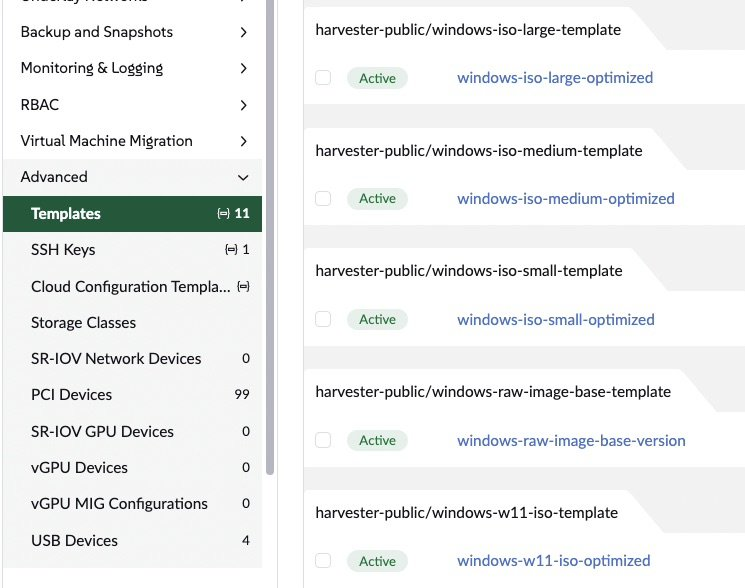

Windows assumes it might be running on Hyper-V. When a hypervisor advertises Hyper-V's
paravirtual interfaces, called **enlightenments**, Windows uses them for timers,
interrupts, spinlocks and inter-processor signals instead of poking at emulated
hardware. Every avoided emulation is a VM exit that never happens.

KVM implements most of those interfaces, and KubeVirt exposes them, but a VM only gets
them if its spec asks. Until SUSE Virtualization (Harvester) 1.9, the Windows templates
didn't. I changed that in
[harvester#11127](https://github.com/harvester/harvester/pull/11127), and added a
template for prepared Windows images in
[harvester#11669](https://github.com/harvester/harvester/pull/11669).

What enlightenments bought in my tests:

- **Periodic I/O stalls disappeared.** Sustained Windows writes stopped pausing for
  7–10 seconds every few batches.
- **A write-heavy phase ran 24% faster** with nothing changed but the enlightenments.
- **Older Windows kept its I/O performance.** Without enlightenments, Windows Server
  2012 R2 and 2016 lost 61–69% of their random 4K IOPS and pinned the guest CPU at 100%.
- **The optimized templates' virtio-blk disks doubled random-write and mixed IOPS**
  compared with virtio-scsi.

**Compared with VMware:** in CPU and memory benchmarks, Windows VMs on SUSE
Virtualization with these settings outperformed the same workloads on VMware vSphere.
I'll publish the full results and methodology in a follow-up post.

## What shipped in 1.9

The Windows templates now enable nine Hyper-V features and a Hyper-V reference clock.
Here's the block from the templates, which you can also paste into any existing Windows
VM's YAML:

```yaml
spec:
  template:
    spec:
      domain:
        features:
          hyperv:
            relaxed:     { enabled: true }   # no watchdog panics when a vCPU is descheduled
            vapic:       { enabled: true }   # paravirtual APIC: fewer exits on interrupts
            spinlocks:   { enabled: true, spinlocks: 8191 }
            vpindex:     { enabled: true }   # virtual processor index, needed by synic/ipi
            synic:       { enabled: true }   # synthetic interrupt controller
            synictimer:  { enabled: true, direct: { enabled: true } }
            ipi:         { enabled: true }   # paravirtual inter-processor interrupts
            runtime:     { enabled: true }
            reset:       { enabled: true }
        clock:
          utc: {}
          timer:
            hyperv: { present: true }        # Hyper-V reference TSC page
            hpet:   { present: false }
            pit:    { tickPolicy: delay }
            rtc:    { tickPolicy: catchup }
```

Three features are **deliberately off**: `frequencies`, `reenlightenment` and
`tlbflush`. They can complicate live migration between hosts with different CPUs, and
my tests showed the stall fix doesn't need them (more below).

## Which template to use



Pick one of the `-optimized` versions when creating a Windows VM:

| Template | vCPU | RAM | Use for |
|---|--:|--:|---|
| `windows-iso-small-optimized` | 2 | 4 GiB | installing from an ISO, light workloads |
| `windows-iso-medium-optimized` | 4 | 16 GiB | installing from an ISO, general servers |
| `windows-iso-large-optimized` | 8 | 32 GiB | installing from an ISO, heavy workloads |
| `windows-w11-iso-optimized` | 4 | 8 GiB | Windows 11 (UEFI, Secure Boot, vTPM) |
| `windows-image-optimized` | 4 | 16 GiB | prepared (sysprepped) images with Cloudbase-Init; in 1.9.1 and 1.10 |

All of them carry the enlightenments above, and their root disks use **virtio-blk**.
They also attach the virtio driver ISO during installation, because Windows needs the
virtio drivers to see that disk.

## Results

### Stalls gone

My clearest result came from a fleet test: 10 VMs (5 Windows Server 2022, 5 Ubuntu)
writing in parallel to LVM thin volumes on one Dell R640 with a hardware RAID-5. Each
Windows VM wrote 500 files of 20 MiB, then compressed and expanded them. Across five
rounds I changed one setting at a time: disk bus, thin-pool zeroing, then
enlightenments.

Rounds 1 to 4 all showed the same pattern: most batches of 50 files took about 2
seconds, but every second or third batch stalled for 7–10 seconds. Storage tuning made
the stalls shallower but never removed them. Enlightenments did. Seconds per 50-file
batch on one Windows VM (six of the ten batches shown; the standard deviation covers all
ten):

| Round | Files 1–50 | 101–150 | 201–250 | 301–350 | 351–400 | 451–500 | Std. dev. |
|---|--:|--:|--:|--:|--:|--:|--:|
| 4: storage tuned, no enlightenments | 2.2 | 2.1 | **9.5** | 2.4 | **7.6** | 2.6 | 2.51 s |
| 5: plus 13 enlightenments | 1.8 | 1.9 | 1.9 | 3.7 | 3.2 | 3.3 | 0.78 s |
| 6: shipped set of 9 enlightenments | 1.01 | 0.95 | 0.91 | 1.80 | 1.39 | 1.44 | 0.28 s |

So the stalls weren't the RAID controller flushing, as they first appeared. They came
from Windows servicing paravirtual interrupts and timers poorly, which made it dispatch
I/O in bursts. Round 6 also confirmed that the trimmed, migration-safe set of features
is enough. (Round 6 was a follow-up run of the write phase alone, so compare its
consistency rather than its absolute times.)

Enlightenments alone, from round 4 to round 5:

- **Write phase:** 35.9 s → 27.1 s per VM on average (**−24%**).
- **Whole Windows workload:** 435 s → 416 s (−4%). Compression is CPU-bound and barely
  moved.

With all tuning combined (disk bus, pool zeroing and enlightenments), the Windows
workload went from 493 s to 416 s (−16%) and its write phase from 48.6 s to 27.1 s
(−44%).

### Older Windows needs them most

I repeated an on/off comparison on Windows Server 2012 R2 and 2016 with `diskspd` and
7-Zip. Without enlightenments:

- Random 4K IOPS dropped by **61–69%**.
- Guest CPU sat at **100%** during I/O tests.
- 7-Zip, a pure CPU benchmark, didn't change.

That pattern is the signature of VM exits: pure computation runs natively either way,
but every interrupt, timer and inter-processor signal pays an emulation cost without
enlightenments. I/O generates a lot of those.

### virtio-blk beats virtio-scsi for Windows writes

With enlightenments on, I compared the two paravirtual disk buses on identical Windows
Server 2022 VMs (4 vCPU, 16 GiB) on LVM thin storage, using `diskspd` with a 50 GiB
preallocated file:

| Workload | virtio-scsi | virtio-blk | Change |
|---|--:|--:|--:|
| Sequential read, 1 MiB, QD32 | 4,663 MiB/s | 4,907 MiB/s | +5% |
| Sequential write, 1 MiB, QD32 | 1,370 MiB/s | 1,307 MiB/s | −5% |
| Random read, 4 KiB, QD32×4 | 151,078 IOPS | 144,714 IOPS | −4% |
| Random write, 4 KiB, QD32×4 | 6,375 IOPS | 13,264 IOPS | **+108%** |
| Random 70/30, 4 KiB, QD32×4 | 12,413 IOPS | 25,770 IOPS | **+108%** |

Reads tie, but virtio-blk doubles random-write and mixed IOPS and halves their average
latency (mixed: 10.3 ms → 5.0 ms, p99 48 ms → 17 ms). That's why the `-optimized`
templates default to virtio-blk. Choose virtio-scsi only when you need SCSI features,
such as many disks behind one controller or persistent reservations for clustering.

## Applying it to existing VMs

1. Stop the VM.
2. Edit its YAML and add the `features.hyperv` and `clock` blocks shown above.
3. Start it again. Windows detects the enlightenments at boot; no driver changes are
   needed.

Changing the disk bus of an existing Windows VM is riskier: Windows must already have
the virtio-blk driver installed, or it won't boot. Install the driver first (the SUSE
VMDP package includes it), then switch the bus.

## What's next

- **Enlightenment toggles in the UI.** Today the settings come from templates or YAML.
  SUSE Virtualization 1.10 adds generic access to KubeVirt features in the VM builder,
  which lays the groundwork.
- **The VMware comparison.** CPU and memory results, with the methodology, are coming in
  a follow-up post.
