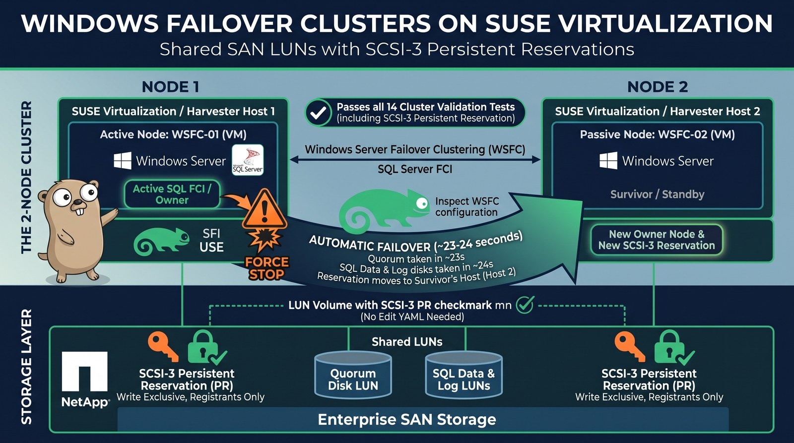
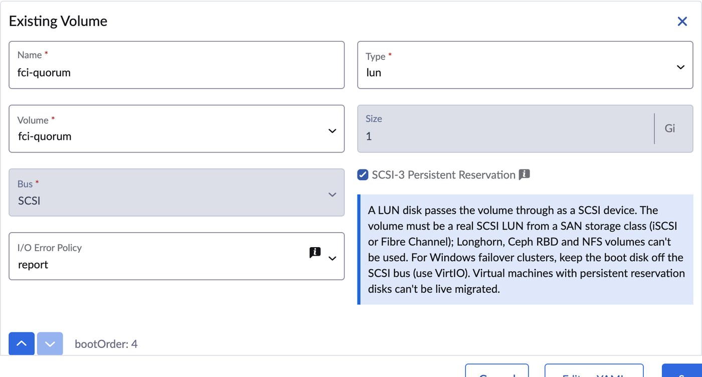
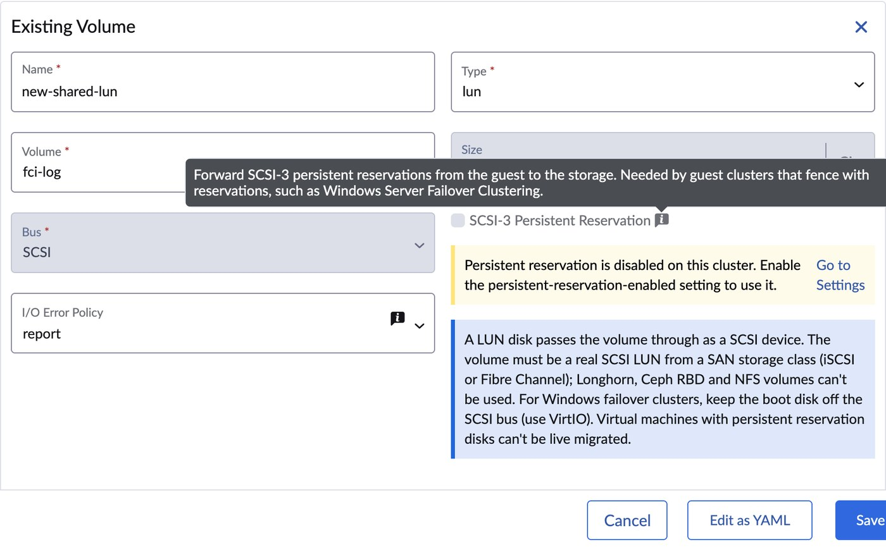
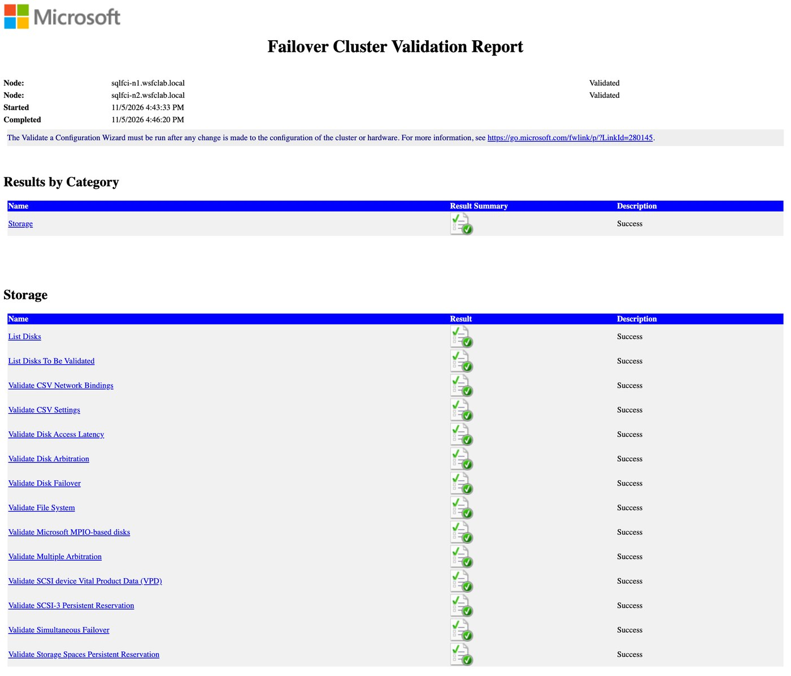

**TL;DR**

- Windows Server Failover Clustering (WSFC) and SQL Server Failover Cluster Instances (FCI) run on SUSE Virtualization (Harvester) with **shared SAN LUNs and SCSI-3 Persistent Reservations (PR)** passed through to the guests.
- With the pending UI change, you add the shared disk as a **LUN** volume and tick **SCSI-3 Persistent Reservation**. No more Edit YAML.
- A 2-node cluster passes **all 14 storage validation tests**, including *Validate SCSI-3 Persistent Reservation*. On the array, a real "write exclusive, registrants only" reservation is held by the owner's host.
- **Hard kill** of the owner VM (`kill -9` of its QEMU process): the survivor owns every cluster disk after **~27 s**, which is 20 s of Windows heartbeat timeout plus a 6 s arbitration wait, and the reservation moves to the survivor's host. A Harvester **Force Stop** fails over in ~10 s.
- Merged: the pr-helper image fix, the `/etc/multipath` permission fix and the KubeVirt 1.9 bump. **Still pending:** the setting that enables PR, the UI, the docs, and a VMDP release with the fixed Windows SCSI driver.

"Can I run a Windows failover cluster on it?" comes up in almost every conversation about moving off VMware. On SUSE Virtualization the answer used to be "only with hand-edited YAML, three node tweaks and a driver workaround". This post shows the answer once the work tracked in [harvester/harvester#11834](https://github.com/harvester/harvester/issues/11834) lands: SQL Server FCI on shared SAN LUNs, configured from the UI, with fencing that the storage array enforces.

## Setup

| Piece | Version / detail |
|---|---|
| Hypervisor | SUSE Virtualization (Harvester) v1.9.0, 3-node cluster, the two cluster VMs pinned to different hosts |
| KubeVirt | 1.8.4 with the `PersistentReservation` feature gate and the fixed `pr-helper` image (see [Status](#status-merged-and-pending)) |
| Storage | NetApp ONTAP iSCSI LUNs via Trident `ontap-san`, `ReadWriteMany` + `volumeMode: Block`, dm-multipath on the hosts |
| Guests | Windows Server 2022, SUSE VMDP drivers with the fixed `pvvxscsi` virtio-scsi driver (test build 1.0.1.18) |
| Database | SQL Server 2022 Developer Edition, FCI with data on `S:` and log on `L:` (both shared LUNs) |
| UI | [harvester-ui-extension#1182](https://github.com/harvester/harvester-ui-extension/pull/1182), in review, run from a development build against the cluster |

Three shared LUNs: a 1 GiB disk witness (Quorum), 4 GiB SQLData and 2 GiB SQLLog.

> [!NOTE] Two hosts, not one
> PR registrations belong to a host initiator (the iSCSI I_T nexus). Two cluster VMs on the same host share one initiator, so the array can't fence one from the other. Pin each cluster VM to a different host.

## How the request travels

A reservation from Windows has to reach the array unchanged:

```text
Windows (WSFC)
  -> virtio-scsi "lun" disk (reservation: true)      KubeVirt
  -> QEMU scsi-block -> qemu-pr-helper (in virt-handler)
  -> dm-multipath (libmpathpersist, reservation_key file)
  -> iSCSI -> ONTAP LUN, which enforces the reservation
```

Each hop needed a fix or a setting, which is why this took an epic rather than a single PR.

## Step 1: Add the shared LUN in the UI

Keep the boot disk on **VirtIO** (virtio-blk). Then, for each shared volume, use **Volumes → Add Existing Volume**, pick the shared RWX Block volume and set **Type** to **lun**. From there, the form:

- forces **Bus** to **SCSI** and marks the disk **shareable**;
- shows the **SCSI-3 Persistent Reservation** checkbox;
- defaults **I/O Error Policy** to **report**;
- offers `lun` only for volumes that can be shared: RWX Block from a non-Longhorn storage class.



That form writes the same spec I used to type by hand:

```yaml
domain:
  devices:
    disks:
      - name: rootdisk
        bootOrder: 1
        disk: {bus: virtio}
      - name: fci-quorum
        shareable: true
        errorPolicy: report
        lun: {bus: scsi, reservation: true}
      # fci-data and fci-log look the same
volumes:
  - name: fci-quorum
    persistentVolumeClaim: {claimName: fci-quorum}   # ontap-san, RWX, volumeMode: Block
```

On a release with the new `persistent-reservation-enabled` setting, the checkbox stays disabled until an administrator turns the setting on, and the form links straight to Settings:



> [!WARNING] Keep the default stop policy off shared LUNs
> On a shared LUN, a write that fails with RESERVATION CONFLICT is the expected result of fencing. With KubeVirt's default `errorPolicy: stop`, that error pauses the whole VM. `report` hands the error to Windows, which is what WSFC expects. The UI sets `report` for you.

## Step 2: Validate the cluster

With both nodes joined to the domain and the Failover Clustering feature installed, I created the cluster with the Quorum disk as witness and ran the storage validation against all three LUNs:

```powershell
$tests = (Test-Cluster -List | Where-Object Category -eq 'Storage').DisplayName
Test-Cluster -Cluster sqlclu -Disk (Get-ClusterResource SQLData, SQLLog, Quorum) `
  -Include $tests -ReportName C:\wsfc\validate-2node
```



All 14 pass. Here is the persistent reservation part of the report:

```text
Validate SCSI-3 Persistent Reservation
  Test Disk 0 supports Persistent Reservation.
  Test Disk 1 supports Persistent Reservation.
  Test Disk 2 supports Persistent Reservation.
```

Windows isn't the only witness. ONTAP shows the reservation on the quorum LUN, held by the initiator of the host that runs the owner node:

```console
admin::*> lun persistent-reservation show -vserver svm0 -path /vol/<quorum-volume>/lun0
Key                     Protocol Type                             Initiator Name
----------------------- -------- -------------------------------- --------------------------
92:5f:9a:d2:00:01:73:4d iscsi    write exclusive registrants only iqn.1996-04.de.suse:01:<host-b>
```

## Step 3: Install SQL Server FCI

SQL Server setup takes the clustered disks by name:

```text
/ACTION=InstallFailoverCluster /FEATURES=SQLENGINE /FAILOVERCLUSTERNETWORKNAME=SQLFCI
/FAILOVERCLUSTERDISKS="SQLData" "SQLLog" /FAILOVERCLUSTERIPADDRESSES="IPv4;<fci-ip>;Cluster Network 1;255.255.255.0"
/SQLUSERDBDIR=S:\MSSQL\Data /SQLUSERDBLOGDIR=L:\MSSQL\Log ...
```

`Final result: Passed`. A client on the domain controller connects through the FCI name and writes to a database whose files sit on the shared LUNs:

```console
server_name  : SQLFCI
active_node  : SQLFCI-N2
is_clustered : 1
edition      : Developer Edition (64-bit)

db       physical_name
--       -------------
wsfcdemo S:\MSSQL\Data\wsfcdemo.mdf
wsfcdemo L:\MSSQL\Log\wsfcdemo_log.ldf
```

> [!TIP] Open the SQL ports yourself
> SQL Server setup doesn't add Windows Firewall rules. Allow TCP 1433 (and UDP 1434 for the Browser) on every node, or clients only work against the node they're logged into.

## Step 4: Pull the plug

I made one node own every cluster disk, then killed its QEMU process with `SIGKILL` on the host: no shutdown, no warning, the closest thing to a host losing power. Timeline from the survivor's cluster log (UTC):

```text
18:43:25.6  kill -9 of the owner VM's QEMU process
18:43:33.2  NetFT: missed more than 40 percent of consecutive heartbeats
18:43:45.8  View change: downers=(node 2)                       (+20.2 s)
18:43:46.1  Quorum: HardDiskpPRArbitrate: Slow Path, Sleeping for 6 secs
18:43:52.1  Quorum: Successful reserve
18:43:52.2  Quorum Online                                       (+26.6 s)
18:43:53.0  SQLData and SQLLog Online                           (+27.4 s)
```

On the array, the reservation moved to the survivor's host:

```console
Key                     Protocol Type                             Initiator Name
----------------------- -------- -------------------------------- --------------------------
b9:75:3a:7f:00:02:73:4d iscsi    write exclusive registrants only iqn.2016-04.com.open-iscsi:<host-a>
```

That's fencing doing its job: the dead node's registration lost the reservation, and the array now blocks writes from anyone who isn't registered. Harvester restarted the killed VM and it rejoined the cluster.

### Where the seconds go

Of the ~27 s, almost all is Windows doing what it's designed to do:

| Phase | Time | What decides it |
|---|---|---|
| Declare the node down | 20.2 s | `SameSubnetThreshold` × `SameSubnetDelay`. [Microsoft documents 10 × 1 s](https://learn.microsoft.com/en-us/troubleshoot/windows-server/high-availability/iaas-sql-failover-cluster-network-thresholds); this Windows Server 2022 cluster reports a threshold of 20 out of the box |
| Wait before taking the disk from a dead owner | 6.0 s | WSFC's slow-path arbitration: the challenger waits for the old owner to defend its reservation before it preempts |
| Reserve, bring the quorum, data and log disks online | ~1.2 s | qemu-pr-helper, multipath and the array: milliseconds per PR command |

Then SQL Server starts and replays its log. Don't lower the heartbeat threshold to chase the number: Microsoft's [tuning guidance](https://techcommunity.microsoft.com/blog/failoverclustering/tuning-failover-cluster-network-thresholds/371834) is to relax it, so that a busy network doesn't trigger failovers.

A Harvester **Force Stop** is gentler than a kill: Windows gets a shutdown signal first and the cluster service reports a graceful shutdown, so the survivor skips both waits. In that test, the quorum disk was online on the survivor **9.6 s** after the click.

For SQL Server role failover between the two nodes, I measured **~21 s for a planned move and ~36 s after a Force Stop, with no lost committed rows**. That run used the earlier driver workaround (see below) and is recorded in the epic.

## Status: merged and pending

| Item | What it fixes | Status |
|---|---|---|
| [#11844](https://github.com/harvester/harvester/pull/11844) | Ships a `pr-helper` image that matches virt-handler and contains `/entrypoint.sh`; without it the gate crash-loops virt-handler ([#10701](https://github.com/harvester/harvester/issues/10701)) | ✅ Merged 2026-10-08 |
| [#11837](https://github.com/harvester/harvester/pull/11837) | Creates `/etc/multipath` with mode 0755 so the capability-dropped `qemu-pr-helper` can read `prkeys`; with 0644, RESERVE silently never reaches the array ([#11836](https://github.com/harvester/harvester/issues/11836)) | ✅ Merged 2026-10-13 |
| [#12039](https://github.com/harvester/harvester/pull/12039) | KubeVirt 1.9 (`pr-helper` images for amd64 and arm64) | ✅ Merged 2026-10-23 |
| [#12059](https://github.com/harvester/harvester/pull/12059) | `persistent-reservation-enabled` setting, default off, that survives upgrades ([#11840](https://github.com/harvester/harvester/issues/11840)) | 🔄 In review |
| [ui-extension#1182](https://github.com/harvester/harvester-ui-extension/pull/1182) | LUN disk type, PR checkbox, error policy ([#11841](https://github.com/harvester/harvester/issues/11841)) | 🔄 In review |
| [docs#1149](https://github.com/harvester/docs/pull/1149) | Guest clustering guide: multipath config, boot bus, Windows steps, maintenance mode ([#11843](https://github.com/harvester/harvester/issues/11843)) | 🔄 In review |
| VMDP `pvvxscsi` ([bsc#1284387](https://bugzilla.suse.com/show_bug.cgi?id=1284387), [#11838](https://github.com/harvester/harvester/issues/11838)) | Reports bus type SAS instead of parallel SCSI, and passes RESERVATION CONFLICT back to Windows | ⏳ Fixed in VMDP, waiting on a release; the latest public image (`vmdp:2.5.5.7.1`) still ships 1.0.1.14 |
| [#11835](https://github.com/harvester/harvester/issues/11835) | A `RerunOnFailure` VM can refuse to start after `virtctl stop --force` | 🔄 Open |
| Guardrails | Reject or warn about `lun` disks on volumes that can't present a SCSI device (Longhorn, Ceph RBD, NFS) | 💭 Under consideration |

Recording this post also caught three bugs in my own UI PR: saving a VM with `lun` volumes failed validation, the error-policy select was pushed out of view, and the info banner showed an HTML entity. Fixes are ready for the PR, and the screenshots above come from the fixed build.

### Until the VMDP release

Windows with the current public VMDP rejects the shared LUNs ("Disk bus type does not support clustering") and fails the PR validation, because its driver reports a successful RESERVE when the array said RESERVATION CONFLICT. Until the release, either:

- set the bus type by hand (`HKLM\SYSTEM\CurrentControlSet\Services\pvvxscsi\Parameters`, `BusType` = `0xA`, then reboot) **and** use the upstream virtio-win `vioscsi` driver for the shared LUNs, or
- use the VMDP test build from the bug if SUSE support provides it to you.

## Things that bite

- **Boot disk on the SCSI bus.** KubeVirt gives a VM one virtio-scsi controller. If the boot disk sits on it too, WSFC reports every shared LUN as "on the system bus" and never sends a PR command. Install with the boot disk on VirtIO, or move it: delete `HKLM\SYSTEM\CurrentControlSet\Services\pvvxblk\StartOverride`, then **immediately** shut down and switch the bus. Windows recreates the key on the next reboot, and a SCSI → VirtIO switch with it present ends in `INACCESSIBLE_BOOT_DEVICE`.
- **Host multipath.** dm-multipath needs `reservation_key file` for PR, and `skip_kpartx yes` so the host doesn't map the guest's NTFS partitions on shared LUNs. Scope both to the SAN vendor's devices; the docs PR has the full snippet.
- **Duplicate iSCSI initiator names.** Clusters installed before v1.5 can carry the same IQN on every node ([#11842](https://github.com/harvester/harvester/issues/11842)). Your array then sees one initiator, and fencing is meaningless. Check `/etc/iscsi/initiatorname.iscsi` on every node; both the issue and the docs PR have the fix.
- **No live migration.** KubeVirt marks VMs with PR disks as not live-migratable. Plan host maintenance as a guest-cluster failover plus a shutdown. Harvester's `harvesterhci.io/maintain-mode-strategy` label covers this.
- **Storage that can't do it.** Longhorn, Ceph RBD and NFS can't back these disks: a `lun` disk needs a real SCSI LUN on the host, and WSFC needs SCSI-3 PR from the array. Use a SAN CSI driver (iSCSI or Fibre Channel), such as [Trident `ontap-san`](/posts/netapp-trident-harvester-yamls/).

## Takeaways

- Harvester now forwards SCSI-3 reservations from Windows guests all the way to the SAN, and the array enforces them. That's the foundation WSFC and SQL Server FCI need.
- Once the setting, the UI and the VMDP release ship, this becomes a checkbox and a driver install instead of YAML and registry edits.
- A similar shared-LUN pattern without reservations runs [Oracle RAC](/posts/oracle-rac-19c-harvester/), so both big "shared disk" clustering stacks have a path on SUSE Virtualization.

## Thanks

Thanks to Ivan Sim and Tim Serong for reviewing and merging the multipath fix, to Vicente Cheng and Kiefer Chang for the pr-helper image fix, to Gaurav Mehta and Vicente Cheng for the review questions on the setting PR, and to the SUSE VMDP team for turning the driver fix around quickly.
